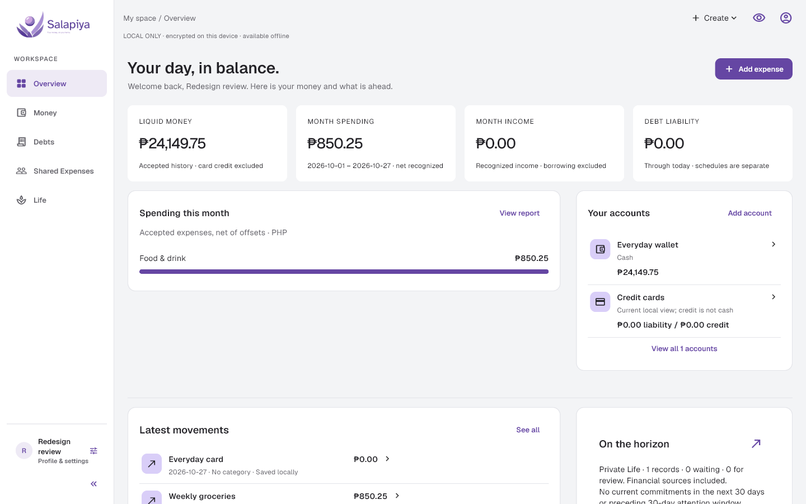
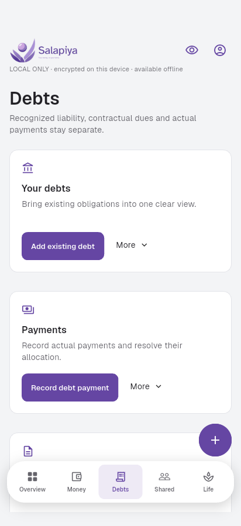
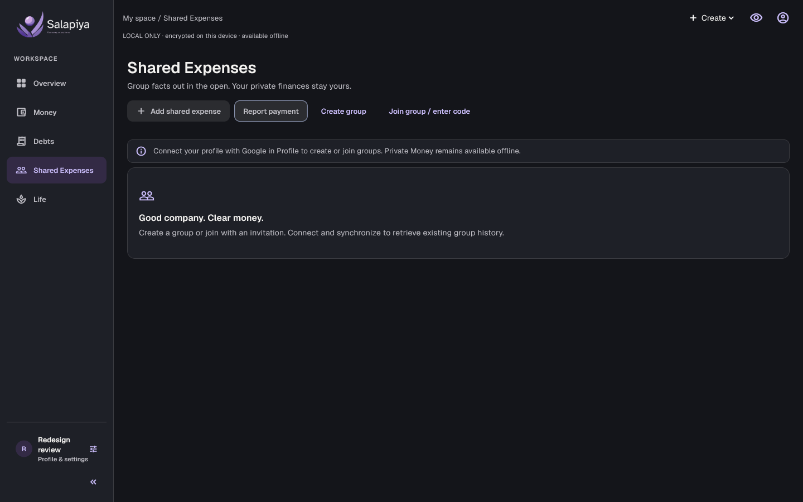
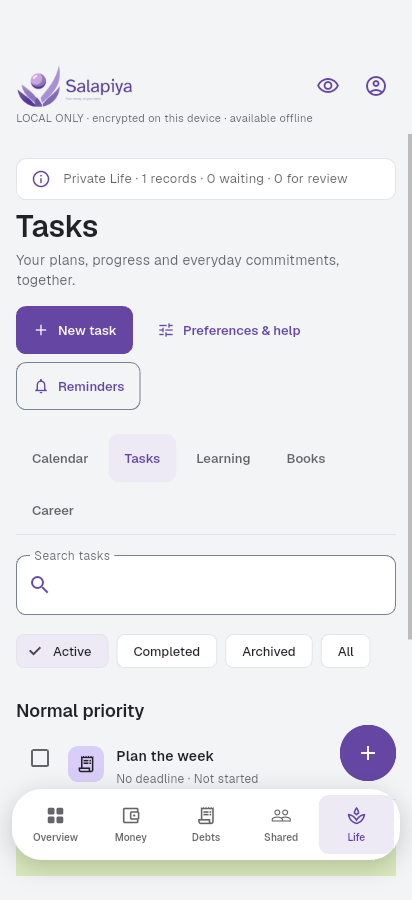

# Personal Management Platform

I designed, built and maintain this repository. It holds two applications:

- **Salapiya** (`apps/salapiya/`): a personal finance and life-management app for **Windows and Android**, built as one Flutter codebase. Version `0.6.1+8` is released to a small private group of users.
- **Personal workspace** (`src/`): the earlier Next.js/PostgreSQL web application. It is kept as an executable reference for financial rules, tests and migrations, and is not deployed to production ([ADR 0005](docs/adr/0005-v3-scope-and-platform-transition.md)).

## What Salapiya does and why

Salapiya records and explains a person's money (accounts, debts, credit cards, budgets and shared expenses) while keeping that data under the person's control. Most work happens offline. An optional Google connection syncs one person's devices and enables shared groups. The design goals come from the [product blueprint](docs/PRODUCT_AND_FEATURES.md#2-product-definition-and-intended-users): exact money, ordinary use without an internet connection, the same features on Windows and Android, and tooling that one developer can operate.

| Windows | Android |
| --- | --- |
|  |  |
|  |  |

Screenshots were captured during the final UI/UX redesign review (27 October 2026, commit `a624282`) using synthetic data.

## Major features

- **Money:** accounts, income and expenses, splits, transfers and fees, corrections and reversals, reports, CSV import/export.
- **Debts and cards:** debts and payments, credit cards with statements and installments, recurring obligations.
- **Planning:** budgets, savings goals and forecasts.
- **Shared Expenses:** groups with invitations and roles, exact payer/share allocation, settlements with recipient confirmation, and private reconciliation with immutable history.
- **Life:** events, agenda and reminders, tasks, learning, books, career applications and interviews.
- **Profiles and data:** encrypted offline profiles, optional Google-connected private and group sync, encrypted backup archives and restore.

Money is stored as exact integer minor units. Every correction keeps the previous record.

## Stack

| Area | Technology |
| --- | --- |
| Native app | Flutter 3.47.7 / Dart 3.13.5, Windows and Android |
| Local data | SQLite (`sqlite3` 3.8.0), encrypted local profiles |
| Identity and sync | Supabase Auth with Google, Supabase PostgreSQL, PowerSync (`powersync` 2.5.0); backend migrations and functions in `services/salapiya/p0/` |
| Distribution | Unsigned Inno Setup installer (Windows), signed APK (Android) |
| Web reference app | Next.js 16.3.8, React 19.2.8, TypeScript, Drizzle ORM, PostgreSQL 17, Better Auth, pg-boss, Tailwind CSS 4 |
| Testing | Flutter unit and integration tests on Windows and the Android emulator; Vitest, Playwright and Docker container checks for the web app |

## Status

| Status | Scope |
| --- | --- |
| Implemented and verified | Salapiya `0.6.1+8` (tag `salapiya-v0.6.1+8`): the feature set above, verified on Windows 11 and Android 17 emulators (231 Flutter tests passed in the release evidence). Web app V1–V3 and redesign M1–M6, with [CI at `239c360`](https://github.com/RAbnza/Personal-Management-Platform/actions/runs/38911065106) passing 1,104 unit, 681 integration and 62 browser tests. |
| Implemented with limitations | The Windows installer is unsigned. Attachments stay on the device, encrypted and unscanned. Physical phones and human screen-reader use are not certified. The hosted backend runs on a free tier that is monitored by hand. A sole account holder who permanently loses their Google identity has no takeover path. See [accepted limitations](docs/OPERATIONS_AND_RELEASE.md#accepted-limitations). |
| Implemented after the release | Debt payment scheduling and urgency (`48847cf`, on `main`, not in a tagged build). |
| Not implemented | Public app-store distribution, a custom updater, cloud attachment transfer and scanning, external calendar sync, and a custom tracker builder in Salapiya (the web app has one). |
| Superseded | Production deployment of the web app ([ADR 0005](docs/adr/0005-v3-scope-and-platform-transition.md)). The earlier phase records are kept as [history](docs/DEVELOPMENT_HISTORY.md). |
| Optional future work | Trusted Windows code signing, a separate free-tier pilot, a broader device matrix. |

Release binaries are built locally and are not published as GitHub release assets. Installation, hashes and recovery steps are in [Operations and release](docs/OPERATIONS_AND_RELEASE.md#salapiya--final-release-and-project-closure).

## How it was built

Development was AI-assisted. I set the scope, made the product and architecture decisions, and reviewed each milestone. Implementation milestones were carried out with AI coding agents working from the repository instructions (`AGENTS.md`, `CLAUDE.md`). Each milestone ended with a written handoff and its verification evidence; those records are preserved under [`docs/archive/`](docs/DEVELOPMENT_HISTORY.md#phase-records).

## Documentation

- [Product and features](docs/PRODUCT_AND_FEATURES.md)
- [Architecture](docs/ARCHITECTURE.md)
- [Database](docs/DATABASE.md)
- [Domain rules](docs/DOMAIN_RULES.md)
- [Design system](docs/DESIGN_SYSTEM.md)
- [Operations and release](docs/OPERATIONS_AND_RELEASE.md), including [native development setup](docs/OPERATIONS_AND_RELEASE.md#salapiya-native-development-foundation) and [testing](docs/OPERATIONS_AND_RELEASE.md#verification)
- [Development history](docs/DEVELOPMENT_HISTORY.md)
- [Architecture decision records](docs/adr/)

## Salapiya development

See [`apps/salapiya/README.md`](apps/salapiya/README.md) for build and run commands and the [native development setup](docs/OPERATIONS_AND_RELEASE.md#salapiya-native-development-foundation) for the tested toolchain.

## Web reference app: local setup

Install Node **24.21.0**, pnpm **12.9.1** and Docker Desktop. Run `pnpm install --frozen-lockfile`. Copy `.env.docker.example`, `.env.bootstrap.example`, `.env.migration.example`, `.env.test.example` and `.env.example` to their corresponding filenames without `.example`. Keep local passwords consistent between the examples. Never commit environment files or use these public development secrets in production.

1. `pnpm services:up`
2. `pnpm db:provision:roles`
3. `pnpm db:check:runtime`
4. `pnpm db:migrate`
5. `pnpm jobs:migrate`
6. `pnpm db:setup:test`
7. `pnpm db:migrate:test`
8. `pnpm jobs:migrate:test`
9. Configure security-email encryption and start the separate worker as described in [operations](docs/OPERATIONS_AND_RELEASE.md#v1-operations).
10. `pnpm dev`; open `http://localhost:3000`. Mailpit is at `http://localhost:8025`.

Migration credentials belong to deployment commands. The web runtime uses only `app_domain` and `auth_adapter`. The worker has separate queue/auth-maintenance/lifecycle connections. No runtime uses `SET ROLE`, table ownership or `BYPASSRLS`.

## Verification

Test strategy, full-suite commands and specialized verification are in [Operations and release](docs/OPERATIONS_AND_RELEASE.md#verification). The [V1 user guide](docs/PRODUCT_AND_FEATURES.md#v1-user-guide) and [Trackers workflows](docs/PRODUCT_AND_FEATURES.md#adaptable-trackers-workflows) describe the web app's flows. Web production checklists are conditional under ADR 0005 and are not active provisioning tasks.

## Licence

This repository has no licence file, so default copyright applies. The bundled fonts are under the SIL Open Font License (`apps/salapiya/assets/fonts/*/OFL.txt`). `src/components/patterns/magic-dock.LICENSE` covers that component.
