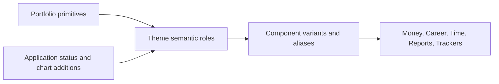
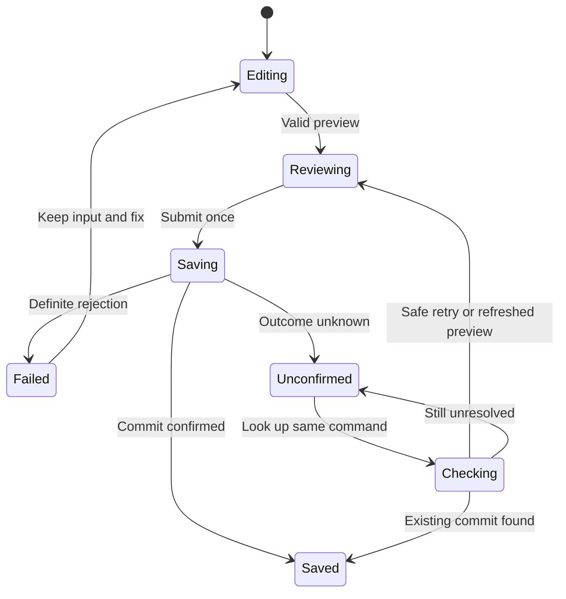

# Design system

## Contents

- Salapiya native application
  - [Salapiya - final UI/UX redesign handoff](#salapiya---final-uiux-redesign-handoff) (formerly `docs/salapiya/FINAL_UI_UX_REDESIGN_HANDOFF.md`)
  - [Salapiya branding and visual direction (product blueprint section 14)](#salapiya-branding-and-visual-direction-product-blueprint-section-14) (from `docs/SALAPIYA_PRODUCT_AND_PLATFORM_BLUEPRINT.md`)
  - [Existing branding asset register](#existing-branding-asset-register) (formerly `docs/salapiya/design/BRANDING_ASSETS.md`)
  - [Creative direction and cultural research](#creative-direction-and-cultural-research) (formerly `docs/salapiya/design/CREATIVE_DIRECTION.md`)
  - [Final native workspace design system](#final-native-workspace-design-system) (formerly `docs/salapiya/design/DESIGN_SYSTEM.md`)
  - [Final adaptive navigation and interaction](#final-adaptive-navigation-and-interaction) (formerly `docs/salapiya/design/PLATFORM_UX.md`)
  - [Screen, state and synthetic scenario inventory](#screen-state-and-synthetic-scenario-inventory) (formerly `docs/salapiya/design/SCREEN_STATE_INVENTORY.md`)
- Web application (reference implementation)
  - [Design System and Visual Guidelines](#design-system-and-visual-guidelines) (formerly `docs/reference/DESIGN_SYSTEM_AND_VISUAL_GUIDELINES.md`)
  - [M1 design foundations and component contracts](#m1-design-foundations-and-component-contracts) (formerly `docs/reference/REDESIGN_M1_COMPONENT_GUIDE.md`)
  - [Adaptive navigation and page context](#adaptive-navigation-and-page-context) (formerly `docs/reference/NAVIGATION_FOUNDATION.md`)
  - [M2/M3 design overhaul continuation](#m2m3-design-overhaul-continuation) (formerly `docs/reference/REDESIGN_M2_M3_DESIGN_OVERHAUL.md`)

## Salapiya - final UI/UX redesign handoff

Date: 27 October 2026 (Asia/Manila). Branch: `feat/salapiya-final-uiux-redesign`.
Status: implemented presentation baseline for visual review; P6 has not started. This is not a release, security, accessibility or synchronization certification.

### Authority and starting point

This handoff supersedes **D0-D5 presentation choices**. In particular, do not restore the Windows floating quick-action tray, dark-only sidebar, oversized hero headings, button walls or technical banners from those historical screenshots. Keep those records for provenance. The accompanying [design system](#final-native-workspace-design-system) and [platform UX](#final-adaptive-navigation-and-interaction) now lead with the implemented rules.

P0-P5 financial/domain, ownership, identity, privacy, immutable evidence, offline storage, synchronization, authorization and recovery contracts are not superseded. The [product blueprint](PRODUCT_AND_FEATURES.md#salapiya--product-revision-and-windowsandroid-migration-blueprint), [P1](archive/salapiya/P1_LOCAL_FOUNDATION_HANDOFF.md), [P2](archive/salapiya/P2_CONNECTED_IDENTITY_HANDOFF.md), [P3](archive/salapiya/P3_SHARED_EXPENSES_HANDOFF.md), [P4](archive/salapiya/P4_COMPLETE_FINANCIAL_SCOPE_HANDOFF.md) and [P5](archive/salapiya/P5_LIFE_AND_NATIVE_INTEGRATION_HANDOFF.md) remain the functional evidence trail.

The requested base `e7027ce984a1ad2a9cafa75a6d1bc0d2d35bfe7c` was verified as an ancestor of the starting P5 branch HEAD `5ed1785af22b250074da849f399498674ed2785a`. The descendant added the six supplied reference images. The redesign branch was created from that HEAD. Unrelated untracked `apps/salapiya/android/build/` was preserved and excluded from the commit. No web application, migration, provider configuration or production dataset was changed.

### Direction and references

The strongest reference is [dashboard_windows_1.png](../apps/salapiya/assets/references/final_redesign/dashboard_windows_1.png): a narrow light sidebar, quiet gray workspace, compact metric row and purposeful white sections. The implemented design adopts that composition while retaining Salapiya's identity, exact financial distinctions and actual available features. The alternate dashboard and four onboarding references informed the first-use frame and phone adaptation; they were not used as fake runtime data or raster UI backgrounds.

The seven supplied problem screenshots drove these concrete corrections:

| Problem | Implemented response |
| --- | --- |
| Cards presented eleven equally prominent pills | Three task groups: Cards & payments, Statements, Installments; primary actions plus labelled secondary menus; card metrics and bounded list |
| Planning presented all commands and empty sections together | Recurring/Budgets/Savings groups, a forecast entry, and separate Recurring/Budgets/Savings/History views |
| Reports were a technical prose wall | Spending/income/cash summary, period comparison, bounded filters, optional liability/clearing detail and linked evidence |
| Import had one long technical warning | Clear import action and history; concise supported scope with format/limits available on demand |
| Files displayed repeated engineering banners | A visible truthful local/unscanned/backup limitation, clear source and file controls, optional limits and backup detail |
| Career displayed fourteen stage chips | One labelled stage dropdown, shared section tabs, search and lifecycle filters; purposeful empty state |
| Android packed five destinations and plus into one row | Five labelled destinations; separate plus above the right edge; large-text/narrow fallback |

### Shared visual system

Geist remains the bundled typeface. Daylight uses `#F3F4F6` canvas, white surfaces, ink text, light dividers and restrained purple actions. Midnight uses `#14151A` canvas, `#1E2027` surfaces and accessible light/lavender roles. The logo remains the approved existing asset. No generated artwork, third-party icon pack, network font or package dependency was introduced.

The scale uses 4/8/12/16/24/32 spacing, 14-radius panels and 10-radius fields/buttons. Workspace panels have 20 padding. Desktop headline/body defaults are 28/14, with 18 section titles. Desktop buttons have 38 minimum height; Android uses 48. Text is allowed to scale and wrap. Neutral notices carry ordinary information; warnings retain visible meaning and do not rely on color alone. Existing reduced-motion and effects preferences are preserved.

`lib/design_system/workspace.dart` centralizes panels, wrapping tabs, responsive grids, task groups, empty states, expandable help, bounded forms, steps, pagination and exit protection. `welcome_frame.dart` owns first-use composition. `app/workspace_overview.dart` owns the production dashboard. These consume existing controllers and semantic colors rather than creating a second feature implementation.

### Onboarding and returning sessions

First use has three clear paths: Continue with Google, Create a local offline profile and Restore from backup. Wide Windows layouts show a brand/privacy column beside the content; Android stacks the same content and scrolls naturally. Local setup is a dedicated route with a name and theme selection, genuine busy/error feedback and dirty cancellation. Successful creation enters the actual encrypted profile. Returning profiles reopen through the existing runtime without introductory delays.

Google connection and recovery use the same bounded framing. Existing configured OAuth/deep-link, local-versus-connected identity, synchronization review and archive operations are retained. The validation opened the Google entry in the isolated unconfigured test environment and returned; it did not sign into a real Google account. Restore UI was inspected, not represented as a newly certified archive round-trip. Recovery still explains excluded file bytes and retains the existing review/restore logic.

### Navigation and information architecture

Windows has a theme-aware 204-wide sidebar (76 collapsed), five primary destinations, profile/settings access and a top Create menu. The expanded layout begins at 1000 logical pixels when available. Page actions remain close to their subject. There is no Windows bottom floating tray. Quick actions remain keyboard accessible and Escape dismisses their menu.

Android has five destinations in one rounded floating surface with short visible labels and full accessible names. The separate plus preserves the existing bounded action menu. At narrow width below 360 or large text scaling, Navigation opens the complete destination chooser. Keyboard appearance hides the dock. Measured dock padding keeps final scroll content reachable. The extra plus row intentionally requires more reserved bottom space than a fixed flat navigation bar.

Money has Accounts, Activity, Cards, Planning, Reports, Import and Files. Expense/income/transfer buttons are direct in Accounts and Activity; advanced tabs emphasize their own tasks, with global creation still available in the shell. Debts remains a separate primary destination. Shared Expenses keeps group/private authority separate. Life keeps Calendar, Tasks, Learning, Books and Career, subject to the existing user preferences.

### Screens and workflows actually changed

| Area | Implemented scope |
| --- | --- |
| Overview | Compact accepted-history metrics; exact net month spending/income and current debt; category bars; accounts/cards links; activity; Life agenda; shared/Life entry points. Pending/projected values and incomplete coverage remain explicit. |
| Accounts/activity | Neutral account surfaces, compact amounts, visible Add account, existing categories/splits and drafts, common heading/row/notice styling. |
| Cards | Task groups preserve every original command ID; liability, card-credit and available-credit meanings remain distinct; records paginate at 12; source history remains accessible. |
| Debts | Compact heading, debt/payment/provider-evidence task groups, empty state and 12-record pagination. Original schedules, payments, statement evidence and correction remain. |
| Planning | Separated task groups and four views; purposeful budget/savings empty states; original recurrence generation, actual links, reservations and read-only forecast remain. |
| Reports | Compact summary and comparison; account/category filters adapt to width; extra accounting detail is expandable; original aggregate queries and source-linked detail remain. |
| Import/files | Clear entry points, concise visible limitations, optional technical information, meaningful empty/history states and conditional pagination. Existing reviewed import, file-picker, integrity, retention and retry paths remain. |
| Shared Expenses | Compact header, group empty state, wrapping group tabs and bounded reviewed forms. Existing group permissions, invitations, bill links, settlement and private review remain. |
| Life | Shared tabs and compact contextual headings; career stage dropdown and empty state; common list/notice/form styling across calendar, tasks, learning, books and career. Existing event and progression models remain. |
| Profile/connection/recovery | Shared theme/control density, first-use frame, bounded connection panel and optional archive-detail disclosure. Existing utilities and recovery operations remain. |
| Detail/evidence | Structured recorded-field labels and separate ledger effects in native financial detail, preserving original evidence and correction access. |

The production local/connected sessions use the new dashboard. The intentionally synthetic historical gallery is not a second production baseline; some historical/demo-only page compositions remain for reference. Deep evidence, import mapping, sync-conflict and lifecycle dialogs retain specialized controls where their decisions require them. This pass does not claim every rare dialog was manually exercised or replaced with a bespoke layout.

### Forms, review and meaningful cancellation

The shared money editor, native P4 financial editor, durable Life form and reviewed Shared form use a centered form surface bounded to 760 logical pixels. Details / Review / Saved names the existing stages. Desktop no longer stretches a small form across an entire window. Mobile uses the same fields and validation with natural scrolling and keyboard insets.

Dirty forms offer Keep editing or Keep draft & close when durable drafts exist. The close waits for draft persistence and stays open with a recovery message if saving fails. A form without draft support asks before discarding. Explicit Life draft discard also confirms. Busy/uncertain financial results retain original-result recovery and are not treated as harmless unfinished input. No new submission, financial arithmetic or authorization service was introduced.

Review remains before the real save; successful, queued, rejected, uncertain and incomplete outcomes retain their controller meanings. Saved is never a timer-based animation. Field validation remains inline/on review through the existing command validators. Date, currency, timezone, evidence and permission details remain visible when they affect the user's decision.

### Data and state preservation

No persistence schema, journal arithmetic, monetary parser, migration, sync protocol or private/group authorization implementation was edited. Dashboard totals use `BigInt` and accepted postings with economic civil dates. Card credit stays outside cash; borrowing stays outside recognized income. The projected view is separately labelled and includes pending work once. Amount masking suppresses values and the spending breakdown. Incomplete accepted history does not show authoritative-looking metrics.

Action grouping only changes discovery; it retains the existing command identifiers and callbacks. Card/debt pagination changes visible rows, not aggregates. Existing history/due pagination is hidden when there is no next page. Planning history remains available on its own tab. Help sections use dedicated PageStorage keys so a parent scroll offset cannot be mistaken for expansion state.

Local and cached-connected loading/error/waiting/review disclosures remain. Cloud file upload/download is still unavailable, local file contents are unscanned and standard archives contain metadata rather than original bytes. These limitations stay prominent. No hosted reset, provider setting change, user-data deletion, credential commit or P6 work was performed.

### Validation and evidence

All native journeys use isolated synthetic profiles and dedicated secure-storage slots; cleanup targets only those generated test directories/slots. Captures are Flutter-rendered native app surfaces, not browser previews or mockups. Windows uses a 1440 x 900 logical test surface; Android uses 412 x 900 on `emulator-5554` (API 37). These fixed test surfaces do not certify every physical window/keyboard/inset configuration.

#### Checks

| Check | Result / scope |
| --- | --- |
| `flutter pub get --enforce-lockfile` | Passed; existing lockfile preserved, no dependency upgrade |
| `dart format --output=none --set-exit-if-changed lib test integration_test` | Passed; 204 files, zero formatting changes |
| `flutter analyze --no-pub` | Passed; no issues |
| Targeted widget suite | 18 passed across final-redesign, P1, P2, P3, P5 and existing financial-widget tests |
| Windows native redesign journey | Passed; real native journey and profile reopen |
| Android emulator native redesign journey | Passed; real native journey and profile reopen |
| Windows release application build | Passed; `flutter build windows --no-pub` |
| Android debug APK application build | Passed; `flutter build apk --debug --no-pub` |
| `git diff --check` | Passed |

The targeted command was `flutter test --no-pub test/final_redesign_widgets_test.dart test/p1_widgets_test.dart test/p2_widgets_test.dart test/p3_widgets_test.dart test/p5_widgets_test.dart test/financial_widgets_test.dart`. This covers real-record composition, pending accepted/projected distinctions and connection review, private/group boundaries and durable offline drafts, both platform layouts/themes, 200% text, keyboard interaction, form reflow, menu access, and failed-draft-save exit protection. It is not the entire repository suite.

`integration_test/final_redesign_test.dart` runs the shared production app on each native target, opens all three first-use paths, tests dirty local-setup cancellation, creates a real encrypted local profile, saves an account with PHP 25,000.00, posts a reviewed PHP 850.25 expense, creates a PHP 50,000 credit limit and saves a Life task. It asserts exact liquid minor units `2414975`, confirms presentation navigation adds no financial revisions, then closes and reopens the profile and checks the same balance and task. The credit limit is never counted as liquid money. No real bank/provider/Google account is contacted.

The native visual matrix contains 35 captures per platform: welcome, connection entry, restore entry, local setup, empty Overview, account form, task form, eleven main/module views plus Career in both themes, light Calendar/Learning/Books and 200% Career. Render exceptions are checked at capture. Fixed-size native captures are review evidence, not exhaustive device coverage.

During iteration, native switching exposed an ExpansionTile/scroll PageStorage key collision; dedicated help keys fixed it and a regression test now covers it. Draft-failure exit behavior is also explicitly tested. Earlier widget failures were old ChoiceChip/hero-label finders or platform-override test cleanup and were corrected without weakening financial assertions. An initial Windows runner build returned a generic MSB8066 error; subsequent native and normal builds passed. A native test cleanup error came from reusing a disposed runtime; the journey now creates a fresh runtime for reopen and passes. Android's toolchain emits the existing Java native-access warning; it did not prevent build or execution.

Build artifacts and raw runner logs remain ignored under `apps/salapiya/build/`; they are not release packages. Screenshots below contain only the isolated synthetic review data.


### Native visual review

All 70 unmodified native captures are retained in `design/review/final/`. Start with Overview, then compare the seven originally reported problem areas.

| Screen | Windows | Android |
| --- | --- | --- |
| Welcome | [View](salapiya/design/review/final/windows-welcome.png) | [View](salapiya/design/review/final/android-welcome.png) |
| Local setup | [View](salapiya/design/review/final/windows-profile-setup.png) | [View](salapiya/design/review/final/android-profile-setup.png) |
| Google entry | [View](salapiya/design/review/final/windows-connection.png) | [View](salapiya/design/review/final/android-connection.png) |
| Restore entry | [View](salapiya/design/review/final/windows-restore.png) | [View](salapiya/design/review/final/android-restore.png) |
| Empty Overview | [View](salapiya/design/review/final/windows-overview-empty.png) | [View](salapiya/design/review/final/android-overview-empty.png) |
| Account form | [View](salapiya/design/review/final/windows-account-form.png) | [View](salapiya/design/review/final/android-account-form.png) |
| Life task form | [View](salapiya/design/review/final/windows-task-form.png) | [View](salapiya/design/review/final/android-task-form.png) |
| Calendar | [View](salapiya/design/review/final/windows-light-calendar.png) | [View](salapiya/design/review/final/android-light-calendar.png) |
| Learning | [View](salapiya/design/review/final/windows-light-learning.png) | [View](salapiya/design/review/final/android-light-learning.png) |
| Books | [View](salapiya/design/review/final/windows-light-books.png) | [View](salapiya/design/review/final/android-light-books.png) |
| Career at 200% | [View](salapiya/design/review/final/windows-large-text-career.png) | [View](salapiya/design/review/final/android-large-text-career.png) |

| Screen | Windows light | Windows dark | Android light | Android dark |
| --- | --- | --- | --- | --- |
| Overview | [View](salapiya/design/review/final/windows-light-overview.png) | [View](salapiya/design/review/final/windows-dark-overview.png) | [View](salapiya/design/review/final/android-light-overview.png) | [View](salapiya/design/review/final/android-dark-overview.png) |
| Accounts | [View](salapiya/design/review/final/windows-light-accounts.png) | [View](salapiya/design/review/final/windows-dark-accounts.png) | [View](salapiya/design/review/final/android-light-accounts.png) | [View](salapiya/design/review/final/android-dark-accounts.png) |
| Activity | [View](salapiya/design/review/final/windows-light-activity.png) | [View](salapiya/design/review/final/windows-dark-activity.png) | [View](salapiya/design/review/final/android-light-activity.png) | [View](salapiya/design/review/final/android-dark-activity.png) |
| Cards | [View](salapiya/design/review/final/windows-light-cards.png) | [View](salapiya/design/review/final/windows-dark-cards.png) | [View](salapiya/design/review/final/android-light-cards.png) | [View](salapiya/design/review/final/android-dark-cards.png) |
| Planning | [View](salapiya/design/review/final/windows-light-planning.png) | [View](salapiya/design/review/final/windows-dark-planning.png) | [View](salapiya/design/review/final/android-light-planning.png) | [View](salapiya/design/review/final/android-dark-planning.png) |
| Reports | [View](salapiya/design/review/final/windows-light-reports.png) | [View](salapiya/design/review/final/windows-dark-reports.png) | [View](salapiya/design/review/final/android-light-reports.png) | [View](salapiya/design/review/final/android-dark-reports.png) |
| Import | [View](salapiya/design/review/final/windows-light-import.png) | [View](salapiya/design/review/final/windows-dark-import.png) | [View](salapiya/design/review/final/android-light-import.png) | [View](salapiya/design/review/final/android-dark-import.png) |
| Files | [View](salapiya/design/review/final/windows-light-files.png) | [View](salapiya/design/review/final/windows-dark-files.png) | [View](salapiya/design/review/final/android-light-files.png) | [View](salapiya/design/review/final/android-dark-files.png) |
| Debts | [View](salapiya/design/review/final/windows-light-debts.png) | [View](salapiya/design/review/final/windows-dark-debts.png) | [View](salapiya/design/review/final/android-light-debts.png) | [View](salapiya/design/review/final/android-dark-debts.png) |
| Shared Expenses | [View](salapiya/design/review/final/windows-light-shared.png) | [View](salapiya/design/review/final/windows-dark-shared.png) | [View](salapiya/design/review/final/android-light-shared.png) | [View](salapiya/design/review/final/android-dark-shared.png) |
| Tasks | [View](salapiya/design/review/final/windows-light-life.png) | [View](salapiya/design/review/final/windows-dark-life.png) | [View](salapiya/design/review/final/android-light-life.png) | [View](salapiya/design/review/final/android-dark-life.png) |
| Career | [View](salapiya/design/review/final/windows-light-career.png) | [View](salapiya/design/review/final/windows-dark-career.png) | [View](salapiya/design/review/final/android-light-career.png) | [View](salapiya/design/review/final/android-dark-career.png) |

### Remaining review and P6 boundaries

Review should focus on Windows dashboard resemblance and information density, Android floating-navigation height/placement, task-group discovery, long-form readability, both themes and whether the terminology is approachable without losing financial distinctions. Inspect populated as well as empty screens; the evidence fixtures deliberately contain only a small set of synthetic records.

No new hosted Google sign-in/refresh, cross-device PowerSync CDC, private/group authorization attack matrix, physical Android device, screen-reader audit, large-data stress/performance run, exhaustive archive/import/file recovery or full release regression was performed in this presentation pass. Existing P0-P5 evidence is retained, not recertified. Standard platform/toolchain warnings do not constitute release acceptance. Human visual approval remains outstanding.

P6 should use this handoff and the updated design-system/platform rules as its presentation baseline, keep all functional contracts above, and conduct comprehensive release testing under a separately authorized assignment. Do not automatically start P6 or merge this branch into main.

## Salapiya branding and visual direction (product blueprint section 14)

### 14. Branding, design system and assets

#### 14.1 Approved identity

Use **Salapiya** consistently for application titles, onboarding, installer labels, help and future release notes. Use **Your money, on your terms.** as the tagline where helpful, especially onboarding/about. Life remains part of the product despite the financial emphasis. The name was selected in the product workshop (D01); trademark/domain/store availability has not been researched or certified by this document.

Do not automatically rename the GitHub repository, old migration identifiers, historical documents, or API namespaces. Choose stable package/application IDs before first signed distribution; these are technical identifiers and should not depend on an unverified domain.

#### 14.2 Visual direction

Carry forward the approved Porcelain light and Midnight Spectrum dark direction, restrained violet/lavender identity, Geist typography where licensing/packaging and rendering are suitable, semantic chart/status colors and readable financial density. Map these into Flutter theme tokens rather than duplicating arbitrary colors per screen. Validate contrast and text scaling in native widgets. The web dock is inspiration, not a requirement to reproduce browser interaction on Android/Windows.

The visual personality is calm, capable and personal. No shame-based overdue copy, money confetti, animated balances or delays before a user can record an expense. Use platform-correct input, selection, focus and feedback within a coherent brand.

#### 14.3 Asset register

| Asset | Plan |
| --- | --- |
| Logo/wordmark | Not finalized and not generated. Later explore a simple mark suggesting agency/freedom without requiring a coin or bank symbol. |
| Windows icon / Android adaptive and themed icon | Create from the approved mark later; include correct masks/layers/scales and verify small-size readability on both themes. |
| Splash/launch | Minimal platform launch screen; no blocking animation or artificial delay. |
| Functional icons | Use a maintained, licensed icon set with consistent weights and accessible labels; evaluate Flutter availability before selecting a package. |
| Onboarding/empty states | Clear text and an action first; optional small original illustrations only where they aid comprehension. |
| Offline/sync/conflict feedback | Text plus icon and appropriate status color; finite progress where measurable, honest indeterminate state otherwise. |
| Charts | Mature accessible chart tools, exact values/table alternatives, meaningful legends and filters; no financial rounding hidden by graphics. |
| Motion | Short purposeful transitions, reduced-motion support, no animated backgrounds or startup intro. |
| Lottie/Rive | Optional later; add only for a specific benefit and measured performance. Neither is a required dependency. |
| Generated imagery | Optional illustration exploration after approval; never rely on generated text/logo details as final production assets without review. |

Bundle required fonts/icons/assets for offline startup. Maintain attribution/licenses and source files. Profile illustrations, large animations and blur-heavy effects are not launch requirements. Test on the user's lower-capability devices rather than equating a powerful development machine with acceptable performance.

## Existing branding asset register

**Status:** Existing brand assets are fixed, supplied inputs and must remain unchanged. Usage
sizes and spacing below are D0 proposals, subject to D1 native visual proof.
All paths below are relative to `apps/salapiya/assets/branding/`.

### Inspected files

| Asset / link                                                                                                                      | Intrinsic dimensions; viewBox       | Bytes  | Intended use                                                                              |
| --------------------------------------------------------------------------------------------------------------------------------- | ----------------------------------- | ------ | ----------------------------------------------------------------------------------------- |
| [source/salapiya_original.svg](../apps/salapiya/assets/branding/source/salapiya_original.svg)                               | 1888×1588; `0 0 1416 1190.999948`   | 167477 | Archival source; mixed original wordmark/tagline colors, not an automatic runtime variant |
| [mark/salapiya_mark.svg](../apps/salapiya/assets/branding/mark/salapiya_mark.svg)                                           | 1486×1491; `0 0 1114.5 1118.250011` | 136338 | Symbol on light or dark; compact shell, About or identity region                          |
| [horizontal/salapiya_horizontal_on_light.svg](../apps/salapiya/assets/branding/horizontal/salapiya_horizontal_on_light.svg) | 1441×463; `0 0 1080.75 347.249998`  | 166550 | Wide welcome/about on Porcelain or white                                                  |
| [horizontal/salapiya_horizontal_on_dark.svg](../apps/salapiya/assets/branding/horizontal/salapiya_horizontal_on_dark.svg)   | Same horizontal geometry            | 166550 | Wide welcome/about on Midnight Spectrum                                                   |
| [vertical/salapiya_vertical_on_light.svg](../apps/salapiya/assets/branding/vertical/salapiya_vertical_on_light.svg)         | Same geometry as source             | 167473 | Portrait welcome/about on Porcelain or white                                              |
| [vertical/salapiya_vertical_on_dark.svg](../apps/salapiya/assets/branding/vertical/salapiya_vertical_on_dark.svg)           | Same geometry as source             | 167473 | Portrait welcome/about on Midnight Spectrum                                               |

Resolve the links above from this document; their targets are the existing assets,
not copies. Product name: **Salapiya**. Tagline: **Your money, on your terms.**

The mark's violet/lavender wings and highlighted pearl remain consistent across
the files. The light wordmark paths use `#553995` with `#8361B2` supporting
lettering; dark variants use `#F8F8F8` and `#F4DDFF`. These observations do not
authorize extracting/replacing the symbol colors with UI tokens.

### Rendering findings and integrity

All six XML documents parse. Each contains two embedded PNG image elements
declaring 338×339 dimensions, two filters using color matrices, a mask and
clipping. Wordmark/tagline lettering is represented by paths. The symbol-only
file has only one path plus its embedded-image composition: it is **not an
all-vector drawing**, despite its SVG extension.

Browser inspection of the unmodified assets shows transparent surrounding
regions, correct supplied light/dark variants, and no added background. The
archival source has a pale wordmark that is barely visible on Porcelain; use
the supplied `on_light` variant there. Do not “repair” the original.

Rendered inspection used installed Edge through Playwright after the bundled
headless Chromium binary was unavailable. Local contact sheet:
`out/salapiya-d0/branding-inspection.png` (ignored review aid, not a new asset).
This proves browser appearance only. It does not establish Flutter SVG parser,
mask/filter fidelity, tiny-size legibility or launcher suitability.

The [flutter_svg package](https://pub.dev/packages/flutter_svg) is a candidate
renderer, not evidence that these particular files work. D1 must compare all
six on both themes in Windows and Android against the browser reference.
Check masks, embedded-image sampling, colors, alpha edges, clipping and scaling.
If fidelity fails, keep the originals; propose visually faithful, transparent
raster display derivatives with recorded source hash and export dimensions.
Review those derivatives before adoption. Do not flatten onto a background,
remove filters blindly, recolor or redraw as a workaround. Launcher icon exports
are a separate later assignment.

| File             | SHA-256 at D0 inspection                                           |
| ---------------- | ------------------------------------------------------------------ |
| Original         | `5f6f711dfc2b4019f2253cbb122b083f35227842f43249b861a99e3f970c06b1` |
| Mark             | `f223376778b191c77115193cbf8952686ba2955a872ff9f5682a804e887b2813` |
| Horizontal light | `d43fda57aee08873886d74443bfc1ec9582aada970d03c47f50b3b7374789fec` |
| Horizontal dark  | `2c70019fc683db470f97d4f9ad24aca8b5c7808bc356f263801852e7ebd56142` |
| Vertical light   | `68a22a5f30fab3c0d9f1defff70347dd73592f7a802d74ee0fffd2a738240502` |
| Vertical dark    | `cbf5c996fad731be5f4143d5273a81a7571e33751ab1355d0755ca819897b0aa` |

### Usage and spacing proposal

- Always contain the full asset at its original aspect ratio. No stretch,
  cropping, rotation, tint, color filter, opacity change, recoloring, added
  outline, monochrome variant or changed internal composition.
- Let **S** be the rendered symbol height. Add at least **S/4** clear space
  outside the full asset bounds on every side; native asset whitespace is
  preserved and not counted as permission to crop. For lockups, compute S from
  the symbol within the full image. D1 records the measured layout value.
- In compact rail/toolbar use the mark at **40–48 logical pixels** initially.
  Test 24, 32, 40, 48 and 96; 24/32 are comparison sizes, not approved minima.
  Interactive container is at least 48×48, independently of image size.
- The full horizontal lockup includes a small tagline. Begin proof at **560
  logical pixels wide**; the vertical lockup at **320 wide**. These conservative
  starting sizes are not a guarantee of tagline readability. At smaller widths
  use the unmodified mark with the product name/tagline as ordinary separately
  laid-out accessible UI text, not a new exported lockup.
- Expanded rail is too narrow for the full horizontal lockup. Use the mark in
  its identity region and a separate “Salapiya” application heading. Do not
  squeeze or crop the supplied wordmark. Onboarding at large text scale should
  similarly prioritize readable text and entry choices.
- Use the symbol alone on either approved opaque theme. Use matching full
  light/dark lockups only on compatible surfaces; do not place branding over
  a busy pattern, chart, photo or translucent changing background.
- Give a meaningful standalone image the semantic label “Salapiya.” If adjacent
  UI already names the app, exclude the duplicate image from semantics. Present
  the tagline in accessible text when it conveys welcome content.
- A brand image is not a loading spinner, sync-state indicator, home-button
  substitute without a label, or currency icon. No pulsing pearl or wing-flap
  animation is planned.

#### D1 rendering decision

D1 bundles the six unchanged SVGs for the comparison switch and six transparent
PNG display exports for normal use. `flutter_svg: 2.3.0` was exercised on actual
Windows and Android runtimes. Both emitted `unhandled element <filter/>`; the
vector result has visibly different edge treatment from the source export.
It is useful for comparison, but does not establish full fidelity for these
particular filter-bearing files. Normal branding therefore uses the authorized
browser-rendered PNG fallback, with no recoloring, stretching or simplification.

`scripts/salapiya/export-branding.cjs` renders the unmodified SVG with Microsoft
Edge and a transparent page. The display manifest records source/output SHA-256,
browser version and dimensions: original/vertical 944×794, mark 768×771,
horizontal 1441×463. Alpha is retained. Original SVG bytes are unchanged from D0.

The native `branding_test.dart` renders all six pairs into identical transparent
640×320 contain rectangles on **each platform**. See the
[review index](salapiya/design/review/d1/README.md), `*-logo-*-svg.png`, `*-logo-*-export.png` and
`*-runtime-branding.json`. Differences include antialiasing/resampling as well as
unsupported source effects, so the numeric difference is diagnostic, not an
acceptance score. Windows mean channel difference: 0.56–0.79/255; Android:
0.56–0.89/255. About 1.9–2.5% of rectangle pixels differ by >16 in some channel.

Gallery cards also show the wordmarks below the conservative 560/320 starting
widths **as stress specimens**, not as a new product-placement approval. Small
taglines there are not reliably readable. The gallery interface uses a 32/40px
mark beside ordinary accessible text. Mark scale specimens show 24/32/48/64px
with one-quarter-mark padding; source lockups preserve their own composition.
Final wordmark placement and larger onboarding use remain D2 review work.

The existing native launcher resources are Flutter development placeholders.
Do not report them as Salapiya Windows icons, Android adaptive icons, themed
monochrome icons or store exports. A monochrome
symbol is explicitly prohibited; later platform work must disclose any conflicting optional icon
treatment rather than create one silently.

## Creative direction and cultural research

**Status:** D1R-R01 selects **Luminous Lattice structure + Woven Calm softness**
after the hands-on D1 comparison. Nunito Sans remains primary (R04).
The historical D0 directions below explain the chronology; they are not two
production themes. See the [decision register](archive/salapiya/design/README.md) and
[D1R live review](archive/salapiya/design/D1R_IMPLEMENTATION.md). These are original modern interpretations,
not reproductions or claims of community endorsement.

### Current visual grammar

Lattice governs signature geometry, framing, compositional rhythm, navigation
and layered focal relationships. Woven Calm contributes soft corners, comfortable
spacing, friendly type and calm opaque working surfaces. Keep Porcelain/Midnight
Spectrum and the violet/lavender palette with bounded warm, plum and blue accents.

The existing three rounded outlines progress diagonally on a 16-unit step inside
a 96-unit square. This original geometry is now the default `CraftMotif`; explicit
interlacing remains only in the small historical comparison. `LatticeFrame` uses
soft 20-unit corners and 28-unit capsule corners, a continuous rounded boundary,
and optional focal gradients/shadows. Neither primitive is a new brand mark.

The October 22, 2026 review approved D1R but rejected the repeated stepped
top line. D2-F0 removes that shared painter, without a replacement corner ornament.
Use bounded motifs intentionally in identity/empty-state regions. Focal panels,
rail/capsule frames and raised action lists have no decorative top stroke.
Financial values, inputs, tables and reviews retain opaque working surfaces.
Effects off removes motifs, highlights, gradients and shadows; labels, selected
outlines, focus and financial meaning remain. No blur, shader or idle animation.

### Research and attribution

Sources below were consulted October 21, 2026. Cultural accounts establish
provenance; the UI translations are original proposals. Distinguish a material,
a weaving technique, a regional tradition and a particular maker's work.

| Reference                                                                                                                                        | Supported context                                                                                                                                                                        | Proposed translation and boundary                                                                                                                                                                      |
| ------------------------------------------------------------------------------------------------------------------------------------------------ | ---------------------------------------------------------------------------------------------------------------------------------------------------------------------------------------- | ------------------------------------------------------------------------------------------------------------------------------------------------------------------------------------------------------ |
| [National Museum: Mats and Baskets](https://www.nationalmuseum.gov.ph/our-collections/ethnology/mats-and-baskets/)                               | Mat/basket traditions use varied plant materials and specialized preparation and weaving knowledge.                                                                                      | Alternating over/under structure and orderly edge rhythm; do not label all woven geometry as one Philippine tradition.                                                                                 |
| [Municipality of Basey: Banig & Tikog Weavers](https://basey.gov.ph/tourism/)                                                                    | Basey, Samar identifies its banig craft with dyed tikog and its local weaving communities.                                                                                               | Banig-informed broad interlacing for Direction A. Attribute this reference specifically to Basey; no claim that all banig uses tikog or originates there.                                              |
| [National Museum: Abel-Iloko Exhibition](https://www.nationalmuseum.gov.ph/exhibitions/nm-ilocos-regional-museum-complex/abel-iloko-exhibition/) | Regional loom-woven textiles include varied techniques, heirloom uses and culturally meaningful patterns; some have ritual functions.                                                    | Inabel/abel-Iloko is a textile context, not a synonym for mat weaving or one geometric motif. Use measured spacing and composition as inspiration, not copied cloth.                                   |
| [Yuchengco Museum: Art of the Loom](https://yuchengcomuseum.org/art_exhibit/art-of-the-loom-weaving-the-story-that-is-the-binakul/)              | Describes binakul/binakol as a variation of abel, with interlocking optical geometry. Its account relates some imagery to sea waves and protective meaning among Cordillera communities. | Study nested proportions separately for Direction B. Do not generalize protective meaning to all Ilokano weaving or claim the UI “protects” money. No moving optical illusion or traced named pattern. |
| [National Museum: Aduana Building, Cebu](https://www.nationalmuseum.gov.ph/2023/02/16/built-tradition-of-the-aduana-building-in-cebu-city/)      | Documents capis shell window panels and soft light within a specific building's colonial/local architectural history.                                                                    | Translucent-looking panes, subtle edge highlights and framed regions. Capiz shell is not a pearl; the lighting metaphor does not make them the same material.                                          |
| [National Museum: Textiles and Weaving](https://www.nationalmuseum.gov.ph/our-collections/ethnology/textiles-and-weaving/)                       | Textiles can express social, ceremonial and spiritual meanings beyond ornament.                                                                                                          | Avoid lifting sacred, status-specific or identifiable motifs; research any proposed named motif before use.                                                                                            |

No museum photograph, textile scan, artisan design or exhibit artwork is copied
into the repository. Public visibility is not reproduction permission. If a
later direction needs an identifiable pattern, record the maker/community,
specific object, context, license/permission and attribution, and seek an informed
review before adopting it. Prefer commissioning and crediting a practitioner
when recognizable regional work becomes central. D0 makes no rights-clearance
claim for third-party artwork.

The eagle/pearl origin of the existing symbol is part of the supplied brand. Preserve that
symbol. Do not multiply birds, feathers, shells or pearls across ordinary
screens. The visual language should still be recognizable with decoration off:
rhythm, framing, hierarchy and interactions must carry it.

### Historical D0 direction A — Woven Calm (then selected)

**Character:** Soft, personal and composed; precise working areas held together
by broad interlaced accents. The application feels crafted through repeated
structural choices, not a patterned wallpaper.

- **Signature geometry:** Two broad perpendicular bands with a deliberate
  over/under interruption. A quiet pair of crossing seams appears at the edge of
  the rail, in a section divider and at one corner of a focal panel. Card bodies
  stay rectangular with soft corners; data columns remain straight.
- **Cultural basis:** Banig structure, with Basey tikog weaving as one documented
  reference. This is original abstract interlacing, not a replica of a Basey mat.
  Inabel is acknowledged separately in the research, not combined under “banig.”
- **Color:** Porcelain and white surfaces; violet actions; lavender selected
  regions; occasional muted reed-brown or plum decoration. Midnight Spectrum
  uses lavender actions, cool layered surfaces and a small warm highlight.
- **Light and surface:** One wide, quiet focal plane; a thin top-edge highlight
  and soft shadow create depth. Financial data sits on an opaque region even if
  the outer header has a pearl-like blend.
- **Typography:** Selected Nunito Sans 400/600/700, one family. Friendly form
  without bubbly display lettering. Tabular numeric proof is mandatory.
- **Windows character:** An anchored rail with a narrow interlaced seam; a
  compact elevated dock feels like a tray of tools. Hover changes fill, not size.
  Expanded labels and predictable columns make repeated work efficient.
- **Android fit:** Works with both A's stable bottom bar and B's floating capsule.
  An edge seam and selected marker carry identity without adding gestures.
- **Strength:** Fits everyday expense entry and dense debt/card evidence; the
  existing logo stays the strongest illustrated element. A single family and
  small shared geometry primitives limit implementation cost.
- **Risk:** Too little craft could become generic; too much seam repetition
  could become ornamental noise. Review the same signature in navigation,
  Overview, empty state and form framing, while keeping input/data areas plain.

**Concrete composition brief:** On a wide Overview, a horizontal “Money today”
region takes roughly two-thirds of the content width; a narrower “Needs your
attention” column shares its baseline. Below, an agenda joins obligations and
Life items with source labels. A single woven corner ends the focal region.
On Android, money, attention and agenda become a reading sequence. No masonry
grid, decorative giant balance or row of identical KPI cards.

### Direction B — Luminous Lattice (now primary with the refinements above)

**Character:** More architectural and expressive; framed luminous panels and
carefully stepped geometry give the product a composed, gallery-like presence.

- **Signature geometry:** An original four-pane frame and a sparse stepped
  corner progression. Pane edges establish section groupings and list/detail
  boundaries. No optical vortices or dense checkerboards.
- **Cultural basis:** Capiz-window framing and light; separate study of
  binakul's interlocking geometric composition. Do not call a generic square
  grid “authentic binakul.” No direct copying of kusikos or other named designs.
- **Color:** Same functional tokens as A; a little more blue/plum emphasis in
  decorative headers. Warm accents remain secondary. Financial statuses do not
  change to match decorative hues.
- **Light and surface:** A few nested opaque panes with a static light-to-violet
  edge. An optional translucent header fragment is separated from every text
  field, figure and essential boundary. Never a full-window blur.
- **Typography:** Nunito Sans 400/600/700 remains primary. The original D0
  Source Sans 3 suggestion was not adopted; it and Geist remain specimens only.
- **Windows character:** Rail selection resembles a framed pane; dock is a
  rounded rectangle, less pill-like than A. Clear vertical seams align workspace
  and contextual inspector.
- **Android fit:** Selected B floating navigation reinforces the suspended-pane
  structure. Its separate + opens a modal vertical list; shell proof remains D2.
- **Strength:** More obvious distinction in onboarding, overview and reports;
  geometric discipline suits structured financial work.
- **Risk:** Nested frames can look like an admin dashboard; repeated optical
  steps can be uncomfortable. Limit pane levels, remove decoration in dense
  contexts, and compare on a lower-capability Android device before approval.

**Concrete composition brief:** Overview uses one large framed money region with
a narrow obligation pane aligned beside it, then an open agenda below. A
four-pane abstract emblem appears only in the welcome margin or empty state.
Ordinary cards do not each receive a gradient, double border or shadow.

### Shared grammar and decoration budget

The following grammar is historical D0 guidance. D2-F0 supersedes repeated
upper-edge strokes; bounded motifs remain. Unimplemented names remain proposals.

| Primitive           | Geometry / placement contract                                                                                                                                                             |
| ------------------- | ----------------------------------------------------------------------------------------------------------------------------------------------------------------------------------------- |
| `WeaveSeam` (A)     | 32 logical-pixel repeat, 8-wide bands, at least 4 clear separation; alternate short gaps to suggest over/under. Use a strip no thicker than 16 at an outside edge, never through a label. |
| `WovenCorner` (A)   | At most 96×96; two to four broad crossings; one per focal region. Clip decoration to the margin, not the logo or content.                                                                 |
| `LatticeCorner` (B) | Three stepped rectangular outlines on an 8-unit grid, minimum 8-unit separation; static, at most 96×96. Avoid concentric high-contrast repetition.                                        |
| `CapizHighlight`    | Two-stop static gradient or solid highlight, no backdrop sampling by default; decorative upper edge only.                                                                                 |
| `CraftEmptyState`   | At most 160×120; two bands joining (A) or four simple panes (B), with actual heading, explanation and labeled action outside the drawing. Never a new logo.                               |
| Decoration density  | One focal motif plus one quiet structural seam per viewport. No pattern beneath money, tables, controls, error messages or focus rings.                                                   |
| Rendering           | Reuse cached vector paths/constant painters; no per-frame path creation, animated noise, shaders or repeating raster textures. Decoration excluded from semantics and pointer handling.   |

Illustration may be removed at narrow widths, high text scale or reduced visual
effects without losing meaning. Do not remove navigation labels or uncertainty
messages to preserve decoration. Neither direction alters the supplied symbol.

### Typography alternatives

These are design assessments; platform rendering has not been tested in D0.
Published font sources/licenses were checked, but binaries were not installed,
bundled or certified. No font is claimed to be intrinsically Filipino.

| Option                                                              | Personality and reading                                                                                   | Numbers and accessibility proof                                                                                                         | Windows / Android / cost                                                                                                                                           |
| ------------------------------------------------------------------- | --------------------------------------------------------------------------------------------------------- | --------------------------------------------------------------------------------------------------------------------------------------- | ------------------------------------------------------------------------------------------------------------------------------------------------------------------ |
| **Nunito Sans — selected for D1/D1R**                                 | Soft, open UI expression; use moderate weights and normal width, not ultra-rounded Nunito display styling | Verify peso sign, lining/tabular digits, decimal/minus distinction, `0/O`, `1/l/I`, diacritics and 200% scaling in exact selected files | Bundle one normal variable TTF or three measured static weights; compare glyph rasterization on Windows and emulator. Variable axes add QA, not automatic quality. |
| **Geist Sans — continuity control**                                 | Precise geometric voice consistent with the web; less warm by default                                     | Same glyph/tabular proof; no extra Mono family just for balances                                                                        | Reusing web direction reduces visual change, but web WOFF files are not a native bundle plan; obtain suitable font files and test both platforms.                  |
| **Source Sans 3 — historical comparison** | Humanist, restrained, suitable for longer labels and dense forms                                          | Same digit, peso and scale proof; judge small captions and table rows directly                                                          | Single-family TTF/variable distribution; compare actual asset bytes and first text rendering before choosing. No assumed speed advantage.                          |

Sources: [Nunito Sans project](https://github.com/googlefonts/NunitoSans) and
[Google Fonts metadata](https://github.com/google/fonts/blob/main/ofl/nunitosans/METADATA.pb);
[Geist project and OFL notice](https://github.com/vercel/geist-font);
[Source Sans project](https://github.com/adobe-fonts/source-sans) and
[OFL license](https://github.com/adobe-fonts/source-sans/blob/release/LICENSE.md).
All three are OFL font candidates. Retain the exact downloaded license and
copyright notices, including reserved-name conditions; record release/hash.
Use direct bundled assets, with no runtime font download or online-startup need.

D1 compares the same `₱1,234,567.89`, `−₱0.01`, `PHP 33.34`, long account name,
“Shared Expenses,” dates and invalid-field message on both platforms. Verify
the selected font's actual `tnum` support and equal digit advances; setting
[FontFeature.tabularFigures](https://api.flutter.dev/flutter/dart-ui/FontFeature/FontFeature.tabularFigures.html)
alone does not prove the font has the feature. Freeze normal width/optical axes
for UI initially. Use the selected single family everywhere before considering
a second family. Platform fallback is for missing glyphs, not a different visual
identity on each OS.

### Selection and review

Woven Calm was recommended and approved during D0/D1 planning. After reviewing
the actual Flutter alternatives, Luminous Lattice was selected for its
more appealing visual language. This subsequent choice supersedes the earlier
recommendation without erasing it. D1R refines the same semantic design system.

Review Foundations, Navigation studies and Brand & craft in the live application.
Confirm the balance of luminous structure and softness, restrained framing and
menu ergonomics in both themes. Android B is selected; D2 validates the complete
shell instead of reopening an A/B contest. Typography research is not restarted.

## Final native workspace design system

> **Presentation baseline superseded - 27 October 2026.** The [final UI/UX redesign handoff](#salapiya---final-uiux-redesign-handoff) is the current implementation baseline for review and subsequent P6 work. Its neutral workspace, compact Windows sidebar/toolbar, Android navigation and shared form system replace D0-D5 presentation choices. Historical approvals and screenshots below remain context, not instructions to restore the former design. P0-P5 financial, identity, privacy, persistence and synchronization contracts remain authoritative. This change does not start or certify P6.

### Post-P6 presentation additions (29 October 2026)

The [post-P6 handoff](archive/salapiya/POST_P6_PRESENTATION_POLISH_HANDOFF.md) adds shared
`ReviewRow`, `ReviewNotes`, `FormStatus`, `FormSyncStatus` and `FormEvidence`.
Use semantic success/error/warning roles with named status and icon; local save,
remote acceptance, downloaded reconciliation and business confirmation are separate.
The final form step is Result, including failed/uncertain outcomes. Technical IDs
and exact financial evidence are selectable disclosures; consequential amounts,
dates, source changes and coverage limitations stay visible. Financial review reads
typed validated plans and retains credit/debit meanings and correction evidence.

Android Overview measures full exact amounts, uses 26-to-18 logical-pixel amount
sizes with system scaling, and switches to one column when needed. Extreme values
use an explicit horizontal-scroll hint, never abbreviations or truncated centavos.
Windows metric typography remains unchanged. Native Windows caption colors follow
the resolved canvas/text/divider tokens; high contrast uses system colors.

### Current implemented rules

- Use the existing Geist family and semantic `CraftTheme`/`ThemeData`; no new font, asset generation or dependency was introduced.
- Daylight uses canvas `#F3F4F6`, white panels, ink text and subtle `#E3E4E9` dividers. Midnight uses canvas `#14151A`, panels `#1E2027`, light text and restrained lavender selection. Purple remains the brand/action accent, not the background of every notice.
- Spacing follows 4/8/12/16/24/32. Workspace panels use 20 padding, 14 radius and 16 bottom separation. Form and control corners are 10. Panels need a distinct purpose; do not wrap every line in another card.
- Desktop headings are generally 28, section titles 18, body 14. Desktop buttons use a 38 minimum height and standard visual density; Android controls use 48. Text scaling is preserved and can grow controls beyond these minima.
- `workspace.dart` supplies `WorkspacePanel`, `WorkspaceTabs`, `WorkspaceGrid`, `WorkspaceActionGroup`, `WorkspaceEmpty`, `WorkspaceHelp`, `WorkspaceForm`, `WorkspaceSteps`, `WorkspacePager`, `FormExitGuard` and `confirmDiscard`.
- `WorkspaceForm` bounds reviewed forms to 760 logical pixels. Details / Review / Saved describes existing real stages; it is not a second submission implementation. Reviewed values, immutable correction and original command/result handling remain in their existing controllers.
- Task groups expose a primary action and a labelled More menu for less common operations. Preserve every original command and permission condition. Do not replace unavailable provider or cloud operations with fake success.
- Ordinary information uses neutral bordered notices or expandable help. Blocking errors, incomplete coverage, waiting work and material file limitations stay visible. `WorkspaceHelp` has a unique PageStorage key to avoid colliding with scroll state.
- Desktop Overview uses accepted exact journal values, compact metrics, spending, accounts, activity and Life agenda. Pending/projected values remain separately labelled. A chart may use a bounded display ratio; stored money and totals remain integer minor units.
- Amount privacy, focus, text scale, reduced motion and effects preferences remain functional. Do not add shimmer, onboarding delays, decorative animations or motion-dependent meaning.

### Historical design record

The material below is retained for provenance. Conflicting presentation guidance is superseded by the rules above and the final handoff.

## Native design system — D2 corrected framing

**Current implementation (23 October 2026):** [Daylight editorial redesign](archive/salapiya/design/D2_REIMAGINED.md) supersedes the visual selections below. Geist, warm porcelain/graphite, ink balance surfaces, lilac navigation, mint wallets and open ledgers are implemented. Older Gallery motifs remain historical comparisons.

**Status:** D1R-R01/R03 refine the P03 baseline in `lib/design_system/`.
Luminous Lattice is primary; Woven Calm softness and Nunito Sans remain.
The [current implementation record](archive/salapiya/design/D2_IMPLEMENTATION.md) maps actual reusable components
and records measured proof and limitations. D1R was approved on October 22, 2026 except for the repeated top line,
removed in D2-F0. Read the
[creative alternatives](#creative-direction-and-cultural-research) and [decision register](archive/salapiya/design/README.md).
Use one shared semantic system across Windows and Android; adapt layout/input.

### Implemented D1R craft and navigation roles

The existing `CraftTheme` remains the single theme extension. Added semantic roles:
`latticeEdge` (divider blended 28% toward primary),
and `modalScrim` (black 44% / 64%). These are decorative/modal roles, never money
or status colors. `Space.floatingRadius` is 28 and `menuDuration` is 160ms.

`CraftMotif` defaults to the original bounded lattice. `LatticeFrame` owns one
soft frame without decorative top strokes, and optional raised shadow or focal
gradient. `CraftPanel(focal: true)` delegates to it; ordinary cards are unchanged.
Rail/capsule and the action list reuse it. Selected `DestinationControl` has an
explicit outline as well as fill and selected semantics, including effects-off.

`FloatingActionMenu` owns a single modal route and compact + control. Callers pass
`FloatingQuickAction` labels, icons and callbacks. See [platform UX](#final-adaptive-navigation-and-interaction)
for anchoring, bounded sheet fallback, focus, Back and input-inset contracts.
No dependency, palette overhaul, font change, finance logic or parallel theme.

### Token architecture

Three layers: named primitives → semantic roles → component aliases. Flutter's
ThemeData/ColorScheme should supply standard controls; a small ThemeExtension
can carry craft, financial coverage, density and motion roles. Components consume
roles, never choose random hex colors. Explicit mappings override generic seeded
defaults where required; a violet seed alone is not the Salapiya design system.

Proposed aliases include `amount.primary`, `field.border`, `field.error`,
`nav.selected`, `dock.surface`, `review.surface`, `coverage.warning`,
`craft.seam` and `craft.highlight`. Do not bind an account category, a success
state and a decorative motif to the same semantic token just because hues match.

#### Core opaque colors

Retain M1's approved canvases and core surfaces. “Proposed” applies to their native
mapping and new roles, not to a claimed reapproval of historical web screens.

| Token                            | Porcelain light       | Midnight Spectrum dark | Contract                                                      |
| -------------------------------- | --------------------- | ---------------------- | ------------------------------------------------------------- |
| `canvas`                         | `#F7F8FC`             | `#0D1020`              | Application background                                        |
| `surface`                        | `#FFFFFF`             | `#171B31`              | Forms, table/list data, money                                 |
| `surfaceRaised`                  | `#FFFFFF`             | `#20253F`              | Dock, menus, dialogs                                          |
| `surfaceSubtle`                  | `#EEF0F8`             | `#202440`              | Grouping, headers, read-only field background                 |
| `textPrimary`                    | `#22252B`             | `#F3F5FF`              | Main text and exact numbers                                   |
| `textSecondary`                  | `#5E6570`             | `#B7C2DE`              | Supporting labels, units, coverage                            |
| `primary` / `onPrimary`          | `#6B469C` / `#FFFFFF` | `#C8B6F2` / `#1B1B22`  | Principal action                                              |
| `primaryHover`                   | `#5D3D88`             | `#BCA5EE`              | Pointer hover, unchanged geometry                             |
| `primaryPressed`                 | `#503474`             | `#B09AE0`              | Press feedback                                                |
| `selection` / `onSelection`      | `#EEEAF5` / `#6B469C` | `#332A45` / `#C8B6F2`  | Selection plus marker/weight                                  |
| `controlBorder`                  | `#7A8197`             | `#929CBA`              | Essential field/control outline                               |
| `divider`                        | `#DCE0EC`             | `#363D5B`              | Nonessential separator; not a field boundary                  |
| `focus`                          | `#6B469C`             | `#C8B6F2`              | 2-unit ring, 3-unit offset, opaque gap                        |
| `disabledFill` / `disabledText`  | `#EEF0F8` / `#5E6570` | `#202440` / `#B7C2DE`  | Explicit readable disabled state; explain unavailable action  |
| `craftWarm` / `craftWarmSurface` | `#82603A` / `#F5EEE5` | `#D9BE97` / `#30291F`  | New bounded material accent; never pending/success            |
| `craftPlum` / `craftPlumSurface` | `#80456F` / `#F4E5EE` | `#F3B6EF` / `#38203F`  | Decorative composition                                        |
| `craftBlue` / `craftBlueSurface` | `#245E87` / `#E5F1FA` | `#8BDCFF` / `#132C45`  | Decorative composition                                        |
| `focalStart` → `focalEnd`        | `#EEE8FF` → `#E1EFFF` | `#302153` → `#142C49`  | Static outer focal region; values use an opaque inner surface |

Warm tint never replaces the Porcelain canvas. Pattern colors may be subtle
because they convey no information; text and functional boundaries never inherit
their opacity. Theme changes select existing logo variants, not recolored images.

#### Business feedback and charts

| Role          | Light foreground / surface        | Dark foreground / surface | Meaning                                                       |
| ------------- | --------------------------------- | ------------------------- | ------------------------------------------------------------- |
| `success`     | `#146C43` / `#EDF8F1`             | `#75D5A5` / `#142B22`     | A specific completed step with evidence; label what completed |
| `warning`     | `#8A4B0F` / `#FFF4DF`             | `#F3C16B` / `#312716`     | Needs review, uncertainty, incomplete coverage                |
| `error`       | `#B42318` / `#FFF0ED`             | `#FDA29B` / `#371D22`     | Validation failure or destructive consequence                 |
| `information` | `#235EA7` / `#EDF4FF`             | `#9AC5FF` / `#19283B`     | Explanation, planned information                              |
| `neutral`     | `textSecondary` / `surfaceSubtle` | Same semantic roles       | Draft, waiting, archived; wording distinguishes               |

A transfer is not “income” because money entered one account. Expenses are not
automatically red failures. Overdue copy is factual, never shame-based. A synced
settlement can still be awaiting recipient confirmation: transport and business
state require separate labels. Prototype success always says it was simulated.

Chart series use separate stable tokens: violet `#6B469C/#C8B6F2`, teal
`#266C80/#79C4D2`, plum `#9A4C72/#E6BCD4`, ochre `#80631B/#E4C572`,
blue `#395EB2/#A9BCFF`, neutral `#59616F/#B9B9C6` (light/dark).
Start with four or fewer simultaneous series; encode with labels, distinct point
shapes, dashed lines or small multiples. Provide an exact table and period/
coverage summary. Chart coordinates may use approximate display numbers only
after an exact read model supplies values; totals, tooltips and exports never
derive money from plotted doubles. No signed-value pie chart or rolling balances.

#### Calculated contrast evidence

Calculated in D0 with WCAG sRGB relative luminance:
linear channel = c/12.92 for c≤0.04045, otherwise ((c+0.055)/1.055)^2.4;
L=0.2126R+0.7152G+0.0722B; contrast=(lighter L+0.05)/(darker L+0.05).
Hex channels are normalized to 0–1. Ratios below are rounded for display only.

| Foreground/background pair                     | Light ratio | Dark ratio |
| ---------------------------------------------- | ----------- | ---------- |
| Main text / surface                            | 15.36:1     | 15.61:1    |
| Secondary / subtle (light), raised (dark)      | 5.17:1      | 8.43:1     |
| Primary label / primary                        | 7.04:1      | 9.32:1     |
| Control border / subtle (light), raised (dark) | 3.41:1      | 5.50:1     |
| Selection label / selection                    | 5.94:1      | 7.34:1     |
| Warm accent / warm surface                     | 4.95:1      | 8.04:1     |
| Success pair                                   | 5.93:1      | 8.45:1     |
| Warning pair                                   | 6.22:1      | 8.83:1     |
| Error pair                                     | 5.93:1      | 7.95:1     |
| Information pair                               | 5.88:1      | 8.38:1     |

Target ≥4.5:1 ordinary text, ≥3:1 essential nontext indicators. Aim for 4.5:1
even for normal display labels. [W3C text contrast guidance](https://www.w3.org/WAI/WCAG22/Understanding/contrast-minimum.html)
is the arithmetic reference; this is not native accessibility certification.
D1 checks every actual background, hover, pressed, selected, error, focus,
disabled and high-contrast rendering. Gradients/translucency are not certified
by endpoint arithmetic; no text relies on them in this baseline.

### Type, spacing and density

Nunito Sans is the P02-approved primary family; Geist and Source Sans 3 are
controlled comparisons only. Sizes below are logical pixels before OS
text scaling, with line heights as ratios, and are minimum role defaults rather
than fixed-height boxes.

| Role            | Size / weight / line height | Use                                                               |
| --------------- | --------------------------- | ----------------------------------------------------------------- |
| Display         | 32 / 600 / 1.20             | One focal figure or welcome title; no all-screen oversized labels |
| Screen heading  | 26 / 700 / 1.25             | Main title                                                        |
| Section heading | 20 / 600 / 1.30             | Meaningful regions                                                |
| Body / input    | 16 / 400 / 1.50             | Android and Windows comfortable mode                              |
| Label / action  | 14 / 600 / 1.40             | Persistent field labels and controls                              |
| Supporting      | 14 / 400 / 1.45             | Dates, scope, coverage; not essential 10px footnotes              |
| Dense data      | 14 / 400 or 600 / 1.40      | Optional Windows table mode, still scales                         |
| Navigation      | 14 / 600 / 1.30             | Allows wrapped “Shared Expenses”; no forced ellipsis              |

Use tabular lining numerals for amounts, quantities and aligned dates. Right-align
financial columns and keep sign/currency/value together. Show exact centavos:
`₱1,200.00`, with semantic reading “1,200 Philippine pesos.” Unknown is “Not yet
available,” not `₱0.00`; no `1.2K` replacement in critical balances or reviews.
Enlarge/wrap the value region before shrinking text; offer a labeled horizontal
table region only for genuine two-dimensional comparisons.

Spacing scale: **4, 8, 12, 16, 24, 32, 48**. Screen margins start at 16 compact,
24 medium, 32 wide. Form content width generally 480–640. Cards use 20 radius,
fields/buttons 12, menus 16, dialogs 24; the selected Android capsule uses 28; Windows dock geometry remains D2 proof. These few shared values prevent arbitrary per-screen rounding.

Touch targets are at least **48×48** on both platforms when touch is possible.
Mouse-oriented dense Windows rows may be 40 high only in an explicit comfortable/
compact preference with adequate focus/activation spacing; touch mode restores
48 minimum. Financial text never becomes smaller to fit the dock. Scaled labels
increase control height and may trigger a different layout.

### Surfaces and motion

| Treatment                     | Proposed budget                                                                                                                                                                                                    |
| ----------------------------- | ------------------------------------------------------------------------------------------------------------------------------------------------------------------------------------------------------------------ |
| Working plane                 | Opaque fill, optional 1-unit divider; no shadow on every row                                                                                                                                                       |
| Floating dock / raised region | One shadow: light black 8%, y=4, blur=16; dark black 20%, y=4, blur=16, plus visible outline                                                                                                                       |
| Modal                         | One stronger shadow: light black 14% / dark 28%, y=8, blur=24; opaque content and bounded scrim                                                                                                                    |
| Pearl highlight               | A bounded static gradient in an intentional branded focal region; no repeated top line; no glow around text or figures                                                                                                                      |
| Capiz-like effect             | Prefer opaque layered color. Optional genuinely translucent decoration may occupy ≤15% of a welcome/header region, never a control/data background; no blur by default. Remove if readability or frame cost fails. |
| Hover/press                   | 100–120ms color change, stable target; focus ring immediate                                                                                                                                                        |
| Menu/disclosure               | 120–160ms; at most 4-unit translation; no animated long-list relayout                                                                                                                                              |
| Side panel / navigation       | 180–220ms ease-out, contained; no bounce                                                                                                                                                                           |
| Optional welcome transition   | Up to 240ms for a user-initiated next step; entry choices usable immediately                                                                                                                                       |
| Reduced motion                | Zero translation, scale, chart interpolation or animated size; immediate state changes. Loading remains labeled; no shimmer required.                                                                              |

No decorative launch sequence, delayed input, continuously animated background,
animated monetary value or congratulatory financial confetti. Platform navigation
transitions must be checked with reduced-motion settings; custom transitions
must not suppress system Back behavior.

### Reusable component contracts and D1 gallery

The gallery is the first implementation, not an unrelated demo page. It contains
the following reusable components with stable state controls and synthetic data.
Names below are proposed contracts, not required class names.

| Family                  | Functional primitive to reuse                     | Salapiya composition / contract                                                                                | Gallery states                                                                |
| ----------------------- | ------------------------------------------------- | -------------------------------------------------------------------------------------------------------------- | ----------------------------------------------------------------------------- |
| Buttons / icon actions  | Flutter semantic buttons, tooltips, Focus/Actions | Primary, secondary, text, destructive; stable busy width; explicit icon label; no double activation            | Rest, hover, pressed, focus, disabled with reason, busy                       |
| Fields / amount entry   | TextFormField, Form, selection/IME behavior       | Persistent label, PHP context, exact text-to-minor-unit adapter, hint/error association; never silent rounding | Empty, valid, malformed, excess precision, zero, maximum, read-only, disabled |
| Choice/date controls    | SDK radio, checkbox, menu and date picker         | Own account/card/scope labels; date is a civil date, not silently shifted by timezone                          | Keyboard selection, long label, missing source, unavailable archived source   |
| Financial summary       | Text, layout primitives                           | Exact value + definition, period/as-of, coverage and source action; null != zero                               | Complete, partial snapshot, pending overlay, hidden value                     |
| Cards/section framing   | Container/Card composition                        | One emphasis level, named regions, optional external seam; avoid card-within-card nesting                      | Plain, focal, selected, small width, 200%                                     |
| Primary rail/mobile nav | SDK navigation semantics and focus                | Five stable destinations; identity, marker and labels; no custom gesture recognizer replacing buttons          | Expanded/collapsed, active, focused, selected B, historical A, long text                           |
| Quick-action dock       | Standard buttons plus menu/sheet primitives       | Context actions, distinct from destinations; measured content clearance; no icon magnification                 | Windows tool tray; Android +, modal list/sheet, safe dismissal                 |
| Sheets/dialogs/review   | SDK modal routes, focus scopes, safe areas        | Named heading, safe initial focus, input retention, Escape/Back policy and trigger restoration                 | Short, long/IME, invalid, unknown result, dirty close                         |
| Financial table/list    | SDK bounded DataTable/list first                  | Domain-supplied exact strings; row identity and explicit Details action; no whole-row-only interaction         | Empty, sorted, filtered, selected, long amount, bounded large fixture         |
| Disclosure/detail       | Expansion/control semantics                       | Expanded state announced; source details and history retained, keyboard accessible                             | Collapsed, expanded, changing content, retained input                         |
| Chart/report            | Mature chart candidate plus exact table           | Period/coverage, non-color series, keyboard/touch selection; derived data only                                 | Zero, negative, missing, pending, dense labels                                |
| Status/coverage         | Icon + text + optional action                     | Domain adapter supplies business state; sync state separately; no badge-only color meaning                     | Draft, local, waiting, accepted, review, unknown, confirmed receipt           |
| Empty/error             | Standard text/action controls                     | Distinguish first use, no matches, offline unavailable, unauthorized, incomplete download                      | Each with appropriate recovery; motif optional and decorative                 |
| Loading/sync            | SDK progress indicators                           | Immediate honest label; measured progress only if denominator known; no false 100%                             | Initial snapshot, files missing, retry, paused/expired session                |
| Confirmation            | Review rows + explicit actions                    | Amount/date/source/private/group effects, warning and evidence; safe Cancel focus                              | Edit/review, consequential ack, invalid, stale, simulated outcome             |
| Theme/effects           | SDK theme and media preferences                   | System/Light/Dark, reduced effects, reduced motion; in-memory gallery controls                                 | Both themes, system change, effects off                                       |
| Craft primitives        | Small owned painter/layout helper                 | Grammar in CREATIVE_DIRECTION; never paints text or hit targets                                                | A/B, off, narrow, high contrast                                               |

A library provides dependable input/focus/layout behavior. Salapiya owns the
composition, spacing, theme, cultural geometry, financial labels and status
mapping. Avoid adding a UI suite just to obtain a rounded button or allowing a
theme package to dictate the overall application layout.

### Accessibility acceptance contract

Follow [Flutter accessibility guidance](https://docs.flutter.dev/ui/accessibility)
and verify the final composition; a semantic primitive is not sufficient alone.

- One current screen heading; logical reading and Tab order; inactive layouts
  excluded from focus and semantics. Do not render duplicate mobile/desktop forms.
- All navigation, row actions, chart details and dock commands work with keyboard,
  touch and screen reader. Tooltips supplement visible labels; no hover-only data.
- Modal focus stays contained and returns to the trigger; nonmodal inspector
  does not trap focus. Announce meaningful result/error changes once.
- Error summary links/focus to fields. Read-only data remains selectable where
  appropriate. Clipboard/edit shortcuts retain platform behavior.
- Test 100%, 150%, 200% text and the OS maximum on supported devices. Do not cap
  text scale or use forced single-line labels to pass screenshots.
- Test Windows high-contrast preferences; if theme adaptation needs an adapter,
  record and prove it. High-contrast mode removes decoration and uses explicit
  boundaries without changing the protected logo.
- Test Narrator on Windows and TalkBack on Android with actual task completion,
  not just semantics snapshots. Follow all reduced-motion preferences.
- Insets, dock, panel and IME must never cover the current focus or final action.
  Width and usable height both affect layout. Preserve features at narrow sizes.

G6 remains open after D1/D5 UI checks; representative physical-device and release
acceptance require their own evidence.

### D2 assembly contract

The shell reuses `DestinationControl`, `LatticeFrame`, `FloatingActionMenu`,
`CraftPanel`, `SectionTitle`, `StatusNotice`, `AmountText` and verified branding.
The Overview uses one focal Money Today surface and opaque financial figures;
attention/agenda/shared/Life form related reading regions rather than a KPI grid.
Signature motifs occur intentionally in identity/focal previews. No new painter,
palette, font, automatic top stroke, blur or idle decoration was introduced.
Product privacy masks all exact amount strings including source previews;
the separate gallery is explicitly outside that demo preference.

## Final adaptive navigation and interaction

> **Presentation baseline superseded - 27 October 2026.** The [final UI/UX redesign handoff](#salapiya---final-uiux-redesign-handoff) is the current implementation baseline for review and subsequent P6 work. Its neutral workspace, compact Windows sidebar/toolbar, Android navigation and shared form system replace D0-D5 presentation choices. Historical approvals and screenshots below remain context, not instructions to restore the former design. P0-P5 financial, identity, privacy, persistence and synchronization contracts remain authoritative. This change does not start or certify P6.

### Post-P6 review and native caption (29 October 2026)

See the [post-P6 handoff](archive/salapiya/POST_P6_PRESENTATION_POLISH_HANDOFF.md). Reviewed
forms retain their controllers, draft/exit guards and original-result recovery.
Shared forms still close their route where appropriate. Result panels announce
truthful local, pending, failed and uncertain states; technical evidence expands
without replacing required review or recovery. Review rows stack at constrained
width/large text, and completed forms give Done clear priority.

Android Overview chooses card columns from measured exact amounts and actual text
scale, retaining matched row heights. It never shrinks below 18 logical pixels;
full-width extreme values can scroll horizontally with a visible hint.

Windows retains its native caption, icon, system menu, controls, window styles,
resize/hit testing and DPI handling. A small DWM adapter applies app-theme colors
without a second Flutter title bar or window-management dependency. Standard OS
geometry/font and fallback remain intentional. Snap/keyboard/multiple-monitor and
human accessibility acceptance remain separately required; compilation and native
state probes do not close P6's blocked release gates.

### Current implemented behavior

Windows uses a theme-aware 204-wide sidebar at sufficient width (1000 logical pixels), a 76-wide collapsed rail, page-level actions and a top Create menu. There is no Windows floating bottom quick-action tray, including constrained Windows windows. The sidebar keeps all five destinations and profile/settings access.

Android keeps five destinations in a rounded floating surface, with icons, short visible labels and full accessible destination labels. The separate plus control sits above the right edge so it does not crowd a sixth target into the bar. Below 360 logical pixels or at large text scale, a labelled Navigation control opens the complete destination chooser. The existing modal quick-action menu retains safe bounds, Back/Escape dismissal and focus behavior. The shell measures the dock and reserves content space; the dock is hidden for the keyboard.

Content adapts by available width and text scale, not merely OS. Workspace grids use equal-width columns with a maximum of four and collapse as space or scale demands. Finance columns stack below their usable threshold. Tabs wrap rather than shrinking text. Long forms scroll and preserve keyboard insets. A floating surface may overlap the visual viewport but must not make final content unreachable.

First-use routes share `WelcomeFrame`: a brand/privacy column and a bounded content column on wide windows, one scrollable column on phones. The welcome offers Google, local offline profile and restore. Local name/theme setup is a separate meaningful step with dirty cancellation. Existing returning profiles reopen directly. OAuth, deep links, recovery and synchronization remain existing runtime behavior, not mocked transitions.

All reviewed forms use the same panel, progression and action hierarchy. Back/close on a dirty durable form offers Keep editing or Keep draft & close, waits for draft persistence and remains open on failure. Forms without durable drafts ask before discarding. A busy or uncertain result remains protected by its existing recovery contract. Explicit discard requires confirmation.

### Historical design record

The earlier proposal below is retained as history. Its Windows dock, dark-only sidebar, oversized geometry and integrated sixth Android action are superseded.

## Adaptive navigation and interaction proposal

**Current implementation:** [D2 reimagined](archive/salapiya/design/D2_REIMAGINED.md) replaces the earlier framing below. Windows uses an ink sidebar and a compact floating quick-action tray. Android uses a floating dock with integrated quick actions and a wallet-first Overview with expandable spending detail. All five destinations remain reachable.

**Status:** D1R-R02 selects Android B floating navigation and R03 selects its
modal + action menu. Windows retains collapsible rail/sidebar plus separate
contextual dock. D2 implements these in the running native shell; final geometry
and composition await live review. See [D2 evidence](archive/salapiya/design/D2_IMPLEMENTATION.md).
Layout uses available logical width, usable height, text scale and input mode.
A small platform adapter selects Windows rail/dock or Android capsule, while
constraints govern each platform's accessible fallback. See
[Flutter adaptive guidance](https://docs.flutter.dev/ui/adaptive-responsive/best-practices);
Salapiya's required financial parity takes precedence over generic advice that
allows removing features on smaller devices.

### Information architecture

| Primary destination | Local organization                                                                             | Contextual creation                                         |
| ------------------- | ---------------------------------------------------------------------------------------------- | ----------------------------------------------------------- |
| Overview            | Money today; needs attention; upcoming obligations; Life agenda                                | Add expense; other quick actions                            |
| Money               | Activity, Accounts, Cards; Planning → Recurring, Budgets, Goals, Forecast; Reports and Imports | Expense, income, transfer; contextual card/planning actions |
| Debts               | Debts list/detail; schedule; payments; evidence and history                                    | Record payment, add existing debt, record borrowing         |
| Shared Expenses     | Groups → group summary, bills, people, settlements, activity/private review                    | Add shared expense; report payment                          |
| Life                | Agenda/Calendar, Tasks, Learning, Books, Career                                                | Task, event or context-specific entry                       |

Profile, sync/backup, Settings and Help are utilities. Activity is a dedicated
Money location; Overview can link to it without becoming a transaction feed.
Reports remain inside Money; source links may cross destinations. Debts is one
domain with a prominent entry, not a second implementation of debt balances.
Cards stay under Money, while Overview/Debts may link to related commitments.
Use full “Shared Expenses” labels, allowing two lines.

#### Windows shell

Proposed starting dimensions:

| Available width                       | Primary frame                                                                 | Workspace                                                                                   |
| ------------------------------------- | ----------------------------------------------------------------------------- | ------------------------------------------------------------------------------------------- |
| ≥1200                                 | 240-wide expanded sidebar by default; user may collapse to 80                 | List/detail only if list ≥520 and detail ≥360 after margins/gaps; otherwise one active view |
| 840–1199                              | 80-wide collapsed rail; expand as overlay without squeezing forms             | One useful main view; contextual panel only if sufficient remaining width                   |
| 600–839                               | Collapsed rail; labels through accessible names/tooltips and expansion        | Single view; complex entry becomes a full workspace route                                   |
| <600 or severe text/height constraint | Labeled Navigation button opens a modal list containing all five destinations | Same capabilities; full task routes, no clipped rail or minimum-window-size workaround      |

These are proof breakpoints, not screen-size restrictions. High text scaling can
switch composition earlier. Preserve selection, scroll, focused record and draft
while resizing; close obsolete overlay geometry without losing content.

Keep native window controls/title-bar behavior. Expanded sidebar contains the
brand identity, five labeled destinations, and separated utilities at the foot.
Collapsed state retains current selection and a labeled expand control. Shared frames have no decorative top stroke or automatic corner ornament. Rail resizing never animates
amount text or displaces a focused input during typing.

Proposed shortcuts, shown in tooltips and Help:
`Ctrl+1`…`Ctrl+5` select destinations; `Ctrl+K` opens the command/search surface;
`Ctrl+N` opens the context creation menu; `Alt+Left` goes back; `Esc` dismisses the
top transient layer. These are review candidates: check OS/assistive-tool
conflicts and do not intercept text-editing shortcuts. No unmodified global
single-letter shortcuts. No shortcut bypasses a consequential review step.

#### Windows floating quick-action dock

The dock is a **tool tray**, never a second primary destination menu.

| Context                   | Leading action                                | Other offered actions                         |
| ------------------------- | --------------------------------------------- | --------------------------------------------- |
| Overview / Money Activity | Add expense                                   | Record income, transfer, more creations       |
| Debt list/detail          | Record payment (choose debt if none selected) | Add existing debt, record borrowing           |
| Group detail              | Add shared expense                            | Report payment; show active group explicitly  |
| Life                      | Add task or context entry                     | Add event, application or book where relevant |

At most three directly labeled actions plus “More actions.” Keep global Add
expense reachable from the command menu in every ordinary workspace. A context
change never silently changes the scope of an already-open draft. If an action
needs an account/group, ask within the form; do not assume a funding source.

Center the dock inside the **main workspace**, excluding the sidebar and an open
nonmodal inspector. Use 48-high targets, 8 padding, 8 gaps, at least 16 from the
usable bottom edge. Reserve bottom content space equal to measured dock height

- bottom inset + 16 clearance; scroll-to-focus uses the same reservation.
  No fixed padding assumption when text wraps. Menus open upward if room permits,
  otherwise as a bounded accessible popover.

When fewer than 640 logical pixels remain for the workspace or usable height is
under 600, try a single labeled “Add” launcher with the same actions. At very
short height, put actions in a normal-flow toolbar. Show the same commands; do
not let a floating control cover the last table row or form footer.

During a focused financial task, the task's own Review/Edit/Simulate action area
replaces the creation dock. A modal suppresses background actions. A nonmodal
entry panel receives one scoped creation flow; opening another action prompts
about the existing draft rather than creating stacked financial forms.

#### Android B — selected floating navigation

D0 required comparing A (anchored) and B (floating). B was selected after
hands-on D1 review (D1R-R02). A remains a collapsed historical gallery specimen,
not a competing production path. D2 must validate B in the actual shell.

Five labeled destinations remain Overview, Money, Debts, Shared Expenses and
Life. A separate compact 56×56 + sits above the capsule's trailing edge, with a
12-unit gap; its accessible name is “Quick actions” and collapsed state is exposed.
It is not a sixth destination. The capsule and Windows rail share softly rounded
lattice framing and an outlined selected pane. Windows still uses its own dock.

`FloatingActionMenu` accepts labeled icons and callbacks from the caller. D1R
supplies six synthetic actions: expense, income, transfer, debt payment, shared
expense and task. Selection closes the modal before invoking one callback and
shows “specimen only — no record created.” No real feature route or mutation.

Opening pushes one SDK modal route with a dimmed whole-viewport scrim, opaque
raised vertical list above the trigger, and an expanded close control in the
trigger's place. Only list and close are interactive; obscured controls are
excluded from traversal and accessibility. Initial keyboard focus is Close;
Tab cycles through the six actions and Close. Full labels wrap at system scale;
targets are at least 48×48. Press feedback and visible focus use semantic colors.

Dismiss through outside tap, close trigger, Android Back, Escape or selection.
The route traps focus, protects against duplicate selection, and keeps the opener
locked until reverse motion and barrier removal finish. Then focus returns to
the trigger if it is still mounted. Outside taps are consumed without activating
a destination. There is no dirty state in this presentation-only choice menu.

Motion is a 160ms scrim/content fade with an ease-out upward displacement of at
most four logical pixels; closing reverses it. System or gallery reduced motion
uses zero-duration transitions and no translation. There is no idle controller,
blur, stagger requirement or decorative background animation.

#### Constrained layout and shell integration contract

The component measures action labels at actual text scale and bounds the menu to
the usable viewport. With enough room above the measured trigger it anchors there.
If space is insufficient, the anchor is out of bounds after resize, or a docked
keyboard reports an inset, it uses a bottom-aligned bounded action sheet with a
scrollable list and a separate always-reachable close control. Safe padding and
keyboard bottom insets are reserved. The same route, action semantics and callbacks
apply; there is no second business implementation. An arbitrary floating keyboard
that reports no inset remains an OS limitation requiring D2 manual verification.

The gallery retains D1's fully labeled vertical navigation fallback at narrow
specimen widths or enlarged text. This keeps every destination accessible in its
scrolling study; it does not approve a tall vertical capsule for the final shell.
D2 must validate an economical visible-label arrangement (such as stable 3+2 rows)
and landscape adaptation against real content, safe insets and system navigation.
Do not squeeze labels or hide Life/Shared Expenses merely to preserve geometry.

The shell must reserve measured capsule/trigger height and clearance, keep the
trigger reachable without gallery scrolling, and hide global creation/navigation
during focused financial tasks. Task forms own keyboard-safe Review/Back controls.
Do not overlay quick creation on an active draft. Validate gesture/three-button
navigation, rotation, IME and large text during D2, preserving all capabilities.

#### Back, focus and state

Maintain each destination's in-session subroute, filters and scroll position.
Switching destinations is not a growing Back stack of tab taps. From a nested
detail, Back returns to its list/previous source with restored focus. From a tab
root, Back follows system app-exit/background behavior; do not trap users in an
Overview-first loop.

Dismiss in order: keyboard where system behavior calls for it, active menu/shelf,
modal sheet/dialog, then route. Dirty routes show “Keep editing” and “Discard
demo draft” before losing meaningful input. `Esc` on Windows follows the same
top-layer principle. Cancelling review returns to the intact draft. Explicit
Back labels supplement gestures.

Use current [PopScope](https://api.flutter.dev/flutter/widgets/PopScope-class.html)
and router-supported Back handling, with ahead-of-time pop eligibility;
validate predictive Back on the installed SDK/emulator. D0 does not prescribe
an obsolete interception API or claim predictive animations passed.

### Overview composition

The dashboard answers “What needs my attention, and what money information can I
trust?” Layout is a hierarchy of related regions:

1. **Header:** greeting/display name if available, current date, concise profile/
   sync status and privacy control. No full personal identity exposed on group
   screens. Quick entry is available without scrolling through an introduction.
2. **Money today:** liquid account total with definition, as-of and account
   drilldown. Cards/credit limits are a separate liability context. Pending
   effects appear as a separately labeled projection, not a silently inflated
   accepted balance.
3. **Needs attention:** unresolved sync/private-effect reviews, due obligations
   and shared receipt confirmations, sorted by actionable urgency and date.
   Business confirmation is not conflated with sync failure.
4. **Upcoming:** chronological debt, card and bill commitments plus personal
   tasks/events. Each item identifies its source and opens that source.
5. **Life glance:** next task/event and bounded progress, with access to full
   Life detail. Do not make Life invisible simply because finance dominates.

At wide sizes, money and attention share the top baseline, with upcoming and
Life regions below. Android presents the same priority order vertically with
disclosure and “View all.” Avoid a row of unrelated metric tiles. Reordering or
hiding optional sections is a future preference; it must not suppress unresolved
financial warnings or erase data/reminders. No recent-transactions destination.

Initial incomplete download shows “Money summary not ready — history is still
downloading,” with source-specific progress and unrelated Life access if ready.
A complete local-only profile shows locally derived amounts without suggesting
it is broken because it is offline. Connected cached views show last successful
sync and pending/review counts. Empty, unavailable and zero remain distinct.

### First run and profile journeys

All prototype screens carry “Demo — synthetic data, resets when closed.”
Use the protected mark and accessible name/tagline. Entry choices appear
immediately; an optional three-step interactive tour can be skipped or replayed
from Help. No decorative launch delay.

| Entry / state                     | Proposed steps and meaning                                                                                                                                                                                             |
| --------------------------------- | ---------------------------------------------------------------------------------------------------------------------------------------------------------------------------------------------------------------------- |
| Create a local offline profile    | Name and optional theme → enter demo Overview → optional account setup. No Google, email, connectivity check or financial setup gate.                                                                                  |
| Continue with Google              | Explanation that identity enables Salapiya sync → **simulated account choice**, never actual credentials → existing-profile download or new connected-profile setup. Do not create an empty local profile first.       |
| Restore from backup               | Select a synthetic manifest → inspect profile/date/schema/counts/attachment coverage → simulated validation/recovery-secret step → review → simulate restore. Do not open personal files or ask for a real passphrase. |
| Connect an existing local profile | Explain private-data upload and service access → simulated identity → enrollment progress/checkpoint → completion only when publication is represented complete                                                        |
| Local/cloud collision             | Show separate populated local and existing cloud profiles → preserve/export-local option → explicitly reviewed switch; Cancel retains local state. No Merge button.                                                    |
| Returning profile                 | Open local demo data directly; expired sign-in pauses simulated sync, never hides private records                                                                                                                      |
| Settings / Sync                   | Local-only, connected, paused, waiting, initial download, needs review and reconnect; pending count and last successful sync                                                                                           |
| Backup / devices / lifecycle      | Distinct backup, sync pause, sign-out/device removal, local deletion and cloud deletion flows; disclose unsynced work and recovery limitations                                                                         |

Recovery preview identifies omitted attachment bytes and wrong-key/corrupt/newer
schema cases. Cloud sync is not backup. Old snapshots cannot reauthorize group
membership. These meanings are required even in simulation; actual OAuth,
file access, encryption and recovery belong to engineering milestones.

### Adaptive financial tasks

| Task complexity                                | Windows                                                                           | Android                                                                   |
| ---------------------------------------------- | --------------------------------------------------------------------------------- | ------------------------------------------------------------------------- |
| Brief contextual choice/filter                 | Popover or small dialog                                                           | Bottom sheet, dismissible                                                 |
| Ordinary expense/income                        | 480–560 side panel if context remains useful; otherwise full task route           | Full-screen form with essential fields first and advanced disclosure      |
| Debt/card allocation, shared multi-payer entry | Full workspace or guided wide panel; source evidence alongside                    | Full-screen guided stages; source evidence on demand                      |
| Consequential correction/recovery/closure      | Review region with exact effects, safe initial action; dialog only if truly short | Full-screen review; bottom sheet must not compress important consequences |

Entry → validation → review → simulated submission → explicit simulated outcome.
Keep title, amount/currency, date, source/account, scope and relevant effects in
review. Advanced fields reveal allocations, notes, files and provider evidence
without hiding their existence. Do not infer principal/interest, reconcile
statements automatically, or treat a group owner's role as private-ledger access.

An invalid field retains input, receives an associated message and is reachable
from the error summary. An unknown outcome keeps the submitted summary and a
check/retry path tied to the same simulated command. A stale version presents
before/current/proposed values for review without silently merging money.
Prototype “Simulate save” results say “Demo entry recorded in this session.”
“Saved on this device,” “Synced” and “Confirmed by recipient” may appear only
inside visibly labeled scenario previews; they are not claims of real effects.

### Implemented D2 adaptation (October 23, 2026)

- Windows starts with a 240-unit sidebar at >=1200 width; a user collapse uses
  the 80-unit rail. At 600-1199, Expand opens a labeled modal destination list.
  Below 600, below 400 height, or above 150% text, the header Navigation utility
  supplies the same five choices. Selection and per-tab scroll remain in memory.
- Android uses the selected B capsule: five labeled cells where they fit, 3+2
  at narrower widths. At >=150% text or below 500 height, an economical labeled
  Navigation control opens all five full labels in a scrollable modal. This
  fallback is proposed for review, not a reopened A/B decision.
- The + remains separate from primary destinations. The existing D1R modal
  owns scrim, focus, duplicate prevention and sheet fallback. Windows displays
  three contextual commands plus + at roomy widths, or Create/+ when constrained.
- Navigation/dock use normal-flow measured footer space and safe insets, leaving
  12-24 units of content clearance. They look like floating surfaces but cannot
  overlap the final scroll item. This is more robust than guessed fixed padding.
- Task routes cover the shell. Their scrollable content resizes above a reported
  keyboard inset. No global creation control can overlap a focused draft.
- Primary tabs never push routes. SDK detail routes carry source breadcrumbs and
  return to the invoking screen and scroll. A group preview can push its settlement
  example; a Life agenda can push Career/Tasks. Global Escape/Alt+Left acts on the
  top route. Dirty demo notes require Keep editing/Discard; receipt and financial
  records are never mutated. Other proposed shortcuts remain unimplemented.
- The profile utility owns scenario, theme, text-size, privacy, effects and motion
  controls; First-run preview and Design Gallery are utilities, never destinations.

## Screen, state and synthetic scenario inventory

> **Presentation baseline superseded - 27 October 2026.** The [final UI/UX redesign handoff](#salapiya---final-uiux-redesign-handoff) is the current implementation baseline for review and subsequent P6 work. Its neutral workspace, compact Windows sidebar/toolbar, Android navigation and shared form system replace D0-D5 presentation choices. Historical approvals and screenshots below remain context, not instructions to restore the former design. P0-P5 financial, identity, privacy, persistence and synchronization contracts remain authoritative. This change does not start or certify P6.

**Status — October 24, 2026:** D0–D4 completed and approved; D5 finalized
under the lightweight inspection/handoff scope. Current Windows/Android
UI/UX is the accepted production visual baseline; all data/operations remain
synthetic/in-memory. The [D5 handoff](archive/salapiya/design/D5_PRODUCTION_HANDOFF.md) records service
integration gaps and open G0–G8 gates. No production, security, accessibility,
performance or synchronization acceptance is inferred. See [D3 coverage and historical
scenario mapping](D3_IMPLEMENTATION.md) and [D4 coverage](archive/salapiya/design/D4_IMPLEMENTATION.md). Every listed financial
capability remains launch scope. D3/D4 placement determines prototype order,
not production release eligibility. Blueprint IDs refer to
[§4 and §19](PRODUCT_AND_FEATURES.md#salapiya--product-revision-and-windowsandroid-migration-blueprint).

D1R updates the design/navigation selection only; financial and Life coverage is
unchanged. Android B floating and its + menu are selected (D1R-R02/R03).

### Screen families and blueprint traceability

Each screen family includes list/detail, creation where applicable, history,
permission, empty, loading, failure and coverage states. Domain details remain
in the linked source documents; a prototype is not the full acceptance suite.

| Screen family                | Blueprint coverage | Required screens and distinctive states                                                                                                                       | First proof                                |
| ---------------------------- | ------------------ | ------------------------------------------------------------------------------------------------------------------------------------------------------------- | ------------------------------------------ |
| Foundation gallery           | F01, A26           | Components, typography, both themes, lattice default/historical weave, brand rendering, keyboard/scale controls                                                                      | D1                                         |
| Shell / Overview             | M13, F01, A21      | Five destinations, Windows rail/dock, selected Android B, money/attention/agenda; complete versus incomplete/pending data                                            | D2                                         |
| Accounts                     | M01                | Account list/detail, creation, opening/cutoff, archive/history; no independently edited balance                                                               | D3                                         |
| Activity / entry             | M02                | Expense/income, category splits, cash/card source, completed transfer/fee, categories, filters and exact detail                                               | D3                                         |
| Corrections / reconciliation | M03                | Correction/refund/reversal, original/revised evidence, balance acknowledgement, reconcile/adjust; dependent-record rejection                                  | D3                                         |
| Debt setup / borrowing       | M04                | Existing liability import versus new borrowing, net proceeds, withheld fee and unknown breakdown                                                              | D3                                         |
| Debt payments / schedules    | M05                | Guided unresolved payment, exact classifications, due allocations, schedule revision/mapping and history                                                      | D3                                         |
| Debt settlement              | M06                | Provider-confirmed payoff, residual closure/adjustment, evidence, stale amount/version and dependent record block                                             | D3                                         |
| Cards                        | M07                | Card detail, purchase/payment, fee/interest/refund, overpayment/utilization; available credit separate from cash                                              | D3                                         |
| Statements / installments    | M08                | Statement list/detail/revision/reconciliation, allocations, installment creation/revision/application and history                                             | D3 representative; D4 complete inventory   |
| Recurring                    | M09                | Rule/version, occurrences, skip/override, partial actual link; expected amount never posted automatically                                                     | D4                                         |
| Budgets                      | M10                | Period/category/basis, net versus gross, overlap rejection, zero limit and historical comparison                                                              | D4                                         |
| Savings goals                | M11                | Goal progress, reserve/release/reallocate, supported funding and shortfall; no duplicate asset value                                                          | D4                                         |
| Forecast                     | M12                | Read-only sources, actual/expected/hypothetical series, coverage and recurring/card overlap explanation                                                       | D4                                         |
| Reports                      | M13                | Period/basis/filter, exact table and source drilldown, pending inclusion, initial-sync gate, synthetic export preview                                         | D4                                         |
| Supporting files             | M14, A27           | Source-linked private metadata, local/online-only/missing/upload-failed/unscanned states; no assumed group access                                             | D4                                         |
| CSV history import           | M15                | Supported-format setup, account/cutoff, duplicate preview, selection, post/retry/cancel and partial batch result                                              | D3 representative; D4 complete inventory   |
| Financial reminders          | M16                | Source-linked obligation and Calendar detail, permission denied, stale/cancelled reminder and delivery limits                                                 | D4                                         |
| Profile / utilities          | M17, F01, F02      | Three first-run choices, optional connect, safe collision, sync, backup/recovery, devices, settings/help/lifecycle                                            | D2 entry stubs; D4 full simulated journeys |
| Groups / people              | S01                | Groups, manual/registered/deleted participant, invitation/claim, membership and history; local-only connect explanation                                       | D3                                         |
| Shared bill                  | S02                | One/multiple payers, selected participants, equal/exact shares, deterministic remainder, preview                                                              | D3                                         |
| Shared correction            | S03                | Creator-only revision, reason, current versus stale revision, immutable earlier bill                                                                          | D3                                         |
| Shared refund                | S04                | Received-money allocation versus consumed-share credit; private evidence changed/review                                                                       | D3                                         |
| Settlement allocation        | S05                | Full/custom/selected bill, partial/multi-bill allocation and advance; exact source caps                                                                       | D3                                         |
| Settlement state/history     | S06                | Pending, confirmed, disputed, cancelled, reversed; recipient versus manual/unverified confirmation                                                            | D3                                         |
| Group positions              | S07                | Confirmed/projected, pairwise explanation, reciprocal netting and suggestions that do not post money                                                          | D3                                         |
| Private adoption             | S08                | Add Expense sharing, existing-purchase conversion, cash/card/unpaid adoption, own-private authorization                                                       | D3                                         |
| Private follow-up            | S09                | Clearing/reclassification, retained evidence and coverage after group changes; no automatic overwrite                                                         | D3                                         |
| Group lifecycle              | S10                | Group history/export, former-member entitlement, ownership transfer/owner-loss, removal and review needs                                                      | D3 core permission; D4 lifecycle           |
| Life Calendar                | L01                | Personal event create/edit, agenda/calendar, generated-source links, reminders, permission/quiet-hours state                                                  | D4                                         |
| Tasks                        | L02                | List/detail/create, status/deadline, completion/reopen, archive/history and reminder                                                                          | D2 glance; D4 full                         |
| Learning / Books             | L03                | Preset typed entries, basic progress/filter, detail/history; no custom template designer                                                                      | D4                                         |
| Career                       | L04                | Application detail, stages, interview/assessment/follow-up, notes/history, source-linked calendar and documents                                               | D4                                         |
| Deferred surfaces            | L05, L06, L07      | Deep Career analytics, custom tracker builder/migrations, advanced tracker reporting are deliberately excluded                                                | Not D1–D5                                  |
| Native reminder replacement  | F03                | Device-local delivery preferences; no web worker/email topology reproduced                                                                                    | D4 simulated settings                      |
| Excluded web operations      | F04                | Hosted web deployment/readiness and disposable web-data conversion are outside native migration; native/cloud operational acceptance remains engineering work | Not D1–D5                                  |

Source anchors:
[cards/statements](DOMAIN_RULES.md#v2-credit-cards-and-statements),
[recurring](DOMAIN_RULES.md#v2-b--recurring-obligations),
[budgets](DOMAIN_RULES.md#v2-c--budgets),
[goals](DOMAIN_RULES.md#v2-d--savings-goals),
[forecasts](DOMAIN_RULES.md#v2-e--forecasts),
[files/imports](DOMAIN_RULES.md#v2-h--supporting-files-imports-and-portability),
[Shared Expenses implementation and 40-scenario index](archive/web/SHARED_EXPENSES_IMPLEMENTATION.md),
[trackers](PRODUCT_AND_FEATURES.md#adaptable-trackers-workflows).
The native blueprint supersedes stale deferrals in older documents. Do not infer
production completeness from this screen-family mapping.

### State dimensions

State dimensions are independent. Avoid one overloaded enum called `success`.

| Dimension      | Required distinctions                                                                                                      | UI obligation                                                                             |
| -------------- | -------------------------------------------------------------------------------------------------------------------------- | ----------------------------------------------------------------------------------------- |
| View data      | Loading, first use, no filter matches, complete, partial, unavailable, failed, unauthorized                                | Never substitute an empty illustration or zero total for missing data                     |
| Interaction    | Pristine, dirty, invalid, reviewing, submitting, simulated completed, rejected, stale, unknown, partially completed batch  | Preserve draft or submitted evidence; distinct recovery actions                           |
| Profile        | Local-only, connected, enrolling, initial retrieval, collision, expired session, revoked access                            | Local profile != Google account != financial account                                      |
| Sync           | Not applicable locally, waiting for connection, pending acceptance, accepted awaiting reconciliation, synced, needs review | “Synced” requires accepted/reconciled scenario state; counts and as-of                    |
| Business state | Planned/actual, unresolved/allocated, pending/recipient-confirmed/manual-confirmed/disputed/reversed                       | Never equate transport success with financial confirmation                                |
| Authority      | Own private, active member, bill creator, recipient, owner administering membership, former member                         | Show permitted actions with reason when useful; display state is not security enforcement |
| Files          | Metadata only, local bytes, transferring, available, rejected/unscanned, missing                                           | No promise of offline preview or attachment-inclusive backup without bytes                |

Gallery controls may select combinations directly. Product-like prototype
journeys transition through the application scenario controller so every screen
sees the same state. Examples: synced + pending receipt; offline + complete local
history; online + incomplete initial snapshot; group rejected + genuine private
expense retained.

### Representative task proofs

| Journey                               | Interaction proof and expected meaning                                                                                                                              | Blueprint scenarios              |
| ------------------------------------- | ------------------------------------------------------------------------------------------------------------------------------------------------------------------- | -------------------------------- |
| J01 Local start / connected retrieval | Separate entry choices; local path no network; existing cloud retrieval no disposable profile; missing snapshot blocks complete amounts                             | A01, A03, A21                    |
| J02 Expense / transfer                | Exact amount/date/source/category and split validation; negative-balance acknowledgement; transfer is not income/spending; review/Edit preserves fields             | A02 (presentation only), M02–M03 |
| J03 Retry / conflict                  | Lost-response scenario retains submitted payload; repeat check does not produce another demo action; stale correction compares old/current/proposed evidence        | A05–A07                          |
| J04 Debt payment / settlement         | Separate cash, contractual payment, fee and unresolved classification; explicit due allocations and provider payoff evidence; rejected closure retains draft        | A16                              |
| J05 Card / statement                  | Purchase increases liability/spending; payment decreases cash/liability without spending twice; allocations, overpayment, revision and installment evidence visible | A17                              |
| J06 Shared creation / adoption        | Equal remainder and multiple-payer/exact-share review; private own effects separate from group facts; card adoption cannot double-post liability                    | A08–A10                          |
| J07 Shared settlement / reversal      | Partial and selected bills, advance, recipient/manual confirmation, dispute and reversal; confirmation cannot deduct cash twice                                     | A11                              |
| J08 Authority / source change         | Creator-only correction; owner cannot edit another private ledger; removed member cannot create new group facts; retained private evidence survives                 | A12–A14                          |
| J09 Planning                          | Rule changes/partial actual link, overlap/zero budget, reservation shortfall, forecast source overlap; plans never create actual money                              | A18                              |
| J10 Import / file                     | Duplicate preview, exact cutoff equation, partial batch cancellation; unavailable/unscanned file and explicit backup omissions                                      | A19, A27                         |
| J11 Life / reminders                  | Source event appears once; edit generated reminder opens source; complete/archive cancels future projected reminder                                                 | A20                              |
| J12 Recovery / lifecycle              | Wrong key/corrupt/incompatible file, interrupted restore, local/cloud collision, unsynced-work warning, old backup receipt reconciliation and revoked membership    | A04, A15, A22–A24, A28           |
| J13 Access / adaptation               | Keyboard/Narrator and touch/TalkBack complete entry/review, Back, large text, both themes and reduced motion                                                        | A26                              |

A25 signed upgrades is engineering-only; D4 may show a read-only update
information/error specimen but implements no updater. A02 crash durability,
A05–A07 distributed correctness and A12–A14 authorization are **simulated UI
outcomes only** here. They still need actual P0–P6 transaction, server, security
and device tests. Map all 40 historical sharing scenarios in D3's traceability
appendix to a prototype interaction/state or explicit production-only check.
Do not use thirteen representative journeys as permission to discard them.

### Synthetic fixture catalog

Use deterministic, invented “Demo household” data. Names such as Amihan, Tala and
Nico are fictional; accounts are “Cash wallet,” “Everyday bank” and “Mobile
wallet,” with no real account number, institution login, email or transaction.
All civil dates below are scenario dates, not dynamically inferred “today.”
The scenario clock is fixed at **2026-10-21, Asia/Manila**.

| Fixture    | Exact values / purpose                                                                                                                                                                                                                                 |
| ---------- | ------------------------------------------------------------------------------------------------------------------------------------------------------------------------------------------------------------------------------------------------------ |
| F-BASE     | Cash wallet `125000` centavos (₱1,250.00), Everyday bank `2485050` (₱24,850.50), Mobile wallet `320025` (₱3,200.25); liquid total `2930075` (₱29,300.75). Card liability `480000` (₱4,800.00) shown separately, never added to liquid money.           |
| F-EXPENSE  | Cash expense `18550` (₱185.50), split `15000` food + `3550` transport; wallet becomes `106450` (₱1,064.50). Total liquid after this isolated action `2911525` (₱29,115.25).                                                                            |
| F-PENDING  | Accepted total `2930075`; separate pending outflow `18550`; projected `2911525`. Incomplete snapshot instead shows unknown accepted total, not those complete-fixture figures.                                                                         |
| F-TRANSFER | Bank → mobile wallet `100000` (₱1,000.00), separate fee `1000` (₱10.00). Transfer alone leaves total unchanged; fee lowers liquid total to `2929075` (₱29,290.75). Not income.                                                                         |
| F-DEBT     | Actual paid `205000` (₱2,050.00), contractual `200000`, external fee `5000`. Known scenario: principal `180000` + interest `20000`; unresolved scenario does not invent that breakdown. Due allocations must match their defined contractual coverage. |
| F-ROUND    | Bill `10000` (₱100.00), three equal participants: `3334/3333/3333`; deterministic participant order is explicit, not randomized by display sorting.                                                                                                    |
| F-SHARED   | Amihan pays `120000` (₱1,200.00); three consume `40000` each. Amihan's private cash −120000, expense 40000, receivable 80000. Group positions +80000/−40000/−40000 sum to zero.                                                                        |
| F-SETTLE   | Tala reports `15000` to Amihan against 40000 owed. Before confirmation accepted positions unchanged; projected Tala remaining 25000. Recipient confirmation reclassifies coverage, never causes another cash movement.                                 |
| F-ADVANCE  | Tala reports `45000` against 40000: `5000` advance separately disclosed. In an isolated confirmed scenario, Amihan +35000, Tala +5000, Nico −40000 still sum to zero. No forced redistribution.                                                        |
| F-CARD     | ₱1,200.00 card purchase increases starting liability ₱4,800.00 to ₱6,000.00; cash unchanged. A separate ₱1,000.00 card payment lowers cash and liability, with zero additional purchase spending.                                                      |
| F-SCHEDULE | Electricity expected ₱1,850.00 due 2026-10-25; debt due ₱2,000.00 on 2026-10-28; interview on 2026-10-23; book/task due 2026-10-24. Expected bills are not actual expenses.                                                                            |
| F-FAILURE  | Empty, huge valid amount, invalid 3-decimal input, negative-balance ack, stale revision, missing source, unknown result, wrong backup key, denied permission, missing attachment                                                                       |
| F-SCALE    | Deterministically generated 10,000 activity rows, multi-year dates and long labels, bounded queries/windows; seeded totals supplied separately from the visible page                                                                                   |

Fixtures are independent starting points unless a journey explicitly composes
them. Do not accidentally apply the transfer and card-payment examples to the
expense fixture's displayed total. Keep canonical money as integer minor units
or decimal strings and format losslessly. The existing web per-component bound
of `100000000000` minor units is a useful boundary fixture, not a new certified
Dart/SQLite/server range: G3 must validate native storage and aggregate ranges.

Store no real personal data in demo assets. A persistent banner and About notice
state that in-memory actions reset on process close. Never show successful real
backup/export/authentication toasts for simulated interactions.

### Implemented D2 scenario mapping

Historical D2-only mapping below is retained. D3/D4 add the interactive workflows
recorded above; D5 does not refresh the fixed fixture clock or certify production
domain behavior.

`PrototypeSession` contains only in-memory presentation state. The scenario clock
remains 21 October 2026 even though implementation continued on October 23.

| Scenario | Money Today / source meaning |
| --- | --- |
| Populated local-only | F-BASE local complete total; no failed-sync implication. Shared records are explicitly illustrative examples, not live membership. |
| Connected current | F-BASE accepted snapshot at 09:00; recipient confirmation remains independently awaiting. |
| Waiting | Complete cached accepted snapshot with last-sync time; no fabricated current synchronization. |
| Pending effect | F-PENDING accepted 2930075, separate pending 18550 outflow, projected 2911525 centavos. |
| Initial download | Accepted total unavailable, no zero substitution; financial detail withheld and Life remains accessible. |
| Empty / first use | Complete empty local profile, zero liquid total and no accounts; distinguished from missing history. |
| Review | Accepted snapshot retained; explicit group-source/private-effect review, no silent private overwrite. |

Overview commitments follow F-SCHEDULE chronologically: Career interview 23 Oct,
reading task 24 Oct, electricity 25 Oct, card-obligation preview 27 Oct (amount
due deliberately unavailable, not inferred from liability), debt 28 Oct. The card
preview date is a D2 synthetic presentation extension. Shared and settlement
examples remain independent of the F-BASE liquid total and say so in detail.
D2 does not implement the financial commands of J02-J10, nor real J01/J12 identity,
restore or synchronization. Full scenario traceability remains required in D3/D4.

## Design System and Visual Guidelines

**Project:** Personal workspace — approved neutral working application identity; repository name remains tentative\
**Version:** 1.2 — approved redesign alignment, October 17, 2026 (original portfolio evidence: October 6, 2026)\
**Status:** M1 foundations completed and explicitly approved October 17, 2026 (Asia/Manila). M2 is ready for separate assignment. M2–M6 have not started. The [M1 component guide](#m1-design-foundations-and-component-contracts) records current tokens, component contracts and adoption boundaries.

**Decision and final refinement (D06):** **Porcelain**, **Midnight Spectrum** and **Magic UI Dock (Concept A)** are approved, including the existing mobile dock and workflows. Preserve the selected canvases, controlled supporting accents, restrained focal gradient and refined active indicator; no glow on text, flashing or animated backgrounds. Desktop and mobile use bottom-centered floating navigation. Desktop has a slim horizontal icon-and-label dock, fixed hover dimensions, subtle border/elevation and reserved safe-area/content/focus clearance; preserve the approved mobile design and short-height fallback. Final visual approval includes desktop appearance/placement/proportions, the refined active text/border/line and dock-connected upward Modules/More menus; no new screenshots or gallery changes are required. Browsing retains document scroll. M1 remains synthetic-only; M2 owns real navigation and M3 real expense workflows.

### 1. Purpose, authority, and flexibility

Build a clean, modern, precise personal workspace with violet/lavender identity, white-based light surfaces, controlled dark spectrum accents and Geist typography. Dense financial records, job applications and upcoming commitments should remain easy to scan, compare and act on over long sessions.

This document defines shared foundations and reusable interaction contracts. It does not prescribe every screen, approve unreleased features, change accounting rules or replace the source documents:

| Source | Authority in this document |
| --- | --- |
| [PROJECT_VISION_AND_FEATURE_BLUEPRINT.md](PRODUCT_AND_FEATURES.md#project-vision-and-feature-blueprint) | Product behavior, privacy, terminology, acceptance scenarios and release scope. |
| [SYSTEM_ARCHITECTURE.md](ARCHITECTURE.md#system-architecture) v1.0 | React/Next.js frontend, libraries, state ownership, command behavior and module boundaries. |
| [DATABASE_ARCHITECTURE.md](DATABASE.md#database-architecture) v1.0 | Actual versus derived data, revisions, ownership, statuses, relationships and temporal/monetary meaning. |
| [RAbnza/rabnza-dev](https://github.com/RAbnza/rabnza-dev) | Visual identity reference, verified against implementation at commit `bdd57e7b2ad3f30b365915227e4fd594440d9391`. |

The [Comprehensive UI/UX Redesign Plan](archive/web/COMPREHENSIVE_UI_UX_REDESIGN_PLAN.md), approved October 17, 2026 under [D01–D04](archive/web/UI_UX_REDESIGN_DECISIONS_REQUIRED.md), governs the new visual/interaction target. Its palette roles, typography scale, geometry, density, compact module-switcher frame, mobile navigation and adaptive compositions take precedence over the original visual/navigation recommendations here. This document continues to govern stable accessibility, financial presentation, feedback, state handling and privacy contracts where the plan is silent. Product/system/database rules remain authoritative for behavior and integrity. The [M1–M6 roadmap](archive/web/UI_UX_REDESIGN_MILESTONES.md) governs adoption; approval does not start implementation.

Use **Personal workspace** as the neutral working identity; final product name, wordmark, logo and native branding are deferred to future Windows/Android planning/development. Do not create speculative branding assets or hardcode identity geometry. Section 2 preserves historical portfolio provenance, not a competing target palette.

#### Decision levels

| Level | Examples | How it changes |
| --- | --- | --- |
| **Stable principle** | Readable values; clear ownership; no false save confirmation; keyboard access; color is never the only signal | Requires an explicit product/accessibility rationale to weaken or replace. |
| **Approved redesign token specification** | Color values, radii, spacing, font sizes, motion durations | Adjust centrally after contrast and representative-layout checks. No product-rule change needed. |
| **Evolving pattern** | Contextual navigation, adaptive list/detail composition, table/mobile presentation, form grouping | Improve using real tasks while preserving semantics and accessible behavior. |
| **Optional experiment** | Subtle welcome gradient, compact desktop density, future career board | Introduce behind a small trial; remove if it harms comprehension or maintenance. |

#### Navigation

| Topic | Sections |
| --- | --- |
| Identity and tokens | [Portfolio evidence](#2-portfolio-inspection-and-visual-direction), [principles](#3-product-design-principles), [color](#4-color-system), [typography](#5-typography), [geometry](#6-spacing-sizing-and-surface-foundations) |
| Interface patterns | [Layout](#7-layout-navigation-and-responsive-behavior), [components](#8-shared-component-guidance), [forms](#9-forms-and-financial-interactions), [states](#10-status-feedback-and-recovery), [domains](#11-domain-specific-visual-conventions) |
| Reporting and quality | [Charts](#12-charts-and-report-views), [motion](#13-interaction-and-motion), [accessibility](#14-accessibility-baseline), [libraries](#15-ui-libraries-and-implementation-responsibilities) |
| Implementation and evolution | [Architecture](#16-token-and-component-implementation), [release/adoption](#17-adoption-testing-and-release-sequence), [open decisions](#18-flexible-decisions-and-experiments), [consistency review](#19-final-consistency-review) |

### 2. Portfolio inspection and visual direction

#### 2.1 Inspected implementation

The reference is the actual source on `main` at the pinned commit above, inspected October 6, 2026. This is source inspection, not a claim that a deployed portfolio screenshot or all rendered states were tested.

| Implementation evidence | Findings that inform this application |
| --- | --- |
| [src/styles/global.css](https://github.com/RAbnza/rabnza-dev/blob/bdd57e7b2ad3f30b365915227e4fd594440d9391/src/styles/global.css) | Named light/dark primitives; lavender primary with charcoal text; violet/light and lavender/dark focus; distinct divider/control borders; Geist Variable; Tailwind semantic aliases; 10–20px radii. |
| [src/styles/portfolio.css](https://github.com/RAbnza/rabnza-dev/blob/bdd57e7b2ad3f30b365915227e4fd594440d9391/src/styles/portfolio.css) | Lavender button hover `#BCA5EE`; outlined secondary actions; opaque header; dark feature sections; lavender/pink radial gradients; lavender-tinted contact section `#EEEAF5`; labeled form controls. |
| [src/styles/experience.css](https://github.com/RAbnza/rabnza-dev/blob/bdd57e7b2ad3f30b365915227e4fd594440d9391/src/styles/experience.css) | Large editorial opening, layered identity illustrations, reading progress, startup overlay, clipped/revealed content and decorative transition sections. |
| [BaseLayout.astro](https://github.com/RAbnza/rabnza-dev/blob/bdd57e7b2ad3f30b365915227e4fd594440d9391/src/layouts/BaseLayout.astro) | Local variable-font loading; shared CSS; motion preference/bootstrap behavior. Dark styling includes presentation sections, so it is not assumed to be a fully validated application theme. |
| [PersonalOpening.astro](https://github.com/RAbnza/rabnza-dev/blob/bdd57e7b2ad3f30b365915227e4fd594440d9391/src/components/sections/PersonalOpening.astro), [ContactForm.astro](https://github.com/RAbnza/rabnza-dev/blob/bdd57e7b2ad3f30b365915227e4fd594440d9391/src/components/sections/ContactForm.astro) | Expressive introductory hierarchy contrasted with practical label/error/status structures. Keep the latter's clarity without reproducing the portfolio page composition. |
| [motion/config.ts](https://github.com/RAbnza/rabnza-dev/blob/bdd57e7b2ad3f30b365915227e4fd594440d9391/src/lib/motion/config.ts), [package.json](https://github.com/RAbnza/rabnza-dev/blob/bdd57e7b2ad3f30b365915227e4fd594440d9391/package.json) | Anime.js narrative motion with 160ms hover and 100ms press, plus much longer entrance sequences; Astro, Geist, Tailwind and Lucide in the portfolio. The application retains its established Next.js stack. |

#### 2.2 Historical extracted palette versus adaptation

These exact source values preserve the October 6 provenance and original adaptation rationale. Their application-interpretation column is historical. They do not override the current D06 tokens and theme-specific action roles in [Plan Section 5](archive/web/COMPREHENSIVE_UI_UX_REDESIGN_PLAN.md#5-visual-identity-and-design-tokens).

| Portfolio primitive | Exact value | Application interpretation |
| --- | --- | --- |
| Silver canvas | `#F7F7FA` | Light application background. |
| White surface | `#FFFFFF` | Light panels and fields. |
| Soft silver | `#EEEEF3` | Light subdued surface and neutral selections. |
| Charcoal | `#1B1B22` | Light text; text on lavender actions. |
| Muted light | `#5E5E6B` | Secondary text with useful contrast. |
| Night canvas | `#111116` | Dark application background. |
| Dark surface | `#1B1B24` | Dark panels and fields. |
| Light text | `#F5F5F8` | Dark foreground. |
| Muted dark | `#B9B9C6` | Dark secondary text. |
| Lavender | `#C8B6F2` | Brand action fill and dark brand emphasis. |
| Violet ink | `#6B469C` | Light links, focus, active marks and chart emphasis. |
| Pink mist | `#E6BCD4` | Occasional decorative accent; dark chart series. |
| Light/dark dividers | `#DCDCE5` / `#343440` | Nonessential structural separation. |
| Light/dark control border | `#82828F` / `#747484` | Discoverable input/outlined control boundaries. |
| Dark muted/accent | `#23232C` / `#262631` | Raised/subdued dark surfaces and interaction backgrounds. |
| Button hover/contact tint | `#BCA5EE` / `#EEEAF5` | Brand hover and light selected/accent surface. |
| Destructive | `#B42318` | Light error/destructive foreground; paired dark treatment added below. |

#### 2.3 Retain, adapt, and leave in the portfolio

Retain restrained violet/lavender recognition, simple line icons and clear boundaries. Adopt D06's white-based light and controlled dark canvases, violet light-theme actions and lavender dark-theme actions. Use the plan’s type/geometry roles and balanced density: readable everyday text, aligned information-rich desktop records, efficient keyboard/mouse access and adaptive mobile forms/touch targets. M1 rendered proofs remain subject to usability/accessibility review.

Keep data surfaces opaque. Use lavender/pink gradients only as optional, low-contrast decoration outside important text. Use purposeful module/category tints rather than restricting normal screens to one small accent. Avoid startup intros, scroll-scrubbed content, parallax, moving backgrounds, blur-heavy glass and headings that wait for animation before appearing. **Opaque floating capsules are required navigation**, with accessible labels and reserved space; this is distinct from decorative glass panels. A user returning to record an expense should reach the dedicated task immediately.

Do not copy the personal initials/logo or person-specific copy into the product by default. Final naming and an independent mark remain deferred under D02; the approved working identity is **Personal workspace**. Visual connection comes from the palette, typography and craft, not an implication that every user is the portfolio owner.

### 3. Product design principles

1. **Attention before decoration.** The dashboard surfaces overdue obligations, upcoming interviews, incomplete records and next actions before optional analytics.
2. **Explain values where they matter.** Every summary has a period, definition/coverage and a path to its supporting records. A large number without its meaning is incomplete UI.
3. **Separate fact, expectation and uncertainty.** Actual cash, scheduled payment, available credit, unknown allocation and an unconfirmed save receive different labels and treatments.
4. **Make relationships visible.** A payment links to its debt and transaction; an interview links to its application; a calendar source opens its authoritative record.
5. **Keep private context obvious.** Personal workspace and group surfaces identify their scope. Group participation is never visually presented as access to a family's collective finances.
6. **Use density through alignment.** Clear columns, restrained surfaces, short labels and progressive detail create density. Tiny text and crowded controls do not.
7. **Let people start small.** Career-only use, skipped onboarding and hidden modules remain complete experiences. Unreleased controls are omitted rather than presented as a long disabled menu.
8. **Preserve user control.** Forms retain recoverable input, previews show consequences, corrections preserve history and ordinary navigation remains predictable.
9. **Use calm, nonjudgmental language.** An overdue obligation or rejected application is useful information, not an occasion for shaming, alarmist copy or gamification.

These principles implement the blueprint's clarity, traceability, manual entry, progressive setup and user-control requirements. The visual details that express them may change.

### 4. Color system

#### 4.1 Three token layers

Use primitive identity values, semantic roles and component aliases. Components request `surface`, `text-muted`, `danger`, `input-border` or `focus-ring`, never a random purple/gray utility. Chart series are separate tokens from business status.



The approved token values live in [Plan Section 5.1](archive/web/COMPREHENSIVE_UI_UX_REDESIGN_PLAN.md#51-color-system). Map existing aliases centrally; do not maintain a second competing palette. Hex values describe opaque sRGB colors. Do not lower text/control opacity without testing the resulting composite color.

#### 4.2 Core semantic tokens

| Existing semantic aliases | Approved role / implementation guidance |
| --- | --- |
| `background`, `surface` / `card`, `popover`, `muted`, `foreground`, `muted-foreground` | Use the plan's current white-based light and controlled dark canvas/surface/elevation and text pairs in each theme. |
| `primary`, `primary-foreground`, hover/pressed | Violet with white label in light mode; lavender with charcoal label in dark mode. Secondary actions remain neutral. |
| `accent`, selection, `link`, `ring` | Explicit role mappings; selected state also needs marker/check/weight. Focus has a distinct offset outline. |
| `border`, `input` / `control-border`, disabled roles | Distinguish decorative dividers from required control boundaries. Keep disabled labels readable and read-only values active/readable. |
| Module/chart accents | Restrained teal, amber and complementary accents; module identity is distinct from business status. |

Lavender against white remains low contrast and is not approved light-theme body text or the sole essential boundary. Light primary actions now use violet with white labels; the old lavender fill/outline recommendation is superseded. Verify every rendered hover, focus, selected, disabled and elevated state in M1.

#### 4.3 Feedback tokens: application additions

Success, warning and information hues extend the portfolio because its branding alone cannot communicate all application states. The light danger foreground is inherited; the other combinations below are design additions. Each tone has a text/icon token and a subtle surface. Use the foreground tone for a necessary status border; do not invent another low-contrast boundary.

| Semantic role | Light foreground / surface | Dark foreground / surface | Intended meaning |
| --- | --- | --- | --- |
| `success` | `#146C43` / `#EDF8F1` | `#75D5A5` / `#142B22` | Server-confirmed completion, reconciliation match, confirmed settlement. |
| `warning` | `#8A4B0F` / `#FFF4DF` | `#F3C16B` / `#312716` | Investigate, unknown breakdown, unresolved save outcome, incomplete coverage. |
| `danger` | `#B42318` / `#FFF0ED` | `#FDA29B` / `#371D22` | Errors, overdue attention, destructive consequences; label distinguishes each. |
| `information` | `#235EA7` / `#EDF4FF` | `#9AC5FF` / `#19283B` | Helpful context, source explanation, planned information. |
| `neutral` | Approved secondary text / subtle surface | Approved secondary text / subtle surface | Pending confirmation, archived/cancelled history, ordinary neutral badge. |

Use semantic foreground-on-subtle badges and callouts by default. For a filled final destructive button, use `danger` as background and white text in light theme; dark theme uses charcoal text on its light danger fill. Verify its hover/pressed variants before adding them. A red badge is not permission to perform a destructive action.

#### 4.4 Data visualization palette

| Series token | Light | Dark | Redundant visual encoding |
| --- | --- | --- | --- |
| `chart-1` | `#6B469C` | `#C8B6F2` | Circle/solid line; portfolio violet/lavender anchor. |
| `chart-2` | `#266C80` | `#79C4D2` | Square/long dash; added teal. |
| `chart-3` | `#9A4C72` | `#E6BCD4` | Triangle/dot; deeper light companion to portfolio pink. |
| `chart-4` | `#80631B` | `#E4C572` | Diamond/dash-dot; added ochre. |
| `chart-5` | `#395EB2` | `#A9BCFF` | Cross/short dash; added blue. |
| `chart-6` | `#59616F` | `#B9B9C6` | Plus/alternate dash; neutral companion. |

The original palette calculations met 3:1 on the original theme surfaces. Revalidate all six against the current D06 surfaces during M1; the old result does **not** certify new surfaces, adjacent-series contrast or color-blind distinguishability. Use labels, point shapes, line patterns, separators or small multiples as appropriate. Start with at most four concurrent series; six is a supported palette limit, not a recommendation to fill every chart. Category-to-series mapping stays stable while filtering a report. Do not imply that chart pink means danger or teal means success.

#### 4.5 Contrast evidence and limits

Use the [approved plan's token-pair calculations](archive/web/COMPREHENSIVE_UI_UX_REDESIGN_PLAN.md#51-color-system) as design evidence for its palette, replacing the original cooler-palette calculations. Neither the old nor new arithmetic certifies rendered components. M1 verifies contrast for actual composed states, and consumer milestones recheck affected combinations.

Target at least 4.5:1 for normal text and 3:1 for qualifying large text; this system aims for 4.5:1 even in ordinary display labels. These thresholds follow [WCAG contrast guidance](https://www.w3.org/WAI/WCAG22/Understanding/contrast-minimum.html). Essential control outlines, focus indicators and chart marks must retain sufficient non-text contrast in their actual surrounding context. Translucency, gradients, selected rows, autofill, error states and native browser controls require separate rendered checks.

#### 4.6 Theme behavior

Offer **System / Light / Dark**, matching the existing preference model; default to System. Support both themes in the foundational components before real-user release. A themed page uses one coherent environment rather than alternating bright and dark portfolio sections.

Persist signed-in preference through `core.workspace_preference.theme`. A non-sensitive device theme cache may help first paint, but it is not another authority for the user's preference. On authenticated load reconcile to that user's setting; clear or reset user-specific presentation on logout/account changes. Follow operating-system changes only when System is selected. Set `color-scheme` so browser-managed controls fit the active theme, and avoid animating every color during switching.

### 5. Typography

#### 5.1 Recommended family and delivery

Retain **Geist** as the approved primary family. Its restrained shapes suit forms, dashboards and financial tables, and it preserves the existing portfolio connection without needing a display family. This is an independent application recommendation supported by the portfolio's actual font use. [Geist's official font information](https://vercel.com/font) is the reference for the family and license.

The current application already loads Geist through `next/font/google` in the root layout. Retain a single Next-managed loading path and system fallbacks. A separate `@fontsource-variable/geist` asset dependency is not installed or required by this documentation change. Any later delivery change needs a concrete requirement and glyph/license/rendering review; do not add a second font loader for styling.

| Role | Recommended stack / use |
| --- | --- |
| Primary | `"Geist Variable", system-ui, -apple-system, BlinkMacSystemFont, "Segoe UI", Arial, sans-serif` |
| Technical reference only | `ui-monospace, "SFMono-Regular", Consolas, "Liberation Mono", monospace` for copyable reference IDs, import diagnostics and optional code samples. |
| Financial values | Primary family with `font-variant-numeric: tabular-nums lining-nums`; not a separate monospace font. |

Start with normal weights 400, 500 and 600 from one variable font file. Use 700 sparingly for a critical total; avoid light weights for data. Do not ship a secondary display/monospace web font initially. Test peso signs, en/em dashes, minus signs, diacritics, long names and fallback font loading. Add language subsets only for supported content; do not strip needed glyphs to save a small amount of transfer size.

#### 5.2 Type scale

Use the approved semantic roles in [Plan Section 5.2](archive/web/COMPREHENSIVE_UI_UX_REDESIGN_PLAN.md#52-typography-spacing-and-geometry); the aligned scale below uses a 16px root. Do not change the root size to defeat browser preferences.

| Token / role | Size | Weight | Line height | Tracking |
| --- | --- | --- | --- | --- |
| `text-caption` | 0.75rem / 12px | 400–500 | 16px | 0 |
| `text-meta` | 0.875rem / 14px | 400 | 20px | 0 |
| `text-sm` | 0.875rem / 14px | 400; 500 for labels | 20px | 0 |
| `text-base` | 1rem / 16px | 400 | 1.5 / 24px | 0 |
| `text-section` | 1.125rem / 18px | 600 | 26px | -0.01em |
| `text-panel-title` | Alias of section title, 18px | 600 | 26px | -0.01em |
| `text-page-title` | 1.5rem mobile; 1.75rem desktop / 24–28px | 600 | 30px mobile / 34px desktop | -0.02em |
| `text-metric` | 1.75rem mobile; 2rem desktop / 28–32px | 600; 700 only for focal amount | 34px mobile / 38px desktop | 0 for numbers |

Use semantic heading levels based on structure, not font size. One clear page heading; panel headings underneath. Data tables use 14px by default, form input text 16px on all devices, labels 14px, explanatory text 14–16px. Reserve 12px for supplementary captions, never error instructions, financial values or the only version of a crucial date.

Paragraphs generally stay within 60–70 characters per line. Set reading views near 68ch and keep financial form explanations closer to their fields. Avoid uppercase sentences and widely tracked tiny labels. Optional short section eyebrows may use 12px/500 with modest tracking, but should not carry essential meaning.

#### 5.3 Numbers and responsive behavior

Right-align comparable amounts and decimal-bearing measures; left-align prose and identifiers. Use tabular digits across value columns, including totals and previews. Keep currency and amount together where possible, but allow a separate currency column for wide tables. Align minus signs and show **PHP 0.00**, **Not provided**, **Unknown**, and **Not applicable** as distinct meanings.

For normal PHP money, show two decimal places in records, previews, reports and errors. Compact `12.4k` axis ticks may accompany an exact accessible value; they must never replace the exact save preview or account balance. Do not convert exact bigint/decimal strings to floating-point values merely to format them. Use the architecture's shared money formatter and validated locale rules.

Long values must not shrink below readable size or be ellipsized without an immediately accessible exact value. Allow metric panels to widen/wrap into a stacked label/value layout. At small widths reduce heading size and columns, not all text proportionally. Test at 200% text zoom and 400% browser zoom with the fallback font as well as Geist.

### 6. Spacing, sizing, and surface foundations

#### 6.1 Spacing and density

| Token | rem / px | Typical use |
| --- | --- | --- |
| `space-1` | 0.25 / 4 | Icon-to-small-indicator relationship. |
| `space-2` | 0.5 / 8 | Label to field; related inline actions. |
| `space-3` | 0.75 / 12 | Dense cell padding; stacked metadata. |
| `space-4` | 1 / 16 | Mobile gutters; field groups; card inner spacing. |
| `space-5` | 1.25 / 20 | Standard card padding where 16 feels tight. |
| `space-6` | 1.5 / 24 | Desktop panel padding; group separation. |
| `space-8` | 2 / 32 | Page sections; generous desktop gutters. |
| `space-10` | 2.5 / 40 | Major form sections where needed. |
| `space-12` | 3 / 48 | Sparse onboarding/help separation only. |

Use an additional 2px micro token only for optical details, not normal layout. The default is comfortable density: 44px minimum button/input height, approximately 48–56px table rows, and 8–12px related-item gaps. Multi-line rows grow naturally. Information-rich mouse layouts may use 40px rows with at least 32px individual controls and adequate target separation; coarse-pointer/mobile actions use at least 48px, with comfortable adaptive forms. Do not apply desktop density to touch or high-zoom layouts. Do not persist a density setting until a product preference is approved.

#### 6.2 Geometry, borders, and elevation

| Foundation | Initial guidance |
| --- | --- |
| Radius | Approved roles: 6px markers; 10px controls; 12px ordinary content regions; 18px focal summaries/dialogs. Pills are reserved for the module switcher, local segmented controls and short status badges. |
| Border | 1px structural/control borders; 2px focus/selected indicator. Use `border` for structural rules and `input` for required interactive boundaries. |
| Surface hierarchy | Canvas → opaque panel/table → elevated popover/dialog. Group related rows without putting a separate shadowed card around every field. |
| Level 0 | No shadow for page canvas, fields and normal tables. |
| Level 1 | Light `0 2px 8px rgb(0 0 0 / 0.06)`; dark `0 2px 8px rgb(0 0 0 / 0.20)` for a floating toolbar or sticky boundary when needed. |
| Level 2 | Light `0 8px 24px rgb(0 0 0 / 0.12)`; dark `0 8px 24px rgb(0 0 0 / 0.32)` for menus/popovers. |
| Level 3 | Light `0 16px 48px rgb(0 0 0 / 0.18)`; dark `0 16px 48px rgb(0 0 0 / 0.45)` for modal surfaces plus backdrop. |
| Gradients/glow | Optional static lavender/pink welcome decoration only; none behind values, cells, inputs or plot areas. No glow as the only focus marker. |

Dark elevation relies on surface differentiation and boundaries as well as shadow. Tokens for shadows are theme-specific. Do not use large drop shadows on every dashboard card or hover lifts on financial rows.

#### 6.3 Icons and layering

Use Lucide React consistently: 16px within compact metadata, 18–20px in controls, 24px for prominent empty-state/module cues; default stroke near 1.75–2. Icons support labels. A standalone icon button needs an accessible name, a usable hit area and a visible tooltip where useful. Decorative SVGs are hidden from assistive technology. Do not use emojis or bank logos as essential status meanings.

Centralize stacking layers: base 0, sticky content 10, shell navigation 20, normal popovers 40, modal backdrop 50, modal content 60, modal-owned popovers 70, global notices 80. These are starting values, not permission for nested overlay chaos. Portaled controls inside a modal must remain in its focus/interaction boundary. A toast must not cover a dialog's confirmation or close button.

### 7. Layout, navigation, and responsive behavior

#### 7.1 Application shell

Use the [approved frame and navigation model](archive/web/COMPREHENSIVE_UI_UX_REDESIGN_PLAN.md#6-application-frame-navigation-and-shared-interaction-contracts): Home, integrated module switcher, Find a screen, contextual Add and Account in a compact utility frame. Money, Career, Calendar, Trackers, Shared expenses when enabled, and Reports remain discoverable through one complete directory. Local module sections and actions sit above content; contextual Settings/detail panels remain useful. A permanent global sidebar is not the new target.

On phones use labeled **Home / Calendar / Modules / More** navigation; Modules opens the complete directory. Reserve bottom-bar height plus safe-area space, and avoid obscuring fields/focus with the keyboard or sticky actions. Menus/sheets retain accessible dismissal and focus restoration. Desktop keyboard search is an accelerator, never the only destination path.

Preserve capability flags, every current URL/deep link and contextual source route. Use active marker/weight plus `aria-current`, not color alone. Module hiding retains data/report inclusion and independent Agenda/reminder settings. Scope and identity remain discoverable without exposing balances in the shell.

#### 7.2 Widths and breakpoints

Follow available width, input and zoom rather than device detection. The [plan's adaptive compositions](archive/web/COMPREHENSIVE_UI_UX_REDESIGN_PLAN.md#62-adaptive-composition) replace the original sidebar-driven breakpoint rules.

| Available width | Approved behavior |
| --- | --- |
| 320–599px | Single column, 16px gutters, labeled bottom navigation; full-screen details and complex forms, no page overflow. |
| 600–1023px | 24px gutters, compact frame/switcher, visible local section selector; one or two compatible regions. |
| 1024–1439px | 24px gutters; list/detail split only when the main region retains at least 600px; detail typically 340–400px. |
| 1440px+ | 32px gutters, work area up to 1600px; dense aligned records and detail 400–440px. |
| Forms / reading | Ordinary form 680px; complex reviewed form up to 1100px with summary; reading/help 68ch. |

Collapse columns before shrinking text. Keep one active accessible page/detail presentation, canonical URLs, safe Back/filter/scroll restoration and focus return. Use space/alignment instead of mandatory nested panels or fixed twelve-column layouts.

#### 7.3 Page composition

Use a repeatable sequence: page title and short scope → primary action → period/filter controls → essential summary/attention → main list or detail → optional secondary analysis. Put an expensive analytics area below the information needed for immediate action. A title should describe the task, such as “Transactions” or “Job applications,” rather than generic “Overview” everywhere.

Desktop forms can have a 2:1 entry/preview arrangement; on phones the preview follows the inputs before submission. A sticky form footer is permitted only if safe-area padding, scroll padding and keyboard behavior keep all fields, focus rings and errors visible. Prefer normal document scrolling over a fixed-height form inside another scrolling region.

### 8. Shared component guidance

Components own visual and accessibility behavior. Domain adapters own business meaning. A reusable Badge accepts a presentation tone, while an application-stage mapper decides that “Offer” is informational and “Accepted” is success. Do not build a universal component that guesses accounting meaning from a negative number or database enum name.

| Component | Initial design and interaction contract |
| --- | --- |
| **Button** | Variants: primary, secondary/outline, ghost, danger and link. One primary action per local decision area. Use explicit labels such as “Record payment,” “Save application” and “Review deletion.” Loading retains width and label context. Native button for actions, anchor for navigation. |
| **Input / textarea** | Opaque surface, strong control border, visible label, help and error slots. Minimum 44px control height; multiline text grows or scrolls accessibly. Read-only fields remain readable and selectable. Never use placeholder as the label. |
| **Select / combobox** | Native select for simple short options where practical; Radix-backed select for consistent rich presentation. Searchable account/category choice uses an approved shadcn combobox recipe with reviewed dependencies. Show archived/unavailable choices distinctly; do not silently substitute an account. |
| **Checkbox / radio / switch** | Checkbox for independent selection; radio for mutually exclusive choices; switch for immediate reversible settings. Persisted settings have a visible saving/error state. Destructive or financial commands do not execute merely by toggling a switch. |
| **Card / panel** | Heading, optional explanation/action, then content. Use semantic section/heading where appropriate. Card clickable areas must not wrap other interactive controls. No unnecessary nested card stacks. |
| **Tabs** | In-page mutually exclusive views use accessible tab semantics and arrow-key behavior. Route navigation uses links styled as tabs, not an ARIA tablist pretending to control a panel. Keep selection visible without color alone. |
| **Dropdown menu** | Short contextual actions with verbs. Group consequential actions apart; a menu item opens the appropriate confirmation, it does not bypass it. Avoid hover-only menus. |
| **Popover** | Small, contextual nonmodal task; escape/outside-close and focus behavior follow the primitive. Use a dialog for a substantial form or consequence review. |
| **Tooltip** | Supplementary explanation on hover/focus, dismissible with Escape. Essential errors, amounts, deadlines and reasons for disabled actions are visible elsewhere. Do not hide interactive links inside a tooltip. |
| **Badge / status label** | Text plus optional icon, 12–14px, semantic tone, no all-purpose colored dot. Distinguish state from urgency: “Partially paid” may appear beside “Overdue.” |
| **Disclosure / accordion** | Optional detail such as fee breakdown, history or advanced filters. Important warnings and save results stay outside collapsed regions. Summary clearly names hidden content. |
| **Breadcrumb** | Useful for nested details; retain a back-to-list path that preserves safe filters. On phones shorten ancestors, not the current identity. |
| **Pagination** | Named previous/next controls with loading state, current range when known and optional supported page size. Do not invent total counts if the API supplies only a next cursor. |

#### 8.1 Dialogs and drawers

Use a Radix-backed Dialog for modal behavior and the corresponding shadcn Sheet composition for a side panel. Begin with center dialogs for short confirmations and full-page forms for complex finance entry; a responsive sheet may support quick expense entry once tested. No separate gesture-drawer library is required initially.

A dialog has a title, description when needed, explicit close/cancel control, sensible initial focus, trapped focus and focus restoration. Use `AlertDialog` for irreversible/high-consequence confirmation, with initial focus on the safe action when appropriate. A large scrollable dialog can initially focus its heading rather than jumping the user past context to a field. Escape and outside dismissal must respect unsaved changes without trapping the user. Do not implement nested financial dialogs; switch to a dedicated page or a clear step inside one dialog.

Mobile sheets use available viewport height and safe-area insets. Inputs stay above the software keyboard. A swipe gesture is optional and cannot be the only dismissal route. Avoid closing a pending financial command in a way that implies cancellation; preserve its status lookup when the user returns.

#### 8.2 Tables and data grids

Use semantic HTML tables, with TanStack Table introduced only for actual consumers under the approved plan; an editable spreadsheet is outside scope. Use a caption or nearby accessible title, column headers and `aria-sort` on the sorted header. Numeric columns align right; header and totals follow the same alignment. Dates, amounts and primary record identity remain visible. Thin row separators and restrained header fill are enough; zebra striping is optional after checking all states.

Sorting/filtering/pagination follows the server's supported fields. Keep selected-row state separate from hover, keyboard focus and row status. Bulk actions announce how many records are selected and whether selection covers only the current page. Do not offer mass deletion of posted money records.

Row details open through a named link or button; a pointer-friendly row click may supplement that control. Row action buttons remain reachable without hover. Truncation is acceptable for a long description if the complete text is available in details; it is not acceptable for an amount, primary date, warning or confirmation preview.

For phones, present a concise record list using the same DTOs and definitions: primary label, exact amount where relevant, date, account/stage and status; extra fields open in detail. Keep a horizontally scrollable, labeled table region when comparison genuinely requires columns, such as a report. Avoid horizontal scrolling for ordinary expense entry. Hide duplicate desktop/mobile render trees from assistive technology rather than announcing both.

Only introduce virtualization after measuring actual rendering costs. Pagination remains primary, and keyboard navigation, focused rows, variable heights and screen-reader reading must be tested before a virtualized variant is accepted.

### 9. Forms and financial interactions

#### 9.1 Shared form behavior

React Hook Form manages editable values; Zod describes client/server contracts; server validation decides whether an operation is valid. Display required labels consistently and mark optional fields explicitly. Associate helper/error text with the control, set `aria-invalid` on invalid fields, and provide a summary for multiple errors. On failed submission announce the summary and focus the first invalid field in a predictable order, as the System Architecture requires.

Validate after interaction or submission rather than interrupting each incomplete keystroke. Preserve money as a string while typing, accept only supported explicit decimal conventions, and parse to exact minor units at the validated boundary. Use `inputmode="decimal"`, a visible PHP prefix and an explanatory format when needed; browser `type="number"` and floating-point coercion are not the money model. Date entry supports typing and a calendar picker; show an unambiguous example such as “6 Oct 2026.”

Group related inputs with headings or fieldset/legend. Show conditional fields only when the selected transaction meaning requires them. Hiding a field must not submit a stale, contradictory value. Preserve intentional input through server errors and version conflicts while refreshing the affected preview.

#### 9.2 Preview before financial commit

Use a reusable **FinancialEffectPreview**, not an exposed accounting journal. It shows:

- action and actual/effective date;
- paying/receiving account names and exact cash changes;
- recognized spending or income effect, separately labeled;
- liability/receivable effect where applicable;
- fee amount and where it is charged;
- assumptions, unknown breakdowns or negative-balance warnings;
- concise correction/settlement consequences when relevant.

For a PHP 5,000 transfer with a PHP 15 source fee, the preview reads “GCash decreases by PHP 5,015.00; MariBank increases by PHP 5,000.00; fee expense PHP 15.00.” Account names are user data, not provider-specific templates. Show before/after balances only from the current server preview and identify stale previews on conflict. Do not fake an updated balance before commit.

For salary/gift receipts, distinguish **Source** from **Receiving account**. An optional default account is editable for every receipt. Ask the meaning of incoming money rather than assuming income: income, borrowing, refund and owned transfer have different effects. Salary split across accounts remains separate V1 receipts, as established.

#### 9.3 Splits, allocations, debt and corrections

| Pattern | Required presentation |
| --- | --- |
| Purchase category split | Purchase amount, categorized rows and exact “Remaining to allocate.” A remainder is labeled, not merely red. Fees remain separate. Additional rows do not imply another cash deduction. |
| Debt payment | Actual total paid, principal/recognized charge/new charge/fee/unknown breakdown where supported; a separate installment-allocation section. Never make “which due item was paid” imply a principal calculation. |
| Partial payment | Show original due, allocated payment and remaining due; retain separate overdue urgency. “Partially paid” never becomes an empty paid checkbox. |
| Unknown breakdown | Render “Breakdown not provided” or the agreed clearing wording. Blank/unknown is not PHP 0.00. Explain what the report can and cannot determine. |
| Early settlement | Verified payoff, actual payment, recognized waiver versus avoided future charge, unresolved difference and future reminder cancellation. Confirmation only after the server validates settlement. |
| Reconciliation | As-of date, app balance, provider/actual balance, exact difference, and investigation links. An explicit adjustment requires reason and preview; a match badge never creates a transaction. |
| Correction | Before/after grouped by business meaning, effective date, reason, linked effects and retained history. Use “Correct entry” or “Reverse entry,” not an ordinary trash action. |
| Schedule revision | Old/new due dates and totals, existing allocations, effective date and reason; indicate whether it corrects information or changes agreed terms. Preserve old version access. |

An entry that would create a negative cash balance receives the established warning and investigation route; do not block a real manual transaction merely because history may be incomplete. Negative liquid balances are not presented as spendable funds. Distinguish warnings from validation failures that genuinely prevent posting.

#### 9.4 Save, retry, and unsaved work

Use this shared state model; the server command receipt remains authoritative:



While saving, prevent duplicate submission and retain a readable label such as “Recording payment…”. A disabled button alone is insufficient feedback. If a response is lost, show “We couldn't confirm whether this was saved. Check status before trying again.” A safe retry reuses the same command identity; a fresh duplicate financial action is never the recovery mechanism.

Keep form values in memory through recoverable errors. Do not claim persistent drafts/offline storage: the architecture does not provide them initially, and private forms must not be silently written to localStorage. Warn before deliberate navigation that would discard dirty input; explain if reauthentication or a full reload may lose it. After confirmed save, show committed details and refreshed balances. Canceling a dialog does not roll back an already submitted command.

### 10. Status, feedback, and recovery

#### 10.1 Meaning precedes color

| State / cue | Tone and icon suggestion | Label and behavior |
| --- | --- | --- |
| Informational | Information; Info | Explain meaning without implying an action failed. |
| Planned / expected | Information or neutral; Calendar/Clock | “Planned — excluded from actual balances.” |
| Pending confirmation | Neutral; Clock | “Awaiting recipient confirmation,” distinct from saving. |
| Saving / processing | Neutral; loader plus text | Current operation, no success claim or speculative money update. |
| Saved / confirmed / matched | Success; CheckCircle | Only after the applicable authoritative result. |
| Warning / incomplete | Warning; TriangleAlert | Explain the issue and the next useful action. |
| Unconfirmed save | Warning; CircleHelp | Unknown outcome, with command status lookup. |
| Overdue | Danger; CalendarClock or alert icon | “Overdue · due 3 Oct”; also show remaining amount/source. Due today is not overdue. |
| Error / failed | Danger; CircleAlert | Definite error plus recovery route; persist near the affected task. |
| Destructive action | Danger; Trash2 where literal deletion applies | Explicit consequence and object; do not use Trash2 for every correction/archive. |
| Archived / cancelled / reversed | Neutral; Archive/History | Preserved history, not disappearance. Reversed financial history remains inspectable. |
| Disabled | Subtle surface, readable muted label | Inactive control with visible reason where needed; no hover-only explanation. |
| Read-only | Normal readable content; Lock if useful | Data remains readable/selectable; distinguish from a disabled or failed control. |

Use a status label and an urgency label separately when both apply. Business states such as rejected applications or debts are not inherently system errors. No-response remains an observation; dark red does not silently convert it into rejection. Domain status adapters must exhaustively map supported server enums and display a safe “Status unavailable” fallback for an unexpected value.

#### 10.2 Feedback surfaces

| Surface | Appropriate use |
| --- | --- |
| Inline field error | Specific validation and how to fix it. |
| Form/task banner | Save failure, conflict, stale preview, unresolved status or missing permissions. |
| Small inline status | “Saved,” refresh progress or settings update result. |
| Shared transient toast (Sonner only if adopted) | Brief secondary confirmation and optional “View record.” It never carries the only error, exact financial effect or recovery control. |
| Persistent attention panel | Overdue records, unresolved reconciliation, incomplete allocations or coverage. Dismissal changes attention preference, not the source fact. |
| Page error boundary | A section/page cannot load. State what is unavailable, provide retry/back and a privacy-safe support reference. |

Use polite live announcements for ordinary updates and a concise assertive alert for an immediate blocking error. Do not announce every table cell or repeated background refresh. Success toasts may expire after roughly 5 seconds; actionable failures remain until resolved/dismissed with an equivalent persistent route. Destructive financial actions do not offer a misleading “Undo” unless it invokes a supported, explicit correction workflow.

#### 10.3 Empty, loading, stale and unavailable states

- **First use:** explain the benefit and one next action, such as “Add your first financial account.” No invented sample totals in the real workspace.
- **No results:** preserve filters, show “No transactions match these filters,” and offer reset. Distinguish this from a genuinely empty account.
- **Unavailable/unauthorized:** use the server's safe generic wording without revealing another user's object identity. Provide a route back to owned records.
- **Initial loading:** use skeletons that match the final geometry and one accessible loading message. Hide skeleton decoration from screen readers. Avoid animated numeric placeholders or fake PHP 0.00 values.
- **Background refresh:** retain existing content, identify that it is refreshing and preserve focus/scroll. If refresh fails, mark the displayed snapshot as potentially stale rather than silently treating it as current.
- **Slow operation:** show truthful progress/counts when known; otherwise show elapsed/task state without invented percentages. Export/import and notification queues do not always have a meaningful percent.
- **Connection loss:** visibly distinguish unconfirmed writes from a failed read. Online-only behavior is explicit; never display “Saved offline” in V1.

### 11. Domain-specific visual conventions

#### 11.1 Money and history

Prefer ordinary labels—Money in, Spending, Transfer, Payment, Adjustment—over debit/credit terminology in everyday UI. Developer ledger signs are not directly displayed as a user's financial meaning. The same amount may be a cash outflow and a liability reduction; label the basis in each view.

Money components should receive an explicit semantic direction/basis rather than inferring “good” or “bad” from a sign. Most table values can remain neutral. Use signs, “In/Out,” arrows and column labels for direction; reserve warning/danger for actual attention states. A spending decrease is not automatically a success, and a positive debt balance is not a software error.

Current transaction details show the current logical action with an accessible history disclosure for corrections/reversals. History distinguishes effective date from recorded/changed time. Backdated changes warn that historical reports and reconciliations may change. An audit timeline must not look like multiple new cash payments when it is showing correction evidence.

Keep separate summary labels for liquid funds, negative balances requiring review, recognized liabilities, scheduled obligations, group payables, group receivables and tracked net position. Available credit and uncertain receivables never join liquid cash. Explain coverage rather than presenting tracked net position as total personal wealth.

#### 11.2 Career

Use a searchable application table first. Stage and terminal outcome are separate fields in both design and data: “Final interview · Rejected” preserves where an attempt ended. Accepted may use success; rejected/withdrawn can use neutral treatment with explicit labels. A linear mandatory stepper would misrepresent skipped and repeated stages, so use a chronological timeline and editable stage selection.

An application can show repeated distinct interviews, assessments and follow-ups. Event forms distinguish date-only from timed entries and expose timezone where relevant. The next action links to its event; do not let separate widgets edit competing dates. Resume labels identify the actual version used. Archive retains the attempt, and a duplicate company/role warning allows another legitimate application.

Salary expectations retain currency and time basis, such as “PHP 35,000–45,000 / month.” Unknown expectations show “Not provided.” Avoid comparing unrelated salary currencies or annual/monthly figures without supported conversion. Contact details and salary expectations stay out of default external notification previews.

#### 11.3 Agenda, calendar and reminders

V1 uses an agenda list grouped by date, with module filters, today/overdue groups, clear all-day versus timed presentation, and a source label such as Debt or Interview. Show an exact date alongside relative text when ambiguity matters. Date-only debt obligations do not display a fictitious midnight time. Timed events preserve source timezone; show the user's display timezone and source-zone detail when different.

The current Calendar is Agenda-based. Month/week views and FullCalendar remain conditional, uninstalled extensions rather than required redesign deliverables. If separately scoped, they must complement Agenda and use the same semantic tokens. Selected date, today and overdue are different treatments: selected outline/fill, a labeled today marker, and explicit overdue text. Multiple events remain reachable through a “3 more” control and agenda list.

Calendar edits dispatch to the source workflow. Dragging a lender due date must not silently rewrite a schedule; initially disable source-date dragging where a reviewed domain command is required. Personal-event rescheduling can be added with keyboard controls and confirmation appropriate to its effect. Completion, payment, reminder snooze and reminder dismissal are separate actions.

Keep reminders accessible from their source and a clear attention area. V1 is in-app; external delivery controls appear only when supported and opted in. Future “Accepted by email provider” is not “Delivered” or “Read.” Quiet-hour settings show timezone and an understandable overnight interval.

#### 11.4 Implemented cards and planning

Credit-card purchases reuse the ordinary purchase/expense-entry experience. Selecting a credit card as the funding source changes the financial meaning but should not force the user into a duplicate card-purchase form.

Keep the default purchase flow simple. Card-specific controls use progressive disclosure, for example:

- posting status/date;
- provider reference;
- regular versus installment purchase;
- provider-confirmed installment details.

Do not require ordinary users to understand statement allocation or liability accounting when recording a basic purchase.

The dedicated Credit Cards surface is a management view rather than a second expense tracker.

Card details separately display:

- posted outstanding balance;
- fixed statement balance;
- remaining statement due;
- minimum due;
- due date;
- card credit/overpayment;
- provider-based available-credit estimate;
- utilization.

Use explicit labels and dates rather than one large ambiguous "Balance."

Missing limits show no utilization value. Overpayment is shown as card credit, not cash. Transaction date and posting date use separate labels.

Card payment uses language such as **Pay card**, identifies the selected private paying account, and previews cash reduction and card-liability reduction separately. It must not visually imply another purchase expense.

Installment setup remains secondary to the purchase. Clearly state that the purchase is recognized once and that future scheduled installments do not automatically create spending. Provider-confirmed charges are displayed separately.

When a card-funded purchase is also shared, the user enters the purchase once. The review separates card liability, the user's own spending share and group receivable without exposing private card information to other participants.

Expected salary/bills use a planned badge and remain excluded from actual totals until linked/recorded. A **Record actual payment** action remains distinct from **Skip occurrence**. Recurrence changes preview the next dates and distinguish one occurrence from future occurrences. Budget progress shows period/basis and explicit overspend/remaining amount; savings reservations show funded/underfunded coverage without becoming another asset card.

#### 11.5 Implemented shared expenses

Shared Expenses supports family, friends, roommates, couples, trips and other groups. Do not label the module as family-only.

Group pages clearly display the group name and **Shared with this group** context. Private adoption/account selection explicitly says **Only you can see this account selection**. Shared expenses has its own directory entry and local group navigation. Group facts remain a separate authority from private Money records; entering My private record makes that scope transition visible.

Shared-expense creation uses progressive disclosure.

Default payer UI may show:

```text
Who paid?
Brother 1

+ Add another payer
```

Adding payers reveals exact contribution inputs. Show:

- bill total;
- each payer contribution;
- total paid;
- remaining/unallocated amount if invalid.

Do not force users to choose a separate "single payer" versus "multiple payer" expense type.

Payer selection and participant-share selection are separate controls.

For each bill show:

- who paid;
- how much each payer contributed;
- who participated;
- each person's share;
- split method;
- exact rounding result;
- source history.

Equal splits expose the extra-centavo recipient. Exact splits show the exact remaining amount until allocations balance.

A manual participant is labeled **Not registered · recorded manually**, never represented as an authenticated member.

Current group summary should emphasize net positions across all effective group activity rather than presenting every expense as an isolated debt.

For a participant relationship, allow an explanation such as:

```text
Dinner                 You owe PHP 1,000
Groceries              Owed to you PHP 800
------------------------------------------
Current net            You owe PHP 200
```

Preserve links to both source bills.

Group summary distinguishes:

- amount paid;
- shares consumed;
- confirmed settlements;
- current confirmed position;
- pending outgoing settlements;
- pending incoming settlements;
- projected position if pending settlements confirm.

Pending values must never visually masquerade as confirmed balances.

Settlement entry provides clear options for:

- full balance;
- custom amount;
- selected expenses.

Selected expenses may be partially settled. One settlement can allocate across multiple selected bills.

Before save, show:

- settlement amount;
- recipient;
- source allocations;
- remaining confirmed balance;
- overpayment/advance if applicable.

For registered recipients, a reported settlement displays **Awaiting confirmation** until the recipient accepts it. The sender must be able to see that they have already reported payment. The recipient receives an explicit **Confirm receipt** and **Dispute** action.

Useful settlement filters include:

- Needs my confirmation
- Waiting for others
- Confirmed
- Disputed
- Reversed/Cancelled
- All

Pending settlement attention may also appear on the Dashboard.

Settlement suggestions are presented separately from actual payments. Use wording such as **Suggested way to settle** rather than claiming a mathematically minimal solution. Suggestions do not alter balances until resulting settlements are recorded and confirmed.

For a PHP 1,200 dinner split three ways, a single payer's private preview can show cash −PHP 1,200, own spending PHP 400 and group receivable PHP 800.

For a PHP 4,000 dinner with multiple payers, the group review can show:

```text
Paid:
You                  PHP 1,500
Brother 1            PHP 2,500

Shares:
You                  PHP 1,000
Brother 1            PHP 1,000
Brother 2            PHP 1,000
Brother 3            PHP 1,000
```

and derive each participant's resulting position.

Other participants' private account/card choices never appear.

**Post my share**, **Link my existing record**, and private funding/account selection are separate from confirming the group bill.

A card-funded shared purchase remains one purchase-entry experience while clearly separating private card effects from group effects.

Group corrections display **Your private record needs review** rather than silently updating another user's financial records.

An overpayment previews the reverse balance/advance. A refund after settlement may create money owed back. Invitations and leaving-group dialogs explain visibility/history policy using finalized rules. Group owners never receive controls suggesting access to another participant's private workspace.


#### 11.6 Trackers, imports, files and account settings

| Area | Visual/interaction requirement |
| --- | --- |
| Trackers, V3 | Presets before template editing; field labels/types from versioned definitions; visible migration review for incompatible changes. A custom template editor cannot masquerade as the finance system. |
| Imports, V2 | Mapping preview, date/currency interpretation, valid/invalid/duplicate counts, sample exact values and opening cutoff. Imported/skipped/failed results remain separate; retry does not invite duplicate confirmed rows. |
| Implemented attachments | Name/type/size, upload/scan/ready/failed state, privacy scope and source record. A successful upload does not imply a payment was recorded or stage changed. Shared receipts have group-specific visibility. |
| Export/report | Scope, filters, dates and coverage; CSV export is not labeled “Full backup.” A pending generated export has truthful state and expiry where relevant. |
| Implemented private graph restore | Preview replacement behavior, supported record/file/group coverage and missing relationships before confirmation; align with the architecture's restore gate. |
| Authentication | Labeled email/password, password visibility control, password-manager support, verification/recovery status and safe generic recovery response. Password paste remains allowed. |
| Sessions | Current-session marker, understandable device/time information and explicit revocation; avoid exposing raw tokens or technical IDs. |
| Module preferences | Explain hiding versus retained data, separate agenda visibility/reminders, and how to re-enable. |
| Account deletion | Dedicated scope review, recent authentication, explicit confirmation, actual grace/retention wording and shared-history implications. Never promise instant backup erasure. |
| Onboarding/help | Skippable, resumable checklist; contextual examples and replayable guidance that cannot submit real records. Career-only paths skip financial setup; demo data is isolated and visibly labeled. |

### 12. Charts and report views

Reports share a **PeriodFilterBar**: weekly, monthly, calendar-quarter, yearly and custom range; module/account/category filters where supported; and visible coverage. The display uses inclusive user dates while the API handles its established half-open boundaries. Respect workspace week start and timezone. Show the selected period in chart titles and exports, not only in a distant toolbar.

The server reporting service owns values and definitions. Recharts receives presentation data from those aggregates. Chart coordinates may be approximate numbers, but tooltips, accessible tables and exports use exact source money strings. A plot must not independently recalculate financial totals or sum overlapping debt-payment and expense summaries.

| Question | Preferred initial visualization | Avoid |
| --- | --- | --- |
| Spending by category | Sorted horizontal bars with exact-value list/table | Many tiny pie slices or unlabeled color keys. |
| Change over time | Line or column chart with explicit date grain and zero/reference rules | Smoothed curves that imply intermediate facts, animated counting. |
| Income versus actual cash outflow | Grouped bars or separate aligned charts, with definitions | Calling all cash outflow “expenses.” |
| Gross spending, refunds, net spending | Clearly labeled summary plus related bars/table | Adding refunds as spending or hiding cross-period refund timing. |
| Debt schedule and payments | Due list/table with allocation/status; optional timeline | A single percentage that hides unknown components. |
| Career activity | Counts by dated activity/stage with detail list | A conversion funnel without defined cohorts/response events. |
| Budget or goal | Labeled progress bar plus actual/target/remaining values | Progress that duplicates assets or hides underfunding. |

A chart includes an accessible title, period, unit, concise trend summary, labeled legend and an adjacent “View data” table. Interaction must work with keyboard and touch where enabled; a hover tooltip alone cannot expose the only exact amount. Empty and unknown observations are gaps/explicit missing data, not zeros. Show source coverage and last confirmed refresh when relevant.

Use a zero baseline for ordinary magnitude bars. A deliberately truncated line axis needs clear bounds and a reason. Negative values and refunds need a visible zero line and signed labels. Do not use 3D, dual axes without a strong explanation, or red/green-only comparisons. Color-blind simulation supplements labels and patterns rather than certifying a palette by itself.

PDF generation is not added by this document. For ordinary browser print, use a light, high-contrast layout with period/coverage and repeated table headers; remove navigation, sticky actions and decorative fills. Existing CSV exports carry column labels, currencies and scope. A visually attractive export must not claim to contain records outside its actual coverage.

### 13. Interaction and motion

#### 13.1 Timing tokens and behaviors

Use CSS transitions/keyframes and the selected primitives' state attributes for V1. The architecture does not require an animation runtime. The portfolio's Anime.js dependency and long narrative sequences do not transfer automatically to this application.

| Motion token / interaction | Initial duration | Behavior |
| --- | --- | --- |
| `duration-press` | 80–100ms | Background/border change; optional 1px icon movement only when it adds clarity. No shifting table rows. |
| `duration-fast` | 120–160ms | Hover, checkbox/check indicator, disclosure icon. Preserve stable layout. |
| `duration-overlay` | 160–200ms | Dialog opacity and at most 4px movement; sheet at most 16px entry displacement rather than a long sweep. |
| `duration-content` | 0–120ms | Optional small content fade; default page navigation is immediate. |
| `ease-state` | `cubic-bezier(0.4, 0, 0.2, 1)` | Familiar portfolio state easing. |
| `ease-enter` | `cubic-bezier(0.22, 1, 0.36, 1)` | Optional overlay easing; never a spring overshoot for financial controls. |

Hover changes color/border only; every hover function has a focus/touch route. Keyboard focus appears immediately, without a delayed ring. Press feedback never moves the target away from the pointer. Menu/dialog exit transitions must not delay subsequent focus restoration or leave invisible controls operable.

Loading indicators describe current work, not an artificial minimum waiting period. Brief requests can show a button pending state immediately; reserve page skeletons for meaningful loads and avoid flashes for instant responses. Success may briefly highlight the changed row plus text; no confetti, animated balances or compulsory celebration. Errors must not shake forms or flash red repeatedly.

#### 13.2 Reduced motion

Honor `prefers-reduced-motion` from first paint. Disable spatial movement, chart entrance animation, smooth automatic scrolling and skeleton shimmer; replace a continuously spinning indicator with static progress text when appropriate. State changes and focus still occur immediately. User-triggered navigation does not require a fade.

An optional app setting may request less motion than the OS, but must not override an OS request to reduce it. This preference is a later settings-schema decision, not an invented field in V1. Reduced motion cannot leave content hidden behind an animation-ready attribute. Do not apply a blanket duration hack that breaks primitive lifecycle events; provide explicit reduced-motion styles for owned components.

### 14. Accessibility baseline

Target **WCAG 2.2 AA** across supported workflows, with stronger product defaults where practical. Automated tooling and a compliant-looking palette do not prove conformance. Use the [WCAG quick reference](https://www.w3.org/WAI/WCAG22/quickref/) as the release checklist and [WAI-ARIA APG](https://www.w3.org/WAI/ARIA/apg/patterns/) for widget behavior; the rules below are concrete product implementation guidance.

#### 14.1 Keyboard, semantics and focus

- Every essential action works by keyboard, including sorting, filters, date entry, row actions, dialog dismissal and alternative stage changes without dragging.
- Use native landmarks, headings, lists, tables, buttons and links before adding ARIA. Provide a skip-to-content link, descriptive page title and a logical source order.
- Use `:focus-visible` with a 2px token-colored outline and about 3px offset. Preserve it in every button/input state, and use a two-tone separator where a colored surrounding surface would reduce visibility.
- Modal primitives trap/restore focus appropriately; route changes move or announce context deliberately. Routine data refresh never steals focus.
- Sticky headers, bottom bars, popovers and toasts must not hide the focused control. Use scroll padding and test the actual overlay combination. See [focus-not-obscured guidance](https://www.w3.org/WAI/WCAG22/Understanding/focus-not-obscured-minimum.html).
- Set proper accessible names and expanded/selected/checked states. Visible action wording appears in the accessible name. Do not add a `grid` role to a read-only table merely because it looks tabular.

#### 14.2 Size, reflow and visual support

Default interactive targets to **44×44 CSS px** or larger. This is a product usability default, not a claim that WCAG AA mandates 44px. WCAG 2.2's AA minimum is 24×24 CSS px subject to its exceptions; compact controls still need adequate size or spacing under those rules. [Target-size reference](https://www.w3.org/WAI/WCAG22/Understanding/target-size-minimum.html).

Support text resizing without clipping and ordinary one-dimensional reflow at 320 CSS px; tables/charts with genuinely two-dimensional content may use a contained scrolling/alternative presentation. Keep the rest of the page usable at high zoom. [Reflow guidance](https://www.w3.org/WAI/WCAG22/Understanding/reflow.html).

Allow user text-spacing overrides without cutting labels or buttons. Retain contrast in Windows forced-colors/high-contrast modes: use real borders/outlines and system colors when required, and avoid disabling forced-color adjustments globally. Do not encode state only in background images, shadows or thin low-contrast dividers.

#### 14.3 Forms, assistive technology and cognition

Labels remain visible after entry. Field errors identify the issue and a repair; an error summary links to the relevant controls. Group related options with legends, expose units/currency, and explain consequences in plain language. Required/optional status is conveyed in text/semantics, not an asterisk with no explanation.

Permit paste, password managers and browser autofill for authentication. Use appropriate autocomplete values. Recovery flows avoid revealing whether another account exists. Session expiry should offer reauthentication and preserve permitted in-memory work where possible without misrepresenting persistence.

Use live regions selectively for result counts, form status and blocking failures. Provide chart equivalents and meaningful icon names; decorative duplicates are hidden. Relative date/time phrases get an exact-date alternative. Long forms use logical sections and progressive disclosure, with key warnings always visible. Confirmations state the action's actual consequence instead of relying on generic “Are you sure?” language.

Radix supplies much of the keyboard/focus machinery, but correct labeling, composition and color remain application responsibilities; its [accessibility documentation](https://www.radix-ui.com/primitives/docs/overview/accessibility) explains that division.

### 15. UI libraries and implementation responsibilities

Use the current web stack and [Plan Section 9](archive/web/COMPREHENSIVE_UI_UX_REDESIGN_PLAN.md#9-library-strategy-and-platform-reuse) for staged/conditional additions. The original architecture selection is not proof of installation. The statuses below reflect the inspected manifest; add/pin dependencies only during assigned implementation when a real consumer justifies them. No package is installed by this approval task.

| Library / tool | Priority and phase | Purpose and manual work avoided | Tradeoff / responsibility |
| --- | --- | --- | --- |
| React + Next.js App Router | Established foundation; first slice | Server-rendered shell/read boundaries and focused interactive components | Keep token CSS global and client islands small; do not move domain authorization into components. |
| [Tailwind CSS](https://tailwindcss.com/docs/theme) | Established; strongly recommended | Responsive/token utilities and state styling | Avoid arbitrary colors/sizes scattered through feature code; semantic CSS variables are the shared contract. |
| [shadcn/ui](https://ui.shadcn.com/docs/theming) + Radix Primitives | Established; strongly recommended | Owned control source, dialogs, menus, select/popover/tab behavior | Choose Radix-backed recipes consistently. Copied source needs review/maintenance; do not import a second primitive family by accident. |
| `class-variance-authority`, `clsx`, `tailwind-merge` | Established; with UI components | Typed visual variants and predictable conditional utilities | Small complementary helpers; do not add a competing styling framework. |
| React Hook Form + `@hookform/resolvers` + Zod | Established; first slice | Dirty/touched state, dynamic split rows and shared validation | Server remains authoritative; user-facing schema errors need intentional wording. |
| TanStack Query | Proposed targeted adoption; not installed | Request state, safe invalidation, scoped caches and pagination | No optimistic financial totals; no persisted private query cache. |
| TanStack Table | Proposed for actual consumers; not installed | Headless sorting/filter/selection and table models | Semantic rendering, mobile records and server query contracts are still ours. |
| TanStack Virtual | Conditional measured need; not installed | Large rendered-list efficiency | Requires focus/screen-reader/height testing; do not adopt just because histories can grow. |
| Lucide React | Established; strongly recommended | Coherent SVG icons without drawing a new set | Import only needed icons, label actions and keep stroke sizes consistent. |
| Sonner | Conditional shared feedback; not installed | Toast scheduling, dismissal and accessible notification mechanics | Persistent task/field state still required; configure position and duration for mobile/dialogs. |
| Recharts | Established; V1 reports | Responsive React chart rendering | Lazy-load; exact data tables and business definitions remain outside chart calculations. |
| React DayPicker | Conditional date/range requirement; not installed | Date/range selection and keyboard calendar behavior | Use the package/major supported by the chosen shadcn recipe; retain typed date input and explicit date-only conversion. |
| date-fns + `@date-fns/tz` | Established; first slice | Formatting and explicit timezone/calendar calculations | No accidental UTC conversion of an all-day date; share the existing domain date contract. |
| Native `Intl.NumberFormat` + shared exact formatter | Established; required | Localized display without a separate currency UI dependency | No lossy conversion of minor-unit integers or reparsing formatted text. |
| FullCalendar React + compatible view/interaction modules + `temporal-polyfill` | Deferred; not installed | Month/week interaction and widget timezone support | Honor the architecture's selected major/package compatibility; no premium resource scheduler; source edits still use domain commands. |
| Geist + current `next/font/google` | Installed font integration; retain | Existing typography and managed loading | One font-loading path; no separate font asset package required. System fallback remains usable. |
| [next-themes](https://github.com/pacocoursey/next-themes) | Installed; retain | System-theme detection, root class and first-paint handling | Client theme state does not replace server preferences. Review CSP nonce/hydration integration; no blanket suppression of hydration errors. |
| CSS transitions/keyframes | Recommended default | Simple state/overlay polish with zero animation runtime | Explicit reduced-motion rules. No Anime.js/Motion dependency required for initial application UI. |
| Driver.js | Optional; not installed or required | Contextual tour placement/highlight | Help/checklist must stand alone; never submit forms or force a tour to finish. |
| `@dnd-kit` | Optional; not installed or required | Drag/drop behavior when a board is justified | Keep keyboard/menu stage editing; dropping cannot invent dates/history. |
| Testing Library + user-event + jsdom, Vitest | Established; component behavior | Accessible-name driven interaction tests | Test public behavior rather than class strings; real browser tests handle layout/focus. |
| Playwright + `@axe-core/playwright` | Established; release verification | Responsive themes, keyboard flows, screenshots and automated accessibility checks | Add manual keyboard/screen-reader checks; axe alone cannot validate all visual or cognitive behavior. |
| MSW | Optional development aid; not installed | Deterministic loading, conflicts, failed/unconfirmed saves and permission scenarios | Mock data stays synthetic; actual authorization/transaction tests remain necessary. |

Use a small development-only component gallery before adding a separate component documentation platform. Each library must solve an active problem; charts, month/week calendars, tours, drag/drop and virtualization should not all enter the first-slice client bundle. Do not migrate the application to the portfolio's Astro setup or import its full CSS/motion stack.

### 16. Token and component implementation

#### 16.1 Organization and aliases

Start within the existing application repository; no separate design-system package or token build pipeline is necessary for a solo developer.

```text
src/styles/tokens.css       # canonical theme/geometry/motion tokens
src/app/globals.css         # existing Tailwind aliases and base rules
src/components/ui/          # owned Radix-backed primitives and variants
src/components/shell/       # current frame/navigation ownership
src/components/<module>/    # existing domain presentation and adapters
src/modules/<module>/       # existing services/validation, outside presentation
```

Preserve existing folder ownership rather than migrating to a new feature architecture. Add shared compositions only when concrete consumers demonstrate reuse. Keep any synthetic component proofs development/test-only, with no public route exposing private records. Keep semantic tokens canonical in CSS. Charts/calendar adapters consume CSS variables, with browser-resolved values only where a library actually needs them. Do not maintain a second independently edited JavaScript hex palette. No runtime theme editor or per-user arbitrary color selection initially.

Map shadcn's `card`, `popover`, `muted`, `accent`, `destructive`, `input` and `ring` conventions explicitly to this system. Add `card-foreground`, `popover-foreground` and `destructive-foreground` as necessary. Audit copied recipes for default `primary/90`, `ring/50`, low-opacity borders or automatically calculated radii: those defaults may violate the specified state colors/contrast. Use named variants rather than ad hoc opacity utilities.

#### 16.2 Illustrative token wiring

This documentation-only excerpt illustrates aliases aligned with the approved plan; it is not an applied stylesheet or a second token authority. Implement the complete approved palette/state/geometry roles during M1 and verify rendered consumers. [Tailwind theme variables](https://tailwindcss.com/docs/theme) and [shadcn CSS-variable theming](https://ui.shadcn.com/docs/theming) are the integration references.

```css
@import "tailwindcss";
@custom-variant dark (&:where(.dark, .dark *));

:root {
  color-scheme: light;
  --brand-lavender: #c8b6f2;
  --brand-violet: #6b469c;
  --brand-charcoal: #1b1b22;
  --background: #f6f5f2;
  --foreground: #22252b;
  --surface: #ffffff;
  --surface-elevated: #ffffff;
  --card: var(--surface);
  --card-foreground: var(--foreground);
  --popover: var(--surface-elevated);
  --popover-foreground: var(--foreground);
  --primary: var(--brand-violet);
  --primary-foreground: #ffffff;
  --primary-hover: #5d3d88;
  --primary-pressed: #503474;
  --primary-border: var(--brand-violet);
  --muted: #efede8;
  --muted-foreground: #5e6570;
  --accent: #eeeaf5;
  --accent-foreground: var(--brand-violet);
  --border: #dddad4;
  --input: #7d8490;
  --ring: var(--brand-violet);
  --radius-control: 0.625rem;
  --radius-panel: 0.75rem;
}

.dark {
  color-scheme: dark;
  --background: #15181d;
  --foreground: #f2f4f5;
  --surface: #20252c;
  --surface-elevated: #2b323b;
  --primary: var(--brand-lavender);
  --primary-foreground: var(--brand-charcoal);
  --primary-hover: #bca5ee;
  --primary-pressed: #b09ae0;
  --primary-border: var(--brand-lavender);
  --muted: #262d35;
  --muted-foreground: #b5bec8;
  --accent: #332a45;
  --accent-foreground: var(--brand-lavender);
  --border: #3a424c;
  --input: #8994a3;
  --ring: var(--brand-lavender);
}

@theme inline {
  --color-background: var(--background);
  --color-foreground: var(--foreground);
  --color-card: var(--card);
  --color-card-foreground: var(--card-foreground);
  --color-primary: var(--primary);
  --color-primary-foreground: var(--primary-foreground);
  --color-primary-hover: var(--primary-hover);
  --color-primary-pressed: var(--primary-pressed);
  --color-primary-border: var(--primary-border);
  --color-input: var(--input);
  --color-ring: var(--ring);
  --font-sans: var(--font-geist), system-ui, -apple-system,
    BlinkMacSystemFont, "Segoe UI", Arial, sans-serif;
}

/* --font-geist is supplied by the existing Next.js Geist integration. */
:focus-visible {
  outline: 2px solid var(--ring);
  outline-offset: 3px;
}

.numeric-value {
  font-variant-numeric: tabular-nums lining-nums;
  letter-spacing: 0;
}
```

Apply the theme class at the document root so nested CSS aliases resolve consistently. For next-themes, use a root-class integration and a compatible CSP nonce if required; render a stable accessible theme-control placeholder until its client-resolved state is known. Do not hide the main application while waiting for the theme provider. Configure the user's System/Light/Dark preference without creating a second persisted account preference.

#### 16.3 Component ownership and contracts

Reusable patterns initially include `PageHeader`, `SectionPanel`, `MoneyValue`, `DateValue`, `StatusBadge`, `FormField`, `FormStatus`, `FinancialEffectPreview`, `PeriodFilterBar`, `DataTable`, `EmptyState`, `ErrorState`, `AgendaItem` and `HistoryTimeline`. These are recommendations for boundaries, not mandatory class names.

Each owned component records purpose, supported sizes/variants, keyboard behavior, loading/disabled/error states, theme examples and a short usage example. Status definitions live in domain adapters with typed exhaustive mappings; presentation tone is not another persisted database state. `MoneyValue` takes exact amount/currency and optional explicit meaning; `DateValue` takes a date-only or timed contract rather than guessing from a string.

Server Components render authenticated initial data. Small Client Components receive narrow DTOs. Retain existing read/command lifecycles; introduce TanStack Query only where it replaces an interactive fetch lifecycle, with scoped identity and no persisted private cache. React Hook Form owns edits, safe URL parameters own filters and local state owns disclosures/dialogs. A design-system component must not introduce its own private cache or bypass these established responsibilities.

#### 16.4 Change management

Keep a short design changelog with token/component changes and affected screens. For a palette change, update semantic variables, run contrast checks, inspect representative light/dark states and update approved screenshots. For a component change, migrate consumers deliberately; avoid keeping five near-identical button variants because old screens copied styles.

New feature UI should compose existing patterns first. Add a shared abstraction only when the behavior is understood and repeated, or when correctness/accessibility demands a single implementation. Keep unique finance allocation and career timeline logic in their domains. Review ordinary refinements without freezing all initial values as permanent requirements.

### 17. Adoption, testing, and release sequence

#### 17.1 Historical adoption sequence and current roadmap

The table below preserves the original staged adoption rationale. V1/V2 are complete under their documented scope and V3 is locally accepted under targeted verification; this is not the current implementation backlog. Follow the approved M1–M6 roadmap, beginning with separately assigned M1, and its [change-impact verification strategy](archive/web/COMPREHENSIVE_UI_UX_REDESIGN_PLAN.md#145-approved-change-impact-verification-and-delivery-boundaries). M6 covers the redesigned application, not an automatic complete V1–V3 campaign; existing CI and mandatory assertions remain unchanged.

| Historical phase | Design-system scope | Evidence before completion |
| --- | --- | --- |
| First usable slice | Light/dark tokens, font, shell, auth, fields/buttons/dialogs, transaction preview, tables/mobile lists, basic application stage/history and agenda | Phone expense entry, desktop keyboard entry, failed-save recovery, account isolation and readable theme states. |
| Coherent V1 | Debt allocations, schedule comparison, settlement, reconciliation, dashboard/report charts, in-app reminders, exports/history and lifecycle review | Blueprint's 18 scenarios represented with exact values and clear states; no misleading money totals. |
| V2 financial maturity | Card/statement distinctions, planning, external notification preferences, uploads/imports/restore when implemented, month/week calendars | Realistic provider examples, unknown values, recurrence preview and file/notification state checks. |
| V2 shared companion | Group scope cues, invitations, people splits, settlement confirmation/disputes and private adoption previews | Six group scenarios, including unlinked coverage, manual identities and corrected settled bills. |
| V3 / later | Versioned tracker forms, template migration, optional board, measured density/virtualization extensions | Existing data remains understandable through template/history changes; keyboard alternatives remain complete. |

The component gallery should include real synthetic edge cases: long account/company names; PHP 0.00; a negative cash balance; large exact amounts; missing debt breakdown; a partial overdue payment; two interviews for one application; an archived source; no results; failed refresh; unknown save result; a modal with a date picker; and a rejected action after session expiry. Later add a shared bill with extra-centavo rounding, overpayment and disputed confirmation.

#### 17.2 Verification matrix

| Dimension | Minimum verification |
| --- | --- |
| Responsive | 320, 390, 768, 1024 and 1440px representative widths; long content, mobile keyboard and safe-area behavior. |
| Themes | Light, dark, System changes, server/client first paint, logout/login with a different user's preference and failed font load. |
| Interaction | Pointer, touch and keyboard; no hover-only actions; visible focus; focus restoration through nested popover/dialog composition. |
| Accessibility | Automated axe checks plus manual keyboard and at least NVDA/Firefox or Chrome and VoiceOver/Safari smoke checks on representative tasks. |
| Contrast | Token calculations plus actual selected/error/hover/disabled/autofill surfaces, charts and forced-colors mode. |
| Typography | Tabular digits, peso glyph, two decimals, 200% text scaling, 400% zoom and text-spacing overrides. |
| Financial correctness | Visible preview equals committed detail/report effects; retry does not show duplicate activity; unknown differs from zero. |
| Visual regression | Deterministic Playwright screenshots of a small representative component/workflow set, with motion disabled. Review changes, not indiscriminate pixel locking. |
| Privacy | Another user's/group member's private record never appears in dialogs, cached rows, tooltips, charts, file previews or toast payloads. |
| Performance | No narrative startup animation; fonts loaded once; lazy charts/calendar; stable loading layout and retained input/focus. |

Testing this document's tokens does not replace testing the built UI. Acceptance checks should exercise task completion and comprehension, including whether a user can tell that a save is unconfirmed, a payment is partial, or a displayed balance excludes planned activity.

### 18. Flexible decisions and experiments

| Decision | Recommended starting point | What remains flexible / when to revisit |
| --- | --- | --- |
| Product name and mark | **Personal workspace** working identity approved (D02) | Final name/wordmark/logo/native branding deferred to future Windows/Android planning/development; no speculative assets. |
| Primary action appearance | Approved violet/white in light mode; lavender/charcoal in dark mode | Verify rendered states in M1; refine centrally with contrast evidence, not a competing default palette. |
| Light/dark defaults | System with explicit overrides; both supported | Usage may suggest onboarding guidance, but do not change saved preferences silently. |
| Typography | Geist Variable, single family, 14–16px working text | Change centrally if glyph coverage or long-session testing exposes problems. Keep exact numeric alignment and readable sizes. |
| Density | Comfortable default; compact desktop only as a trial | Add persistent preference only after product/schema agreement and keyboard/touch validation. |
| Mobile navigation | Approved Home / Calendar / Modules / More with complete directory | Validate safe-area/keyboard/focus and discoverability in M1/M2; retain all enabled modules and contextual actions. |
| Motion | CSS only; brief optional transitions | Add an animation library only for a concrete requirement that CSS/primitives cannot maintainably satisfy. |
| Card composition | Few useful summaries and a dominant work area | Rearrange using user tasks; no fixed requirement for a particular number of cards. |
| Charts | Bars/lines with exact table alternative | Add chart types only when they answer a defined question; verify definitions before new analytics. |
| Date/time presentation | Unambiguous localized date; visible zone when needed | Match supported locale/time preferences; do not create a new unsupported time-format preference silently. |
| Shared-history/deletion wording | Preserve implemented history, provenance and lifecycle rules | Explain actual scope/retention; redesign does not reopen accepted business/privacy policy. |
| Customization | Token changes by developer, per-user theme only | Arbitrary user colors, layout builders and custom chart systems remain separate product decisions. |

Experiments use synthetic or properly authorized data and record their hypothesis. A successful experiment improves comprehension, accessibility or task efficiency; novelty alone is insufficient. Do not add telemetry containing private financial/contact details to measure design preferences.

### 19. Final consistency review

#### 19.1 Review against the three documents

| Requirement / source concept | Design-system support | Result |
| --- | --- | --- |
| Blueprint: modular, attention-first personal platform | Task-led dashboard, staged navigation, career-only onboarding, shared component vocabulary | Compatible; no mandatory setup for unused/unreleased modules. |
| Blueprint: exact receipts, fees and category splits | Editable receiving account, exact preview, split remainder, fee separation | Compatible; sample providers remain illustrative. |
| Blueprint/database: actual versus planned and unknown | Explicit labels/badges, no zero placeholders for missing values, distinct forecast/report surfaces | Compatible; planned records never appear as posted balances. |
| Blueprint/database: debt payments, schedules and settlement | Two allocation axes, partial/overdue cues, schedule comparison, payoff/waiver distinction | Compatible; no UI shortcut silently forces settlement or duplicates spending. |
| System/database: immutable financial evidence and corrections | Current logical action plus linked history; before/after preview and reasons | Compatible; ordinary trash/undo does not erase posted financial history. |
| System/database: command receipts and uncertain outcomes | Saving/saved/failed/unconfirmed model and same-command status/retry | Compatible; no speculative financial success or invented offline persistence. |
| System: current Next.js/React UI stack | Existing Radix/Tailwind/forms/charts/dates; staged conditional additions under Plan Section 9 | Preserved; proposed Query/Table/calendar packages are not represented as installed. |
| Database: career stages, outcomes, repeated events | Separate stage/outcome badges, chronological history, distinct event records | Compatible; no forced linear pipeline or auto-rejection. |
| Database: projected agenda and reminder state | Source-linked editing, date-only/timed display, separate snooze/dismiss/pay actions | Compatible; no duplicate calendar authority. |
| Product/system/database: multiple private users and group boundary | Private/shared scope cues, narrow DTOs, theme reconciliation, owner-only adoption | Compatible; group membership never implies household access. |
| Implemented cards, planning, uploads, imports, trackers | Current redesigned routes preserve scope and state distinctions | Compatible; M1–M6 reorganize presentation without adding feature/schema obligations. |
| Product: recovery, disable/re-enable, exports and deletion | Accessible auth/session UI, preserved-data copy, coverage and lifecycle previews | Compatible; no unsupported backup/privacy promise. |

#### 19.2 Portfolio, readability and evidence review

The historical base palette was derived from the pinned repository implementation: its exact silver/night surfaces, foregrounds, lavender, violet, pink, dividers and control borders are recorded in section 2. New status hues, deeper light chart companions, pressed state and application elevation roles are explicitly labeled as adaptations/additions. That provenance remains historical; the D06 white-based/dark-spectrum refinement supersedes corresponding palette/layout roles without importing Astro, personal branding or narrative motion.

Typography favors readable working sizes, tabular financial figures, one font family and system fallbacks. Light/dark semantic pairs and initial chart marks have been calculated for contrast; rendered component states, assistive-technology behavior and the final UI still require implementation testing. No production interface, migrations or accessibility conformance certification is claimed by this design document.

The stable commitments are clarity, privacy, exact meaning, accessible operation and honest feedback. The approved plan governs palette, typography, spacing, geometry, density and layouts; M1 rendered review validates their application. Evolve centrally with evidence while retaining these stable commitments.

### 20. M2–M3 implementation mapping (October 17, 2026)

The production shell now uses the approved M1 dock and a single upward Modules/More panel. `cmdk` searches static, capability-filtered screen/task names, never private records. The existing module snapshot/`/api/v1/me` and deployment sharing flag govern discovery; services still authorize every request. Home keeps three prominent financial metrics with visible coverage warnings and explicit supporting-evidence disclosures.

Money uses native list/detail routes, M1 responsive record patterns, browse/create disclosures and focused financial tasks. Mobile entry/review temporarily replaces the capsule with the task's own controls and safe-area clearance; ordinary browsing keeps bottom-centered navigation. Review and Edit preserve in-memory fields. Existing command validation, preview authority, frozen uncertain commands and identical retries remain required. Input hydration uses the existing `useClientReady` guard. Successful sign-in enters a fresh private document to discard prior client/RSC state; Better Auth and session policies remain authoritative.

Implementation inventory, constraints, actual checks and deferred visual and M6 acceptance are in [the combined handoff](archive/web/REDESIGN_M2_M3_HANDOFF.md). These implementation choices do not grant visual approval or expand M4/M5 scope.

## M1 design foundations and component contracts

Implementation date: October 17, 2026 (Asia/Manila). Authority: approved plan sections 5, 6, 9, 11 and 12. These foundations are complete and explicitly approved October 17, 2026 (Asia/Manila), through `03950ab`. See [handoff and verification](archive/web/REDESIGN_M1_HANDOFF.md) before starting M2.

**Current decision (D06):** **Porcelain**, **Midnight Spectrum**, **Magic UI Dock (Concept A)**, bottom-centered placement, slim proportions and overall M1 direction are approved. Final visual approval on October 17, 2026 (Asia/Manila) includes the active-state and upward-menu refinement; M1 is complete and M2 is ready for separate assignment. Activity architecture, separate expense entry/review, migration and shared states are preserved. This is M1, not an M2 shell or M3 conversion.

### Tokens and styling

`src/styles/tokens.css` remains the single semantic theme source, exposed through Tailwind 4's `@theme inline`. Existing aliases remain compatible. Do not add a parallel palette, per-screen hex colors, opacity-reduced body copy or another styling system.

| Role | Light | Dark |
| --- | --- | --- |
| Canvas / working surface | `#F7F8FC` / `#FFFFFF` | `#0D1020` / `#171B31` |
| Elevated / subtle | `#FFFFFF` / `#EEF0F8` | `#20253F` / `#202440` |
| Text / secondary | `#22252B` / `#5E6570` | `#F3F5FF` / `#B7C2DE` |
| Primary / label | `#6B469C` / white | `#C8B6F2` / `#1B1B22` |
| Control border / focus | `#7A8197` / violet | `#929CBA` / lavender |
| Focal blend / text | lavender `#EEE8FF` to blue `#E1EFFF` / `#282344` | violet `#302153` to blue `#142C49` / `#F3F5FF` |
| Dock / label | white / `#34324C` | `#20253F` / `#F3F5FF` |
| Dock active / label | violet / white | lavender / `#292033` |
| Blue / tint | `#245E87` / `#E5F1FA` | `#8BDCFF` / `#132C45` |
| Teal / tint | `#226851` / `#E7F2ED` | `#A2EADC` / `#153531` |
| Plum / tint | `#80456F` / `#F4E5EE` | `#F3B6EF` / `#38203F` |

**Porcelain** was selected: a cool near-white canvas that separates white working surfaces while allowing lavender/blue/plum identity, and dark **Midnight Spectrum**. **Gallery white** and **Graphite blue** remain historical comparison controls/query values, with no persisted theme preference. Ivory/cream are rejected historical iterations.

Controlled dark glow is static and confined to the active dock icon (16px, 18% violet); never glow body text, input content or semantic errors. Only the focal region uses a restrained two-color blend. No animated background, blur layer or flashing. Semantic success/warning/error roles remain separate from module color. Borders and text retain explicit readable colors; rendered axe/contrast checks remain required.

### Primitive contracts

| Component | Contract |
| --- | --- |
| `Button`, `buttonVariants` | Existing variants, props and default `type="button"` preserved. Loading disables duplicate activation, retains the original width and exposes `aria-busy` plus its loading label. Disabled labels use readable explicit colors. Merge variant overrides with `cn`, not class-string concatenation. |
| `IconButton` | Required accessible `label`; child icon is decorative. Square target, inherited variants and busy behavior. Use visible labels for navigation and consequential actions. |
| `Input`, `Textarea`, `Select` | Native controls; forward refs; preserve browser date, selection, autofill and keyboard behavior. Select is a native select, not a custom listbox. Disabled, invalid, read-only and focus states remain distinct. |
| `FormField` | Existing props preserved; optional `required` adds a visible marker and native requirement. A **direct child with matching `id`** receives joined hint/error IDs and `aria-invalid`, preserving existing associations and refs. Compound children retain explicit associations in their caller. Supply unique IDs and connect errors; placeholders do not replace labels. |
| `Dialog`, `DialogContent`, `SheetContent` | Radix Dialog supplies trap, Escape, outside dismissal and restoration. Required title/description. Sheet shares the same behavior. Root state and Content autofocus/dismissal hooks remain available to the caller. Long contents scroll inside bounded viewport space. |
| `ConfirmationDialog` | Radix AlertDialog; Cancel receives initial focus. Explicit action and consequence copy supplied by caller. Controlled root supported. For an asynchronous command, prevent the Action's default close and retain authoritative pending state; the wrapper never submits, retries or interprets a result. |
| `Popover` | Named Radix dialog-style help with keyboard/touch access and explicit Close; interactive content is allowed. No hover-only instructions. |
| `Menu`, `MenuItem` | Radix DropdownMenu handles keyboard/typeahead/Escape/return focus. Arrow navigation loops across enabled items. Disabled actions remain inactive. Use `asChild` for domain navigation links. |
| `Disclosure` | Native details/summary with Enter/Space and expanded semantics. |
| `StatusBadge`, `Notice` | Text plus icon; semantic tone supplied explicitly. Badge is not a live region. Notice accepts `status`/`alert` when a changing result requires announcement. Domain enums still require domain-owned mapping. |
| `EmptyState`, `InlineError`, `LoadingRegion` | Caller distinguishes first use, no matches, unavailable, unauthorized and disabled. Retry is caller-owned and never clears a draft. Loading gives one status and hides decorative placeholders from assistive technology. |

These are owned Radix-backed, shadcn-style recipes within the existing component family, not a second installed UI framework. Do not infer that composing a Radix primitive alone certifies accessibility.

### Shared compositions

`src/components/patterns` contains presentation only. Demonstrated recurring needs come from the transaction/transfer reviews, financial history/Career lists, dashboard/report coverage, and tracker/financial command states. The proofs compose them across workflows without converting production domain screens.

| Pattern | Caller responsibility |
| --- | --- |
| `WorkArea`, `ScreenHeader` | One main landmark in the page/shell; one page heading, scope, actions, local navigation and description. Do not wrap every section in a Panel. Editor variant bounds complex reviews. |
| `MagicDock`, `MagicDockItem` / Radix navigation prototype | Compact desktop uses fixed widths, a subtle 180ms hover tint and no icon movement. Current destinations use stronger text, an icon border and small line without a filled capsule. Modules/More share a nonmodal, dock-centered upward Radix Popover on desktop/mobile; Escape/Close restore the trigger, outside interaction preserves outside focus, and opening/switching focuses the first destination. One menu at a time; reduced motion disables entrance animation. Mobile geometry remains. Alternative B retains its historical desktop Navigation Menu. Native links/current semantics, no route registry or authorization. M1 only; M2 owns integration. |
| `DetailLayout` | Supply only the active detail presentation. Split begins at 1280px so the list retains at least 600px. Below that, navigate to the canonical detail route; do not retain an active duplicate mobile/desktop view. The domain adapter owns return URL, safe filters, scroll/focus restoration and authorization. |
| `RecordTable<T>` | Stable `rowKey`, domain columns, already ordered bounded records, exact strings, empty content and optional selected key. Native headers/caption; numeric alignment; contained, labeled, keyboard-reachable horizontal region. Selected row has weight and background cues. No implied search, sorting, filtering or selection across pages. |
| `CompactRecordList` | Title, exact value/status, date, source/account/scope metadata and an explicit detail link. Choose a single accessible representation at a breakpoint. |
| `FilterBar` | Accessible GET-form composition and supplied summary. Expose only supported source filters. Caller applies/reset filters, retains independent list cursors and keeps sensitive values out of new URLs. Narrow filter controls need a full row; do not allow flex shrink to hide a select's value. |
| `PageControls`, `cursorPage`, `offsetPage` | Cursor helper passes opaque cursor to a caller URL builder; Previous exists only when supplied. Offset helper takes the real offset, limit and authoritative `hasMore`; a full page does not imply another page. Total/range only when known. Keep independent subsection paging and documented source maximums. |
| `Metric`, `CoverageNotice` | Supply exact formatted value or `null`, period/as-of, source link and material coverage limitations. Never calculate money or suppress uncertainty in these components. |
| `ReviewSummary` | Stable labeled domain-supplied rows and optional evidence/warnings. No parsing, arithmetic or payload construction. |
| `CommandStatus` | Explicit draft, review, submitting, confirmed, validation-failure, stale-revision, unknown-outcome and partial-completion states. Workflow supplies consequences and supported recovery actions. Confirmed requires accepted evidence; unknown remains inline. The workflow owns input preservation, summary/invalid-field focus, command IDs, revision checks and exact retry semantics. |

Cursor examples in the current application are account history, Career and trackers. Card lists/statements use offset plus server `hasMore`. Financial activity itself remains a fixed latest-100 list; the proof deliberately does not invent pagination for it. Do not infer a global total from loaded records.

Browsing uses **one document scroll**: review toolbar, application header and main move together. No height-capped/overflow-hidden Home or stationary header over a separately scrolled main. Both desktop A and mobile float at bottom center. Desktop reserves 6.5rem plus safe-area space below all content, including expense task actions; mobile retains 7rem and its existing task/keyboard behavior. Document scroll-padding and focused-target margins clear the dock. Initial Home title and Add expense must be fully reachable at 320/390/768px and desktop, after fresh navigation and toolbar changes. Short/high-zoom layouts put navigation in flow. Home grids use explicit zero-minimum tracks; focal type/padding adapts and long labels wrap, including enlarged dock labels, so 200% text does not expand the page. Exact amounts are never truncated. M2 must preserve this contract and implement domain-appropriate Back/scroll restoration; no unconditional reset on history restoration is prescribed.

The dedicated expense task still replaces mobile product navigation with Back and a reserved action area: entry and review never coexist. Only this focused task uses its bounded scrollable body, with a short-height document-flow fallback. Draft description/notes survive Edit/Review; exact fixture amount/date remain read-only. Real IME, screen-reader and device behavior remain unverified. The Next development indicator is disabled with documented `devIndicators: false`, including manual review; compile/runtime errors still surface.

Record navigation retains exact metadata and source destinations, with an icon container/chevron in desktop title links and an outlined Details-plus-chevron link on compact records. Accessible names identify the record; there is no whole-row click handler or nested interactive target.

### Dependency choices

Added exact versions: `@radix-ui/react-alert-dialog` **1.1.23**, `@radix-ui/react-popover` **1.1.23**, `@radix-ui/react-dropdown-menu` **2.1.24**. Their React 19 peer ranges and shared transitive versions were inspected against installed Dialog **1.1.23**. The aligned versions reuse its focus/portal/context family rather than adding a second Dialog version.

Tailwind 4, CVA, clsx, tailwind-merge, RHF, Zod, Lucide, Geist, next-themes and all domain services remain. No TanStack Query: these proofs introduce no server-state lifecycle. No Sonner: consequential feedback is inline and no shared transient requirement emerged. TanStack Table remains staged for actual M3 table consumers that need its view state; the M1 synthetic comparison needs no headless sorting/selection machinery. Round 3 adds one animation engine, Motion; no competing engine, new router, financial library or private browser persistence.

### Navigation library evaluation — Round 3

Researched live documentation, source registries and licenses on October 17, 2026, before implementation. Compatibility was checked against React 19.2.8, Next 16.3.8, Tailwind 4 and existing Lucide/Radix. The actively updated Magic UI repository and current registry support Motion; installed package peer ranges accept React 19. Radix's current package also declares React 19 compatibility. Source recipes require application accessibility work; no demo is accepted as certification.

| Candidate | Appearance / behavior | Accessibility / mobile fit | Cost, license and decision |
| --- | --- | --- | --- |
| [Aceternity Floating Dock](https://ui.aceternity.com/components/floating-dock), [actual registry source](https://ui.aceternity.com/registry/floating-dock.json) | Mac-style circular proximity magnification with hover labels; mobile expands an icon stack from one trigger. | Default mobile hides the four primary destinations and source has hover-only labels; substantial adaptation needed. | Registry lists Motion plus Tabler. Lucide could replace Tabler. Linked [license page](https://ui.aceternity.com/licence) describes Pro terms; registry does not embed a free-component license. Not copied or selected; free-component licensing would need confirmation before reuse. |
| [Magic UI Dock](https://magicui.design/docs/components/dock), [registry](https://magicui.design/r/dock.json) | **Approved A** uses a slim desktop pill with horizontal icon/label destinations and a compact static mobile tile dock. Both float at bottom center. | Native labeled anchors/buttons; the existing Radix Popover dependency supplies an upward dock-connected Modules/More panel. Static touch and reduced-motion policy, 48px dock targets. | **Selected**. Exact `motion` **14.3.0**, one engine (its `framer-motion` dependency is the same implementation, not a second framework). [MIT](https://github.com/magicuidesign/magicui/blob/main/LICENSE.md); retained notice in `magic-dock.LICENSE`. |
| [shadcn Radix navigation](https://ui.shadcn.com/docs/components/radix/navigation-menu), [Radix API/keyboard guide](https://www.radix-ui.com/primitives/docs/components/navigation-menu) | Our **B** uses separate floating desktop segments with an integrated module panel; mobile uses a compact ink rail with a filled active destination. No proximity animation. | Radix supplies link/current semantics, arrow navigation, disclosure keyboard access and Escape restoration; mobile uses the shared upward dock popover. All four destinations stay visible. | Exact `@radix-ui/react-navigation-menu` **1.4.1**, reuses existing Radix dependencies. [MIT](https://github.com/radix-ui/primitives/blob/main/LICENSE). Quieter and without magnification; remains a real alternative. M1 loads both comparison branches, so no smaller B-only route bundle is claimed. |

The noncompact adaptation retains Magic UI's distance -> transform -> spring mechanics (mass 0.1, stiffness 150, damping 12), uses clientX and removes blur/hover-only naming. Desktop A opts into a static compact presentation: 60px container height, approximately 384px width at default text size, fixed 90px items, 24px icon tiles and horizontal 12px labels. Dimensions scale with text size. Desktop hover/focus uses a 180ms ease-out surface tint and accent text without width changes, spring motion or icon lift; touch/reduced-motion disables transitions. The pill retains its subtle border/elevation; stronger selected text, an icon border and a small indicator line replace the filled active capsule/tile. Home, Calendar, Modules and More retain native links/buttons; Modules/More open one connected upward popover, sized to the dock and bounded by available viewport height. Desktop rests 1rem plus safe-area above the viewport bottom; the top frame contains application identity only. At heights up to 500px it returns to document flow. Mobile keeps its existing layout, sizes, placement and motion policy. Keyboard users retain labels and focus outlines. Selected icons use a restrained border without an active glow. The Radix concept remains a historical comparison; M2 owns application-wide integration of selected A. Placement, proportions and final active/menu treatment are explicitly approved October 17, 2026 (Asia/Manila). The screenshot gallery is unchanged.

Motion/navigation imports occur only through the development proof. Production exclusion, public sign-in client closure and isolated navigation runtime cost are measured in the [current results](archive/web/verification/REDESIGN_M1_RESULTS.md). Do not infer that later M2 adoption is bundle-free. M2 must choose the approved concept, remove comparison-only branches, preserve semantic/focus/layout contracts and measure actual app routes.

### Subsequent adoption

Final visual approval is recorded in the [handoff](archive/web/REDESIGN_M1_HANDOFF.md#final-approval-and-integration); the [rendered proofs](reference/verification/assets/redesign-m1/README.md) remain historical evidence and predate the final dock revisions. Begin broad conversion only under a separate milestone assignment. M2 owns application navigation and Home rollout; M3–M5 own their screens. Reuse existing DTOs/commands, RHF validation, source URLs and financial formatting. A new view is not permission to change supported filters, backend behavior or command recovery. Check real assistive technology and Android input when those environments are available; browser automation is only part of acceptance.

## Adaptive navigation and page context

**Visual approval:** M1–M5 explicitly approved October 18, 2026 (Asia/Manila). Implementation is complete as recorded below; consolidated technical acceptance is tracked separately in [M6 acceptance](archive/web/REDESIGN_M6_ACCEPTANCE.md). Historical test results are not retroactively expanded.


Follow-up to the M2/M3 design overhaul, on `feat/redesign-m2-m3`. This refines the existing visual direction; it does not start M4/M5.

### Composition

- At 1024px and above, the floating dock separates Home/Calendar from direct enabled Money, Career, Trackers and Reports destinations. Explore holds shared-expense discovery and module management. The active module is identified across all of its nested routes, not just its landing page.
- Below 1024px the compact Home, Calendar, Modules, More pattern remains. Existing mobile task/keyboard suppression, safe-area clearance, upward menus and reduced-motion behavior remain. Only one responsive Primary navigation landmark is used.
- The header is a unified focal surface: workspace identity and private/shared context, screen search, the existing contextual expense action, and desktop account controls. Mobile More exposes the same account, theme and sign-out controls. Search indexes static available screens only. Native links remain usable while interactive menu controls wait for hydration.
- Local Money/Plans/Settings destinations now derive from the same `navigation-model.ts` definitions as discovery. Plans expands on its own routes. Header and dock menu state resets on pathname changes, including browser Back/Forward; form trees are not keyed or reset. Next Link retains normal navigation, scroll and focus behavior. No page-transition overlay or delay was added.

### Reusing breadcrumbs

`AppShell` supplies `PageLocationProvider` and the semantic Breadcrumb navigation. `breadcrumbsFor` in the shared navigation model derives logical hierarchy from existing destinations plus explicit record-route metadata. Parent links only target real landing pages: an account links to its history, for example, and no fictitious `/money` page or tracker template collection is introduced. Unknown URL segments are never printed as labels.

A page that has already authorized and loaded a record renders `BreadcrumbRecords` with:

- `path`: the exact current pathname, without query parameters;
- `labels`: a map from record-path prefixes to the already-loaded names;
- optional `parents`: an explicit logical ancestry when it differs from URL nesting (used for recurring occurrences and their originating plan).

Names come from the existing page snapshot. The shell performs no record lookup, persistent caching, localStorage write or new authorization query. Labels are scoped to an exact path and shell identity, cleaned up on unmount, and ignored on other paths. Neutral labels appear before hydration or when data is unavailable; UUIDs are never display labels. Authorized names are connected for Money records/tasks and existing Career, Calendar, Tracker and shared group/expense/participant views. Unnamed evidence uses meaningful generic labels or its statement date.

Desktop displays the hierarchy as an ordered list with `aria-current="page"`. Narrow screens show the nearest navigable ancestor and current location, with a parent arrow and constrained text. Existing financial Back/Cancel controls remain; breadcrumb navigation does not submit, persist or alter drafts or retry commands. Query filters and revision selections retain their own existing controls rather than becoming fictional ancestors.

For a future route, extend its existing destination metadata (`local`, `pageLabel`) and record pattern only where needed, then pass authorized labels from that page. Do not add a second route list, a record search index, or a breadcrumb-specific data service.

### Collection alignment

Financial accounts use distinct identity, body and bottom footer regions. Names reserve two lines; balances are separate from optional notes. Notes are expandable with bounded internal scrolling, so long notes remain accessible. Equal-height horizontal slides and `margin-top:auto` keep the two action controls aligned, including when notes expand. Cards keep their own natural content height rather than imposing a global card height. Credit-card grids anchor their final action row; Home plan highlights reserve title space and anchor the period/status line.

### Verification

- TypeScript and changed-source ESLint passed; focused formatting and whitespace checks run before commit.
- Eleven distinct unit/component tests passed across the navigation model, breadcrumb lifecycle, and app shell. These cover module filtering, deep-route active states, real parent URLs, named/fallback hierarchy, label cleanup, command navigation, account/mobile menus and Escape focus return.
- One focused installed-Chrome smoke passed (30.2 seconds): desktop direct navigation, Explore/header menu focus, command search, account footer geometry with different name lengths and expanded notes, direct history/reconciliation links with names, browser Back/Forward, mobile menus/task suppression, and document overflow at 320/390/768/1024/1440px. Dark/reduced-motion conditions were included. The initial header-menu attempt exposed an early hydration click; interactive readiness and visible-menu focus were corrected before the passing run.
- Existing financial payloads, session controls, module preferences, authorization services, RLS, CI and existing assertions remain. No full regression/migration campaign, screenshot gallery, video or trace was generated. The browser fixture used only the isolated test database.

Visual acceptance, physical-device touch behavior, zoom and comprehensive assistive-technology review remain visual-review/M6 work. No merge or M4/M5 redesign is included.

## M2/M3 design overhaul continuation

**Visual approval:** M1–M5 explicitly approved October 18, 2026 (Asia/Manila). Implementation is complete as recorded below; consolidated technical acceptance is tracked separately in [M6 acceptance](archive/web/REDESIGN_M6_ACCEPTANCE.md). Historical test results are not retroactively expanded.


This continues the uncommitted design-led work recovered on `feat/redesign-m2-m3` from baseline `fa154fa0aa651472e87f7e9632a8967f8a622e56`. It supersedes the earlier handoff's panel-and-paragraph layout descriptions. The approved Porcelain, Midnight Spectrum and Magic Dock foundations remain.

### Implemented experience

- The five images in `docs/reference/redesign-references` informed stronger balance typography, compact icon actions, complementary account colors, asymmetric desktop composition, integrated charts and concise activity. They are visual references, not financial data or copied screens.
- Home leads with a focal balance area, period spending, daily spending/income chart and signed category bars. Attention, activity and Agenda have compact initial views with explicit access to remaining records. Career and Tracker summaries use distinct accents. Contextual information controls and evidence disclosures reduce persistent explanation; coverage and funding warnings stay visible.
- The overall balance and individual accounts occupy one horizontal Home collection. Account browsing uses a horizontal collection with partially visible next cards. Budget and savings highlights have a view switch and separate horizontal collections, preserving their periods, values and risks. Manage links expose the full paginated collections.
- Native overflow and CSS scroll snap provide touch/trackpad scrolling, previous/next buttons, position indicators, keyboard arrows/Home/End, ordinary link focus and reduced-motion handling. No auto-rotation, custom gesture engine or new dependency. Histories and consequential forms retain conventional layouts.
- Auth has a composed introduction/form layout; Settings gains icon navigation and appearance emphasis; Help has expandable topics; onboarding is more concise. Money collections have colored account/card surfaces, prominent plan progress and clear action controls. Creation disclosures no longer consume an empty desktop column.

### Everyday entry and safeguards

- Expense/income entry asks for the amount once, account, date and description. A single category stays optional; splits expose amounts when needed. Merchant/sender, references, notes and sharing remain in More details. Card posting requirements and negative-balance warnings stay visible. The server supplies the initial workspace-local date without overwriting a hydrated edit.
- Transfers start without fee rows. Description visibly defaults to `Transfer from <source> to <destination>` in its placeholder and review. Actual fees, treatment, dates, bearing accounts and categories remain explicit; invalid fee fields open their disclosure. No classification or fee is invented.
- Debt payment starts with an explicitly unknown breakdown. Exact cash less an explicit external fee becomes unresolved clearing; it does not reduce recognized principal or infer interest. Users can enter a known breakdown. Installment suggestions require review and explicit confirmation. Review/Edit retains chosen allocations; changing the economic intent revokes confirmation.
- Card commands offer named evidence-source choices and a custom source. No source is preselected. Provider references remain optional only where the existing contract permits.
- Entry/review boundaries, exact minor-unit payloads, immutable ledger/correction semantics, acknowledgements, stale-data handling and identical retry commands remain. No auth/session/API/schema/migration/RLS changes or draft persistence were added.

### Chart and financial meaning

Home reuses `readFinancialBreakdowns` inside its existing authorized, read-only snapshot. Plots use recorded daily postings, not fabricated balance history or filled missing dates. Category drilldowns retain period and category, including uncategorized entries. Coordinates are approximate JavaScript numbers; labels, tooltips, source links and the accessible exact-data table use original signed integer strings, including values above Number's safe integer range.

Account balances include archived and negative balances. Reservations and bills are not deducted from liquid funds. Credit limits stay separate from cash. Recognized liabilities, contractual dues, pending evidence and savings reservations retain their distinct meanings. Detailed coverage evidence remains accessible.

### Focused verification and limits

- Route type generation and TypeScript checking passed. Changed-source/test ESLint passed. Changed code formatting and final diff whitespace are checked before commit.
- Forty-two distinct focused tests passed across dashboard snapshot/components, exact chart values/drilldowns, transaction entry, transfers, debt payments and card commands. Existing payload, split validation, fee treatment, acknowledgement and retry assertions remain. Added checks cover the default transfer description/date and guided allocation retention through Review/Edit.
- The isolated Chrome smoke passed (41.8 seconds on the warmed development server): shell and M2/M3 collections, mobile expense review/Edit and identical retry, Home horizontal navigation, exact chart values, plan switching and 320/768/1440px document overflow under dark/reduced-motion conditions. Earlier attempts encountered sandbox startup restrictions, cold startup timeout, the old shared Home-heading assertion (corrected), and a development hot reload during navigation. None were counted as passes; no assertion was removed or timeout raised.
- No production build, broad regression campaign, migration, screenshot gallery, trace or video was generated. The guarded browser fixture uses only the test database. Visual approval, physical touch-device checks and consolidated responsive/zoom/assistive-technology acceptance remain M6 work. M4/M5 redesign has not started.

For local review, use an existing development account and the normal environment at `http://localhost:3200/`. Start with `BETTER_AUTH_URL=http://localhost:3200` in that process and `pnpm dev --webpack --port 3200`. The isolated test runtime is separate.
