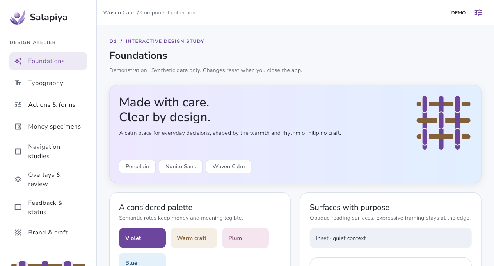
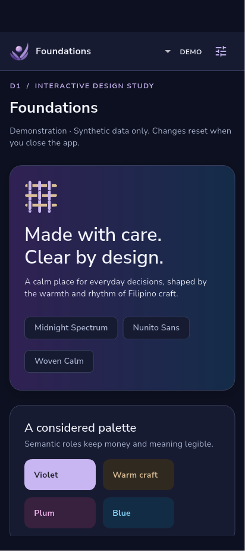

# D1 native visual review

These are actual Flutter raster captures from Windows and the existing Android
emulator, not HTML mockups. The gallery is synthetic and memory-only. Woven Calm
and Nunito Sans are the approved starting direction; the rendered refinements
await owner approval. [Implementation, commands and limitations](../../D1_IMPLEMENTATION.md).

## Start here

| View                          | Windows                                                       | Android                                            |
| ----------------------------- | ------------------------------------------------------------- | -------------------------------------------------- |
| Porcelain and woven framing   | [Light foundations](windows-light-foundations.png)            | [Light foundations](android-light-foundations.png) |
| Midnight Spectrum             | [Dark foundations](windows-dark-foundations.png)              | [Dark foundations](android-dark-foundations.png)   |
| Financial hierarchy           | [Money](windows-light-finance.png)                            | [Money](android-light-finance.png)                 |
| Validation                    | [Invalid amount](windows-validation.png)                      | [Invalid amount](android-validation.png)           |
| Review                        | [Bottom sheet](windows-review-sheet.png)                      | [Bottom sheet](android-review-sheet.png)           |
| Dirty dismissal               | [Keep/discard](windows-dirty-dismiss.png)                     | [Keep/discard](android-dirty-dismiss.png)          |
| Status language               | [Feedback](windows-light-feedback.png)                        | [Feedback](android-light-feedback.png)             |
| Reduced effects and 200% text | [Large text](windows-large-text-reduced.png)                  | [Large text](android-large-text-reduced.png)       |
| Original craft comparison     | [Woven Calm / Luminous Lattice](windows-craft-comparison.png) | [Stacked comparison](android-craft-comparison.png) |

## Android OS interaction capture

[Short native recording](android-native-interaction.mp4) (90 seconds, 540×1212, about 2 MB,
silent) shows preferences/theme changes, gallery navigation, a sheet, invalid
input, keyboard Back dismissal and the keep/discard confirmation. It uses ADB-injected
touch/key events on the existing emulator, not a physical phone. Brief pauses
are retained while the accessibility tree was inspected; its green inspection
outline is an OS tooling overlay, not part of the gallery design. Keep editing
and discard were exercised after the recording reached its time limit.

Full-resolution OS captures: [floating numeric keyboard](android-native-keyboard.png),
[validation](android-native-validation.png), [system Back confirmation](android-native-back.png).
Gboard's floating hardware-keyboard mode can cover the input field without
providing a docked bottom inset; this run does not accept docked-IME avoidance.
The temporary emulator software-keyboard visibility setting was restored.

## Type comparison

The content and tabular-figure request are identical. Default UI stays Nunito
Sans. Compare reading comfort, numbers, minus/decimal distinction, Filipino
expressions and enlarged text in the running app, not just screenshots.

| Family        | Windows                                    | Android                                    |
| ------------- | ------------------------------------------ | ------------------------------------------ |
| Nunito Sans   | [Specimen](windows-light-typography.png)   | [Specimen](android-light-typography.png)   |
| Geist         | [Specimen](windows-type-Geist.png)         | [Specimen](android-type-Geist.png)         |
| Source Sans 3 | [Specimen](windows-type-Source-Sans-3.png) | [Specimen](android-type-Source-Sans-3.png) |

`*-runtime-debug.json` and `*-runtime-profile.json` contain measured digit advances
at 400/600/700. Tabular alignment passes on both native text renderers. Subjective
legibility remains an owner review decision.

## Navigation and constrained layouts

| Evidence                     | Windows                                                   | Android                                                 |
| ---------------------------- | --------------------------------------------------------- | ------------------------------------------------------- |
| Rail/dock study              | [Section](windows-light-navigation.png)                   | [Shared components](android-light-navigation.png)       |
| Android A specimen           | [A](windows-navigation-a.png)                             | [A](android-navigation-a.png)                           |
| Android B specimen           | [B](windows-navigation-b.png)                             | [B](android-navigation-b.png)                           |
| Narrow, 200% text            | [640×480](windows-constrained-640x480-money-200pct.png)   | [320×568](android-constrained-320x568-money-200pct.png) |
| Wide / short landscape, 200% | [1600×900](windows-constrained-1600x900-money-200pct.png) | [800×360](android-constrained-800x360-money-200pct.png) |

All requested widths were tested on their native platform; only representative
captures are retained. `*-runtime-layout.json` records all eight width/scale rows
per platform, each covering both themes and eight gallery sections. These use
Flutter's constrained logical test surface. They are **not** screenshots of an
OS display configured to those dimensions. Short-height content scrolls; labels
and values remain available rather than being removed to fit a capture.

[Actual Windows resize evidence](windows-native-resize.jpg) shows a 643×714
window capture including the title bar, after native window sizing. This input
proof was captured before the final persistent DEMO-label refinement; use the
PNG set for the final appearance. Native Tab/Enter/Escape and UI Automation
labels were inspected separately. Android A/B remain provisional; these are
isolated specimens, not the product route hierarchy.

## Supplied branding fidelity

The six original SVG files are unchanged. Normal use displays faithful transparent
browser exports. The source switch demonstrates `flutter_svg 2.3.0`, which reports
unsupported filter elements. Review edges/highlights as well as composition;
pixel metrics include ordinary antialiasing and are not a visual acceptance score.

| Logo              | Windows export / SVG                                                                              | Android export / SVG                                                                              |
| ----------------- | ------------------------------------------------------------------------------------------------- | ------------------------------------------------------------------------------------------------- |
| Symbol            | [Export](windows-logo-mark-export.png) / [SVG](windows-logo-mark-svg.png)                         | [Export](android-logo-mark-export.png) / [SVG](android-logo-mark-svg.png)                         |
| Horizontal light  | [Export](windows-logo-horizontal-light-export.png) / [SVG](windows-logo-horizontal-light-svg.png) | [Export](android-logo-horizontal-light-export.png) / [SVG](android-logo-horizontal-light-svg.png) |
| Horizontal dark   | [Export](windows-logo-horizontal-dark-export.png) / [SVG](windows-logo-horizontal-dark-svg.png)   | [Export](android-logo-horizontal-dark-export.png) / [SVG](android-logo-horizontal-dark-svg.png)   |
| Vertical light    | [Export](windows-logo-vertical-light-export.png) / [SVG](windows-logo-vertical-light-svg.png)     | [Export](android-logo-vertical-light-export.png) / [SVG](android-logo-vertical-light-svg.png)     |
| Vertical dark     | [Export](windows-logo-vertical-dark-export.png) / [SVG](windows-logo-vertical-dark-svg.png)       | [Export](android-logo-vertical-dark-export.png) / [SVG](android-logo-vertical-dark-svg.png)       |
| Original archival | [Export](windows-logo-original-export.png) / [SVG](windows-logo-original-svg.png)                 | [Export](android-logo-original-export.png) / [SVG](android-logo-original-svg.png)                 |

Each pair uses a 640×320 transparent contain rectangle on its native renderer.
An image viewer may show transparent pixels as black/white; the image alpha is
preserved. Gallery-context comparisons are [Windows export](windows-light-branding.png),
[Windows SVG](windows-brand-svg.png), [Android export](android-light-branding.png)
and [Android SVG](android-brand-svg.png). The source manifest, hashes, browser
dimensions and placement caveats are in the [branding register](../../BRANDING_ASSETS.md).

## What this evidence does and does not establish

Default Windows captures: 1266×683 raster pixels, from a 1582×853 physical native
view at 1.25 DPR. Default Android captures: 412×924 raster pixels, from a
1080×2424 physical view at 2.625 DPR. Captures round logical bounds upward and
retain safe insets. Repaint-boundary screenshots do not include OS title bars,
the Android status/navigation glyphs or the OS keyboard. The native resize JPEG
and `android-native-*` artifacts are OS captures. Exact platform/view/DPR and
frame metrics are in JSON.

Native tests and captures prove rendering and exercised interactions, not owner
visual acceptance, manual Narrator/TalkBack usability, physical-device performance,
production correctness or G0–G4/G6 closure. The profile scenario is deliberately
small and synthetic; measurements are not a general 60fps promise.

To review locally: `flutter run -d windows` / `flutter run -d emulator-5554`,
open preferences, compare light/dark and effects, then visit all eight sections.
In Overlays, change an amount, Review → Edit, press Escape/Back, keep editing,
then inspect unknown outcome and discard. In Money, scroll, expand allocation,
leave and return. Compare Android A/B at normal and enlarged text before making
any D2 selection.
